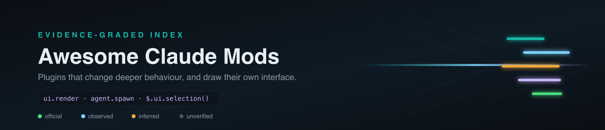

  

<h1 align="center">Круті моди для Claude</h1>

<b>Індекс модів і плагінів для Claude Code, оцінених за доказовістю, а також глибших змін у поведінці, які вони вносять.</b>

  
  
  
  
  
  

<a href="../README.md">English</a> · <a href="README.zh-CN.md">简体中文</a> · <a href="README.zh-TW.md">繁體中文</a> · <a href="README.ja.md">日本語</a> · <a href="README.ko.md">한국어</a> · <a href="README.es.md">Español</a> · <a href="README.fr.md">Français</a> · <a href="README.de.md">Deutsch</a> · <a href="README.pt-BR.md">Português</a> · <a href="README.ru.md">Русский</a> · <a href="README.it.md">Italiano</a> · <a href="README.ar.md">العربية</a> · <a href="README.hi.md">हिन्दी</a> · <a href="README.tr.md">Türkçe</a> · <a href="README.vi.md">Tiếng Việt</a> · <a href="README.th.md">ไทย</a> · <a href="README.id.md">Bahasa Indonesia</a> · <a href="README.pl.md">Polski</a> · <a href="README.nl.md">Nederlands</a> · <b>Українська</b>

> [!NOTE]
> **Актуальний індекс** · Остання синхронізація: `2026-10-13T08:29:52+08:00` (UTC+8)
> · Записи: **583** · Додано під час останнього оновлення: **0** · Мови реалізації: **13**

Кожен наведений нижче запис було автоматично зібрано, відфільтровано та повторно перевірено. Тут немає платних розміщень.

## Актуальна добірка

По одному запису на категорію, упорядкованому за рівнем доказовості та кількістю зірок; рейтинг перераховується під час кожного оновлення. Це рейтинг, а не рекомендація; кожна добірка веде до повної картки нижче. Перевагу надано проєктам, які опублікували знімок екрана або запис, щоб добірка залишалася візуальною.

<table>
<tr>
<td width="50%" valign="top">

<b>🏛️ <a href="https://github.com/anthropics/claude-code-action">anthropics/claude-code-action</a></b>
⭐9488 · TypeScript · ✅ official
</td>
<td width="50%" valign="top">

<b>🧩 <a href="https://github.com/alexgreensh/token-optimizer">alexgreensh/token-optimizer</a></b>
⭐2543 · Python · 👁️ observed
Знайдіть токени-привиди. Виправте їх. Переживіть ущільнення. Уникайте погіршення якості контексту.
</td>
</tr>
<tr>
<td width="50%" valign="top">

<b>🧵 <a href="https://github.com/ruvnet/ruflo">ruvnet/ruflo</a></b>
⭐74447 · TypeScript · 👁️ observed
🌊 Оригінальний агентний рушій. Розгортайте інтелектуальні багатокористувацькі рої, координуйте автономні робочі процеси та створюйте розмовні системи ШІ. Серед…
</td>
<td width="50%" valign="top">
<b>📰 <a href="https://news.ycombinator.com/item?id=49925102">Claude Code Mods</a></b>
⭐6 · 👁️ observed
</td>
</tr>
</table>

## Зміст

- [Що таке мод для Claude Code](#що-таке-мод-для-claude-code)
- [Як оцінюються записи](#як-оцінюються-записи)
- [Офіційні: власні репозиторії та примітки до випусків Anthropic](#офіційні-власні-репозиторії-та-примітки-до-випусків-anthropic) — **16**
- [Моди: створені за допомогою можливості модифікації](#моди-створені-за-допомогою-можливості-модифікації) — **448**
- [Екосистеми плагінів DSH і Cordis](#екосистеми-плагінів-dsh-і-cordis) — **108**
- [Тексти, обговорення та відео](#тексти-обговорення-та-відео) — **11**
- [Проєкти за мовою реалізації](#проєкти-за-мовою-реалізації)

## Що таке мод для Claude Code

Claude Code отримав **моди** у версії 2.1.287: розширення, які можуть змінювати глибші аспекти поведінки, ніж плагіни, і промальовувати власний інтерфейс.

Мод може підключатися до `ui.render`, щоб відображати **рядок, смугу, панель або картку** навколо запиту, читати текст, який ви востаннє вибрали за допомогою `$.ui.selection()`, створювати колег за допомогою `agent.spawn` і володіти областю `Client`. Якщо мод не може відобразити інтерфейс, він виходить з ладу сам — `ui.fault` не дає одному зламаному моду зупинити сесію.

Цей список охоплює моди, поверхню плагінів і хуків, на які вони спираються, а також відповідники для DSH і Cordis. Він навмисно **не** охоплює ширшу екосистему Claude Code: набір запитів — це не мод.

## Як оцінюються записи

Більшість списків у цій сфері просто заявляють про включення. Цей показує, що саме було перевірено, а потім дає змогу відповідно фільтрувати записи. Оцінка описує докази, а не якість проєкту — добре створений мод, про який ще ніхто не написав, усе одно має статус `inferred`.

| Оцінка                                                                          | Що це означає                                                                                                                                                                                                    |
| ------------------------------------------------------------------------------- | ---------------------------------------------------------------------------------------------------------------------------------------------------------------------------------------------------------------- |
| `опубліковано безпосередньо Anthropic`                                          | Опубліковано безпосередньо Anthropic або прочитано безпосередньо в офіційному журналі змін.                                                                                                                      |
| `у власному тексті згадується мод API або заявлено підтримку модифікацій`       | У власному тексті згадується частина поверхні модифікацій — `ui.render`, `ui.fault`, `agent.spawn`, `$.ui.selection()`, панель, смуга або картка, — тож автор описує щось, створене для роботи зі справжнім API. |
| `заявлено мод, плагін або хук, але нічого конкретного про поверхню модифікацій` | Називає себе модом, плагіном або хуком, але в тексті нічого конкретного про поверхню модифікацій не згадується. Справжній, але непідтверджений.                                                                  |
| `збіг лише за термінологією`                                                    | Збіг лише за термінологією. Додано, щоб фільтр можна було перевірити, а не тому, що цьому запису довіряють.                                                                                                      |

## Офіційні: власні репозиторії та примітки до випусків Anthropic

Anthropic's own Claude Code repositories, and the releases that defined the mod surface. Read from the source rather than summarised.

🏛️ <b><a href="https://github.com/anthropics/claude-code">anthropics/claude-code</a></b> · ⭐150436 · TypeScript · ✅ official · 0 天

##### 📝 Опис

Claude Code — це агентний інструмент для програмування, що працює в терміналі, розуміє вашу кодову базу й допомагає програмувати швидше, виконуючи рутинні завдання, пояснюючи складний код і керуючи робочими процесами git — усе за допомогою команд природною мовою.

🔧 Знайдено використання в коді: `feed.xml`, `mods/diff/README.md`

##### 📌 Основні факти

| Поле          | Значення                                                         |
| ------------- | ---------------------------------------------------------------- |
| Категорія     | `Офіційні: власні репозиторії та примітки до випусків Anthropic` |
| Підтвердження | `опубліковано безпосередньо Anthropic`                           |
| Мова          | TypeScript                                                       |

##### 📊 Дані

| Метрика                 | Значення   |
| ----------------------- | ---------- |
| Зірки                   | **150436** |
| Останній push           | 2026-10-13 |
| Вперше додано до списку | 2026-10-04 |

🏛️ <b><a href="https://github.com/anthropics/claude-code-action">anthropics/claude-code-action</a></b> · ⭐9488 · TypeScript · ✅ official · 3 天

##### 📝 Опис

Опис від upstream не було опубліковано.

##### 📌 Основні факти

| Поле          | Значення                                                         |
| ------------- | ---------------------------------------------------------------- |
| Категорія     | `Офіційні: власні репозиторії та примітки до випусків Anthropic` |
| Підтвердження | `опубліковано безпосередньо Anthropic`                           |
| Мова          | TypeScript                                                       |

##### 📊 Дані

| Метрика                 | Значення   |
| ----------------------- | ---------- |
| Зірки                   | **9488**   |
| Останній push           | 2026-10-09 |
| Вперше додано до списку | 2026-10-11 |

---

<table><tr><th align="center" width="50%">🖼 Зображення</th><th align="center" width="50%">🎬 Відео</th></tr><tr>
<td align="center" valign="top"></td>
<td align="center" valign="top">медіа не опубліковано</td>
</tr></table>

🏛️ <b><a href="https://github.com/anthropics/claude-agent-sdk-python">anthropics/claude-agent-sdk-python</a></b> · ⭐8255 · Python · ✅ official · 3 天

##### 📝 Опис

Опис від upstream не було опубліковано.

##### 📌 Основні факти

| Поле          | Значення                                                         |
| ------------- | ---------------------------------------------------------------- |
| Категорія     | `Офіційні: власні репозиторії та примітки до випусків Anthropic` |
| Підтвердження | `опубліковано безпосередньо Anthropic`                           |
| Мова          | Python                                                           |

##### 📊 Дані

| Метрика                 | Значення   |
| ----------------------- | ---------- |
| Зірки                   | **8255**   |
| Останній push           | 2026-10-09 |
| Вперше додано до списку | 2026-10-11 |

🏛️ <b><a href="https://github.com/anthropics/claude-code-security-review">anthropics/claude-code-security-review</a></b> · ⭐6355 · Python · ✅ official · 243 天

##### 📝 Опис

Огляд безпеки на основі ШІ GitHub Action із використанням Claude для аналізу змін у коді на вразливості безпеки.

##### 📌 Основні факти

| Поле          | Значення                                                         |
| ------------- | ---------------------------------------------------------------- |
| Категорія     | `Офіційні: власні репозиторії та примітки до випусків Anthropic` |
| Підтвердження | `опубліковано безпосередньо Anthropic`                           |
| Мова          | Python                                                           |

##### 📊 Дані

| Метрика                 | Значення   |
| ----------------------- | ---------- |
| Зірки                   | **6355**   |
| Останній push           | 2026-02-11 |
| Вперше додано до списку | 2026-10-11 |

🏛️ <b><a href="https://github.com/anthropics/claude-agent-sdk-typescript">anthropics/claude-agent-sdk-typescript</a></b> · ⭐1800 · Shell · ✅ official · 3 天

##### 📝 Опис

Опис від upstream не було опубліковано.

##### 📌 Основні факти

| Поле          | Значення                                                         |
| ------------- | ---------------------------------------------------------------- |
| Категорія     | `Офіційні: власні репозиторії та примітки до випусків Anthropic` |
| Підтвердження | `опубліковано безпосередньо Anthropic`                           |
| Мова          | Shell                                                            |

##### 📊 Дані

| Метрика                 | Значення   |
| ----------------------- | ---------- |
| Зірки                   | **1800**   |
| Останній push           | 2026-10-09 |
| Вперше додано до списку | 2026-10-11 |

🏛️ <b><a href="https://github.com/anthropics/model-cards">anthropics/model-cards</a></b> · ⭐25 · ✅ official · 311 天

##### 📝 Опис

Додаткові матеріали для карток моделей Claude

##### 📌 Основні факти

| Поле          | Значення                                                         |
| ------------- | ---------------------------------------------------------------- |
| Категорія     | `Офіційні: власні репозиторії та примітки до випусків Anthropic` |
| Підтвердження | `опубліковано безпосередньо Anthropic`                           |

##### 📊 Дані

| Метрика                 | Значення   |
| ----------------------- | ---------- |
| Зірки                   | **25**     |
| Останній push           | 2025-12-05 |
| Вперше додано до списку | 2026-10-11 |

🏛️ <b><a href="https://github.com/anthropics/claude-code/blob/main/CHANGELOG.md">Claude Code 2.1.287 — the mod surface</a></b> · ✅ official

##### 📝 Опис

Додано модифікації Claude: плагіни тепер можуть змінювати глибшу поведінку. Додано You should know — вбудовану модифікацію, у якій бічний агент стежить за вами та позначає те, що ви або Claude можете не помітити. Увімкніть її за допомогою `/plugin enable cc-plugin-you-should-know@builtin` (для сеансів першої сторони з увімкненою телеметрією)

##### 📌 Основні факти

| Поле          | Значення                                                         |
| ------------- | ---------------------------------------------------------------- |
| Категорія     | `Офіційні: власні репозиторії та примітки до випусків Anthropic` |
| Підтвердження | `опубліковано безпосередньо Anthropic`                           |

##### 📊 Дані

| Метрика                 | Значення   |
| ----------------------- | ---------- |
| Вперше додано до списку | 2026-10-04 |

🏛️ <b><a href="https://github.com/anthropics/claude-code/blob/main/CHANGELOG.md">Claude Code 2.1.288 — the mod surface</a></b> · ✅ official

##### 📝 Опис

Додано `$.ui.selection()` для модифікацій: повертає текст, який ви востаннє вибрали в повноекранному режимі, а коли вибране міститься в одному рядку транскрипту — цей рядок. Виправлено помилку, через яку кнопка модифікації іноді виконувала дію іншої кнопки під час натискання на поданні, намальованому до перезапуску Claude Code. Виправлено завершення повноекранних сеансів із помилкою «unrecoverable interface error» під час відкриття діалогу фонових завдань, коли плагін або модифікація відображали рядки над запитом. Виправлено помилкове віддалене повідомлення `claude plugin test` про вимкнення модифікацій, коли воно лише прочитало застаріле збережене налаштування

##### 📌 Основні факти

| Поле          | Значення                                                         |
| ------------- | ---------------------------------------------------------------- |
| Категорія     | `Офіційні: власні репозиторії та примітки до випусків Anthropic` |
| Підтвердження | `опубліковано безпосередньо Anthropic`                           |

##### 📊 Дані

| Метрика                 | Значення   |
| ----------------------- | ---------- |
| Вперше додано до списку | 2026-10-04 |

🏛️ <b><a href="https://github.com/anthropics/claude-code/blob/main/CHANGELOG.md">Claude Code 2.1.289 — the mod surface</a></b> · ✅ official

##### 📝 Опис

Виправлено помилку, через яку правило deny або ask для вкладеної частини складної команди оболонки не зберігалося після схвалення модифікації, встановленої користувачем, на керованих машинах. Виправлено незавантаження встановлених модифікацій у першому сеансі після оновлення. Додано `agent.spawn` для команд, один ідентифікатор агента для подій хуків плагінів, а також стани бездіяльності й очікування в `$.agent.list()`. Виправлено завершення сеансів із помилкою «unrecoverable interface error», коли значення, записане хуком `ui.render` модифікації, спричиняло помилку під час відображення рядка; тепер рушій натомість відображає власний рядок. Виправлено відображення вирівняного праворуч вмісту в панелі або смузі модифікації під позначкою закриття або `\[-\]`, wh

##### 📌 Основні факти

| Поле          | Значення                                                         |
| ------------- | ---------------------------------------------------------------- |
| Категорія     | `Офіційні: власні репозиторії та примітки до випусків Anthropic` |
| Підтвердження | `опубліковано безпосередньо Anthropic`                           |

##### 📊 Дані

| Метрика                 | Значення   |
| ----------------------- | ---------- |
| Вперше додано до списку | 2026-10-04 |

🏛️ <b><a href="https://github.com/anthropics/claude-code/blob/main/CHANGELOG.md">Claude Code 2.1.290 — the mod surface</a></b> · ✅ official

##### 📝 Опис

Додано `serverToolUses` до результату хука `turn.step` мода: інструмент викликає API, який сам виконався (радника), для кожного зазначено його ідентифікатор, назву, вхідні дані, початок і завершення. Додано `ceiling` до запитання та вердикту, які читає хук `tool.check` мода, із зазначенням схвалення, якого організація вимагає для інструмента. Додано типи `ThemeKey` і `Color` до типів хуків плагіна, щоб редактор перелічував кольори теми, які може назвати малювання мода. Додано до `claude plugin validate`: кожен хук, зареєстрований модом на сайті контролю доступу, перелічується із зазначенням, чи має він `.catch` (`gatingHooks` у `--json`). Виправлено результат `turn.step` мода

##### 📌 Основні факти

| Поле          | Значення                                                         |
| ------------- | ---------------------------------------------------------------- |
| Категорія     | `Офіційні: власні репозиторії та примітки до випусків Anthropic` |
| Підтвердження | `опубліковано безпосередньо Anthropic`                           |

##### 📊 Дані

| Метрика                 | Значення   |
| ----------------------- | ---------- |
| Вперше додано до списку | 2026-10-06 |

🏛️ <b><a href="https://github.com/anthropics/claude-code/blob/main/CHANGELOG.md">Claude Code 2.1.292 — the mod surface</a></b> · ✅ official

##### 📝 Опис

Додано `prompt.autocomplete`, подію, до якої мод під’єднується, щоб додавати власні рядки до списку автодоповнення поля запиту Додано кешування запитів до `$.model.complete` для модів: `prompt` і `system` приймають блоки тексту, а `cache: true` на блоці кешує запит до нього Додано агентів робочого процесу до хука мода `agent.spawn`, з їхнім запуском та індексом, щоб мод міг відмовити їм Виправлено рядки Write, Edit, NotebookEdit і LSP, а також одиночні рядки Read, Grep і Glob, приховуючи, чому мод відхилив виклик: тепер рядок показує причину Виправлено хук мода `config.set`, `state.set`, `env.set` або `agent.spawn`, який відхиляє піс

##### 📌 Основні факти

| Поле          | Значення                                                         |
| ------------- | ---------------------------------------------------------------- |
| Категорія     | `Офіційні: власні репозиторії та примітки до випусків Anthropic` |
| Підтвердження | `опубліковано безпосередньо Anthropic`                           |

##### 📊 Дані

| Метрика                 | Значення   |
| ----------------------- | ---------- |
| Вперше додано до списку | 2026-10-07 |

🏛️ <b><a href="https://github.com/anthropics/claude-code/blob/main/CHANGELOG.md">Claude Code 2.1.293 — the mod surface</a></b> · ✅ official

##### 📝 Опис

Додано `isDeferred` до `$.tool.register` для модифікацій: `false` від самого початку перелічує схему інструмента в запиті, а не ховає її за пошуком інструментів Виправлено пропуск хуків модифікації на подіях `classic.*`, поки перезапускається робочий процес хуків плагіна, через що хуки налаштувань відповідали без них Виправлено збій `claude plugin test` для модифікацій, які викликають `$.session.append`; тести можуть прочитати додані рядки назад за допомогою нового `mock.session`

##### 📌 Основні факти

| Поле          | Значення                                                         |
| ------------- | ---------------------------------------------------------------- |
| Категорія     | `Офіційні: власні репозиторії та примітки до випусків Anthropic` |
| Підтвердження | `опубліковано безпосередньо Anthropic`                           |

##### 📊 Дані

| Метрика                 | Значення   |
| ----------------------- | ---------- |
| Вперше додано до списку | 2026-10-08 |

🏛️ <b><a href="https://github.com/PerryLink/dsh-mcp-panel">PerryLink/dsh-mcp-panel</a></b> · ⭐74 · TypeScript · 🔎 inferred · 0 天

##### 📝 Опис

Консоль керування MCP для офіційного клієнта DeepSeek Harness MCP: команда /mcp із діагностикою стану та пробними викликами конвеєра, вкладка «Налаштування» MCP з CRUD для серверів (записи після схвалення, автоматичні резервні копії) і консоль пробного запуску інструментів через офіційний конвеєр інструментів (Apache-2.0, dsh-plugin).

##### 📌 Основні факти

| Поле          | Значення                                                                        |
| ------------- | ------------------------------------------------------------------------------- |
| Категорія     | `Офіційні: власні репозиторії та примітки до випусків Anthropic`                |
| Підтвердження | `заявлено мод, плагін або хук, але нічого конкретного про поверхню модифікацій` |
| Мова          | TypeScript                                                                      |

##### 📊 Дані

| Метрика                 | Значення   |
| ----------------------- | ---------- |
| Зірки                   | **74**     |
| Останній push           | 2026-10-12 |
| Вперше додано до списку | 2026-10-13 |

🏷 `ai-agent` · `ai-agents` · `cordis` · `deepseek` · `deepseek-harness` · `developer-tools` · `dsh` · `dsh-plugin`

---

<table><tr><th align="center" width="50%">🖼 Зображення</th><th align="center" width="50%">🎬 Відео</th></tr><tr>
<td align="center" valign="top"></td>
<td align="center" valign="top"> анімований запис</td>
</tr></table>

🏛️ <b><a href="https://github.com/PerryLink/dsh-ticktick">PerryLink/dsh-ticktick</a></b> · ⭐4 · TypeScript · 🔎 inferred · 0 天

##### 📝 Опис

Міст задач TickTick (Dida365) для DeepSeek Harness: панель задач у заголовку сесії (фільтр списку, подання невиконаних/виконаних, пошук, перетягування для зміни порядку), 11 відібраних інструментів агента, картка налаштувань, через офіційну кінцеву точку TickTick MCP.

##### 📌 Основні факти

| Поле          | Значення                                                                        |
| ------------- | ------------------------------------------------------------------------------- |
| Категорія     | `Офіційні: власні репозиторії та примітки до випусків Anthropic`                |
| Підтвердження | `заявлено мод, плагін або хук, але нічого конкретного про поверхню модифікацій` |
| Мова          | TypeScript                                                                      |

##### 📊 Дані

| Метрика                 | Значення   |
| ----------------------- | ---------- |
| Зірки                   | **4**      |
| Останній push           | 2026-10-12 |
| Вперше додано до списку | 2026-10-13 |

🏷 `ai-agent` · `ai-agents` · `cordis` · `deepseek` · `deepseek-harness` · `developer-tools` · `dida365` · `dsh`

---

<table><tr><th align="center" width="50%">🖼 Зображення</th><th align="center" width="50%">🎬 Відео</th></tr><tr>
<td align="center" valign="top"></td>
<td align="center" valign="top"> анімований запис</td>
</tr></table>

<b>Більше в цій категорії</b> · 2

- [Claude Code 2.1.295 — the mod surface](https://github.com/anthropics/claude-code/blob/main/CHANGELOG.md) - Додано `$.ui.notify` для модифікацій: створює нативне сповіщення через власне…
- [Claude Code 2.1.296 — the mod surface](https://github.com/anthropics/claude-code/blob/main/CHANGELOG.md) - Виправлено завершення безголових сеансів, очищення введеного промпту або…

## Моди: створені за допомогою можливості модифікації

Кожен запис тут містить докази використання можливості, яку Claude Code отримав у версії 2.1.287: він виводить дані через `ui.render`, має власну панель, смугу або картку, читає `$.ui.selection()`, запускає колег за допомогою `agent.spawn` або прямо називає себе модом.

🧩 <b><a href="https://github.com/alexgreensh/token-optimizer">alexgreensh/token-optimizer</a></b> · ⭐2543 · Python · 👁️ observed · 0 天

##### 📝 Опис

Знайдіть токени-привиди. Виправте їх. Переживіть ущільнення. Уникайте погіршення якості контексту.

##### 📌 Основні факти

| Поле          | Значення                                                                  |
| ------------- | ------------------------------------------------------------------------- |
| Категорія     | `Моди: створені за допомогою можливості модифікації`                      |
| Підтвердження | `у власному тексті згадується мод API або заявлено підтримку модифікацій` |
| Мова          | Python                                                                    |

##### 📊 Дані

| Метрика                 | Значення   |
| ----------------------- | ---------- |
| Зірки                   | **2543**   |
| Останній push           | 2026-10-12 |
| Вперше додано до списку | 2026-10-13 |

🏷 `agentskills` · `claude-code` · `claude-code-mod` · `claude-code-skill` · `claude-plugin` · `codex` · `context-engineering` · `context-window`

---

<table><tr><th align="center" width="50%">🖼 Зображення</th><th align="center" width="50%">🎬 Відео</th></tr><tr>
<td align="center" valign="top"></td>
<td align="center" valign="top"> анімований запис</td>
</tr></table>

Ресурс підключено безпосередньо з репозиторію-джерела, оскільки ліцензію, придатну для повторного розповсюдження, не зазначено.

🧩 <b><a href="https://github.com/karanb192/awesome-claude-code-mods">karanb192/awesome-claude-code-mods</a></b> · ⭐535 · JavaScript · 👁️ observed · 0 天

##### 📝 Опис

Спільнотний каталог загальнодоступних модифікацій Claude Code (функціональних hooks), просканованих із GitHub, із зазначенням того, що кожна модифікація може читати, записувати, запускати або надсилати мережею. Переглянути https://mods.aidojo.si/

🔧 Знайдено використання в коді: `data/seeds.txt`, `data/duplicates.txt`, `tools/kind.mjs`, `README.md`

##### 📌 Основні факти

| Поле          | Значення                                                                  |
| ------------- | ------------------------------------------------------------------------- |
| Категорія     | `Моди: створені за допомогою можливості модифікації`                      |
| Підтвердження | `у власному тексті згадується мод API або заявлено підтримку модифікацій` |
| Мова          | JavaScript                                                                |

##### 📊 Дані

| Метрика                 | Значення   |
| ----------------------- | ---------- |
| Зірки                   | **535**    |
| Останній push           | 2026-10-12 |
| Вперше додано до списку | 2026-10-04 |

🏷 `anthropic` · `awesome` · `awesome-list` · `claude` · `claude-code` · `claude-code-hooks` · `claude-code-mods` · `claude-code-plugin`

🧩 <b><a href="https://github.com/hamzafer/claude-code-mods">hamzafer/claude-code-mods</a></b> · ⭐211 · TypeScript · 👁️ observed · 0 天

##### 📝 Опис

Модифікації Claude Code: плагіни на основі хуків, які додають динамічні рядки над запитом, захисти, панелі та ігри. Панель контексту, вимірювач використання, відстеження перевірок Codex, попередній перегляд Markdown, поточне відтворення Spotify та багато іншого.

🔧 Знайдено використання в коді: `mods/next-steps/hooks/register.tsx`, `mods/agent-radar/hooks/register.tsx`, `mods/review-watch/hooks/register.tsx`

##### 📌 Основні факти

| Поле          | Значення                                                                  |
| ------------- | ------------------------------------------------------------------------- |
| Категорія     | `Моди: створені за допомогою можливості модифікації`                      |
| Підтвердження | `у власному тексті згадується мод API або заявлено підтримку модифікацій` |
| Мова          | TypeScript                                                                |

##### 📊 Дані

| Метрика                 | Значення   |
| ----------------------- | ---------- |
| Зірки                   | **211**    |
| Останній push           | 2026-10-12 |
| Вперше додано до списку | 2026-10-11 |

🏷 `ai-agents` · `anthropic` · `claude` · `claude-code` · `claude-code-mod` · `claude-code-mods` · `claude-code-plugins` · `developer-tools`

---

<table><tr><th align="center" width="50%">🖼 Зображення</th><th align="center" width="50%">🎬 Відео</th></tr><tr>
<td align="center" valign="top"></td>
<td align="center" valign="top"> анімований запис</td>
</tr></table>

🧩 <b><a href="https://github.com/karanb192/cache-tax">karanb192/cache-tax</a></b> · ⭐163 · TypeScript · 👁️ observed · 8 天

##### 📝 Опис

Підтримуйте кеш промпту Claude Code теплим під час перерв і показуйте орієнтовну вартість перед холодним надсиланням.

##### 📌 Основні факти

| Поле          | Значення                                                                  |
| ------------- | ------------------------------------------------------------------------- |
| Категорія     | `Моди: створені за допомогою можливості модифікації`                      |
| Підтвердження | `у власному тексті згадується мод API або заявлено підтримку модифікацій` |
| Мова          | TypeScript                                                                |

##### 📊 Дані

| Метрика                 | Значення   |
| ----------------------- | ---------- |
| Зірки                   | **163**    |
| Останній push           | 2026-10-04 |
| Вперше додано до списку | 2026-10-10 |

🏷 `claude-code` · `claude-code-plugin` · `claude-mods` · `function-hooks` · `prompt-caching`

---

<table><tr><th align="center" width="50%">🖼 Зображення</th><th align="center" width="50%">🎬 Відео</th></tr><tr>
<td align="center" valign="top"></td>
<td align="center" valign="top"> анімований запис · <a href="https://raw.githubusercontent.com/karanb192/cache-tax/main/docs/assets/cache-cost-explainer.mp4">Відкрити відео</a></td>
</tr></table>

🧩 <b><a href="https://github.com/hellosverre/claude-skins">hellosverre/claude-skins</a></b> · ⭐119 · TypeScript · 👁️ observed · 0 天

##### 📝 Опис

Скіни для Claude Code: рядки інструментів з піктограмами, картки diff, таблиць і діаграм Mermaid, панель використання та п’ятнадцять тем. /skin змінює їх у реальному часі.

##### 📌 Основні факти

| Поле          | Значення                                                                  |
| ------------- | ------------------------------------------------------------------------- |
| Категорія     | `Моди: створені за допомогою можливості модифікації`                      |
| Підтвердження | `у власному тексті згадується мод API або заявлено підтримку модифікацій` |
| Мова          | TypeScript                                                                |

##### 📊 Дані

| Метрика                 | Значення   |
| ----------------------- | ---------- |
| Зірки                   | **119**    |
| Останній push           | 2026-10-12 |
| Вперше додано до списку | 2026-10-13 |

🏷 `claude-code` · `claude-code-mod` · `claude-code-mods` · `claude-code-plugin` · `terminal` · `theme`

---

<table><tr><th align="center" width="50%">🖼 Зображення</th><th align="center" width="50%">🎬 Відео</th></tr><tr>
<td align="center" valign="top">медіа не опубліковано</td>
<td align="center" valign="top"> анімований запис</td>
</tr></table>

🧩 <b><a href="https://github.com/NahumLitvin/prismantis">NahumLitvin/prismantis</a></b> · ⭐89 · TypeScript · 👁️ observed · 0 天

##### 📝 Опис

Барвисті відповіді Claude Code із підтримкою тем: таблиці, код, діаграми, графіки та рядки інструментів у 15 темах із кнопками копіювання. Мод Claude Code.

##### 📌 Основні факти

| Поле          | Значення                                                                  |
| ------------- | ------------------------------------------------------------------------- |
| Категорія     | `Моди: створені за допомогою можливості модифікації`                      |
| Підтвердження | `у власному тексті згадується мод API або заявлено підтримку модифікацій` |
| Мова          | TypeScript                                                                |

##### 📊 Дані

| Метрика                 | Значення   |
| ----------------------- | ---------- |
| Зірки                   | **89**     |
| Останній push           | 2026-10-12 |
| Вперше додано до списку | 2026-10-11 |

🏷 `claude-code` · `claude-code-mod` · `claude-code-plugin` · `markdown` · `mermaid` · `terminal` · `theme`

---

<table><tr><th align="center" width="50%">🖼 Зображення</th><th align="center" width="50%">🎬 Відео</th></tr><tr>
<td align="center" valign="top"></td>
<td align="center" valign="top"> анімований запис</td>
</tr></table>

🧩 <b><a href="https://github.com/Tickloop/claude-mods">Tickloop/claude-mods</a></b> · ⭐79 · TypeScript · 👁️ observed · 4 天

##### 📝 Опис

Колекція модифікацій claude code

##### 📌 Основні факти

| Поле          | Значення                                                                  |
| ------------- | ------------------------------------------------------------------------- |
| Категорія     | `Моди: створені за допомогою можливості модифікації`                      |
| Підтвердження | `у власному тексті згадується мод API або заявлено підтримку модифікацій` |
| Мова          | TypeScript                                                                |

##### 📊 Дані

| Метрика                 | Значення   |
| ----------------------- | ---------- |
| Зірки                   | **79**     |
| Останній push           | 2026-10-08 |
| Вперше додано до списку | 2026-10-11 |

🧩 <b><a href="https://github.com/scasella/claude-flightdeck">scasella/claude-flightdeck</a></b> · ⭐75 · TypeScript · 👁️ observed · 0 天

##### 📝 Опис

Мод Claude Code, який додає до термінала живу панель агента: контекст і вартість, часову шкалу радника, кожну перевірку дозволів, картки субагентів і swimlane.

##### 📌 Основні факти

| Поле          | Значення                                                                  |
| ------------- | ------------------------------------------------------------------------- |
| Категорія     | `Моди: створені за допомогою можливості модифікації`                      |
| Підтвердження | `у власному тексті згадується мод API або заявлено підтримку модифікацій` |
| Мова          | TypeScript                                                                |

##### 📊 Дані

| Метрика                 | Значення   |
| ----------------------- | ---------- |
| Зірки                   | **75**     |
| Останній push           | 2026-10-12 |
| Вперше додано до списку | 2026-10-10 |

🏷 `agent-observability` · `agent-visualization` · `anthropic` · `claude` · `claude-code` · `claude-code-mod` · `claude-code-mods` · `claude-code-plugin`

---

<table><tr><th align="center" width="50%">🖼 Зображення</th><th align="center" width="50%">🎬 Відео</th></tr><tr>
<td align="center" valign="top"></td>
<td align="center" valign="top"> анімований запис</td>
</tr></table>

🧩 <b><a href="https://github.com/darrell-tw/darrelltw-mods">darrell-tw/darrelltw-mods</a></b> · ⭐65 · HTML · 👁️ observed · 7 天

##### 📝 Опис

Модифікації Claude Code від Darrell Wang — смуги над запитом, нуль токенів моделі. Панель тайванських／американських акцій + інші функції в майбутньому.

##### 📌 Основні факти

| Поле          | Значення                                                                  |
| ------------- | ------------------------------------------------------------------------- |
| Категорія     | `Моди: створені за допомогою можливості модифікації`                      |
| Підтвердження | `у власному тексті згадується мод API або заявлено підтримку модифікацій` |
| Мова          | HTML                                                                      |

##### 📊 Дані

| Метрика                 | Значення   |
| ----------------------- | ---------- |
| Зірки                   | **65**     |
| Останній push           | 2026-10-05 |
| Вперше додано до списку | 2026-10-11 |

🧩 <b><a href="https://github.com/0xDarkMatter/claude-mods">0xDarkMatter/claude-mods</a></b> · ⭐62 · Shell · 👁️ observed · 5 天

##### 📝 Опис

Експертні Skills, агенти, команди, правила, хуки та стилі виведення для Claude Code — безперервність сеансів + сучасні інструменти CLI для реальних робочих процесів розробки

🔧 Знайдено використання в коді: `justfile`, `skills/auto-skill/SKILL.md`, `skills/task-runner/SKILL.md`

##### 📌 Основні факти

| Поле          | Значення                                                                  |
| ------------- | ------------------------------------------------------------------------- |
| Категорія     | `Моди: створені за допомогою можливості модифікації`                      |
| Підтвердження | `у власному тексті згадується мод API або заявлено підтримку модифікацій` |
| Мова          | Shell                                                                     |

##### 📊 Дані

| Метрика                 | Значення   |
| ----------------------- | ---------- |
| Зірки                   | **62**     |
| Останній push           | 2026-10-07 |
| Вперше додано до списку | 2026-10-11 |

🏷 `agent-skills` · `ai-agents` · `ai-tools` · `anthropic` · `claude` · `claude-code` · `claude-skills` · `developer-tools`

🧩 <b><a href="https://github.com/whyashthakker/awesome-claude-code-mods">whyashthakker/awesome-claude-code-mods</a></b> · ⭐55 · TypeScript · 👁️ observed · 9 天

##### 📝 Опис

Колекція з понад 100 модифікацій, які можна використовувати з Claude Code.

🔧 Знайдено використання в коді: `README.md`, `docs/COMMUNITY_MODS.md`, `mods/agent-board/hooks/register.js`, `mods/desktop-agent-desk/hooks/register.js`

##### 📌 Основні факти

| Поле          | Значення                                                                  |
| ------------- | ------------------------------------------------------------------------- |
| Категорія     | `Моди: створені за допомогою можливості модифікації`                      |
| Підтвердження | `у власному тексті згадується мод API або заявлено підтримку модифікацій` |
| Мова          | TypeScript                                                                |

##### 📊 Дані

| Метрика                 | Значення   |
| ----------------------- | ---------- |
| Зірки                   | **55**     |
| Останній push           | 2026-10-03 |
| Вперше додано до списку | 2026-10-11 |

🏷 `claude` · `claude-code` · `claude-code-mod` · `claude-code-mods` · `claude-code-plugin`

🧩 <b><a href="https://github.com/zycck/claude-mods">zycck/claude-mods</a></b> · ⭐47 · TypeScript · 👁️ observed · 4 天

##### 📝 Опис

Модифікації Claude Code: динамічні індикатори прогресу плану над запитом

##### 📌 Основні факти

| Поле          | Значення                                                                  |
| ------------- | ------------------------------------------------------------------------- |
| Категорія     | `Моди: створені за допомогою можливості модифікації`                      |
| Підтвердження | `у власному тексті згадується мод API або заявлено підтримку модифікацій` |
| Мова          | TypeScript                                                                |

##### 📊 Дані

| Метрика                 | Значення   |
| ----------------------- | ---------- |
| Зірки                   | **47**     |
| Останній push           | 2026-10-08 |
| Вперше додано до списку | 2026-10-11 |

---

<table><tr><th align="center" width="50%">🖼 Зображення</th><th align="center" width="50%">🎬 Відео</th></tr><tr>
<td align="center" valign="top"></td>
<td align="center" valign="top"> анімований запис · <a href="https://raw.githubusercontent.com/zycck/claude-mods/main/media/plan-progress.mp4">Відкрити відео</a></td>
</tr></table>

🧩 <b><a href="https://github.com/henrik-thevibe/Claude-Fables">henrik-thevibe/Claude-Fables</a></b> · ⭐32 · TypeScript · 👁️ observed · 10 天

##### 📝 Опис

Спостерігайте, як Claude Code створює маленький мультфільм під час вашої роботи.

##### 📌 Основні факти

| Поле          | Значення                                                                  |
| ------------- | ------------------------------------------------------------------------- |
| Категорія     | `Моди: створені за допомогою можливості модифікації`                      |
| Підтвердження | `у власному тексті згадується мод API або заявлено підтримку модифікацій` |
| Мова          | TypeScript                                                                |

##### 📊 Дані

| Метрика                 | Значення   |
| ----------------------- | ---------- |
| Зірки                   | **32**     |
| Останній push           | 2026-10-02 |
| Вперше додано до списку | 2026-10-10 |

🏷 `ai-narration` · `claude` · `claude-code` · `claude-code-plugin` · `claude-mod` · `claude-mods` · `developer-tools` · `fun`

---

<table><tr><th align="center" width="50%">🖼 Зображення</th><th align="center" width="50%">🎬 Відео</th></tr><tr>
<td align="center" valign="top"></td>
<td align="center" valign="top"> анімований запис</td>
</tr></table>

🧩 <b><a href="https://github.com/oikon48/prompt-rail">oikon48/prompt-rail</a></b> · ⭐28 · TypeScript · 👁️ observed · 9 天

##### 📝 Опис

Стрічка підказок вашої сесії Claude Code: наведіть курсор, щоб прочитати, клацніть, щоб перейти (функціональні хуки / Mods)

##### 📌 Основні факти

| Поле          | Значення                                                                  |
| ------------- | ------------------------------------------------------------------------- |
| Категорія     | `Моди: створені за допомогою можливості модифікації`                      |
| Підтвердження | `у власному тексті згадується мод API або заявлено підтримку модифікацій` |
| Мова          | TypeScript                                                                |

##### 📊 Дані

| Метрика                 | Значення   |
| ----------------------- | ---------- |
| Зірки                   | **28**     |
| Останній push           | 2026-10-03 |
| Вперше додано до списку | 2026-10-04 |

🏷 `claude-code` · `claude-code-plugin` · `claude-mods` · `function-hooks`

---

<table><tr><th align="center" width="50%">🖼 Зображення</th><th align="center" width="50%">🎬 Відео</th></tr><tr>
<td align="center" valign="top"></td>
<td align="center" valign="top"> анімований запис</td>
</tr></table>

🧩 <b><a href="https://github.com/NovusEdge/glowup">NovusEdge/glowup</a></b> · ⭐26 · TypeScript · 👁️ observed · 0 天

##### 📝 Опис

Оновлений вигляд Claude Code: панель керування в реальному часі, теми, якими можна ділитися, і піксельний улюбленець, який показує, що робить Claude

##### 📌 Основні факти

| Поле          | Значення                                                                  |
| ------------- | ------------------------------------------------------------------------- |
| Категорія     | `Моди: створені за допомогою можливості модифікації`                      |
| Підтвердження | `у власному тексті згадується мод API або заявлено підтримку модифікацій` |
| Мова          | TypeScript                                                                |

##### 📊 Дані

| Метрика                 | Значення   |
| ----------------------- | ---------- |
| Зірки                   | **26**     |
| Останній push           | 2026-10-13 |
| Вперше додано до списку | 2026-10-11 |

🏷 `ai-coding` · `anthropic` · `claude` · `claude-code` · `claude-code-mod` · `developer-tools` · `eye-candy` · `terminal`

---

<table><tr><th align="center" width="50%">🖼 Зображення</th><th align="center" width="50%">🎬 Відео</th></tr><tr>
<td align="center" valign="top"></td>
<td align="center" valign="top"> анімований запис</td>
</tr></table>

🧩 <b><a href="https://github.com/dgokcin/claude-pokemon-mod">dgokcin/claude-pokemon-mod</a></b> · ⭐25 · JavaScript · 👁️ observed · 0 天

##### 📝 Опис

Піксельний Pokémon, який живе над запитом у Claude Code

##### 📌 Основні факти

| Поле          | Значення                                                                  |
| ------------- | ------------------------------------------------------------------------- |
| Категорія     | `Моди: створені за допомогою можливості модифікації`                      |
| Підтвердження | `у власному тексті згадується мод API або заявлено підтримку модифікацій` |
| Мова          | JavaScript                                                                |

##### 📊 Дані

| Метрика                 | Значення   |
| ----------------------- | ---------- |
| Зірки                   | **25**     |
| Останній push           | 2026-10-12 |
| Вперше додано до списку | 2026-10-11 |

🏷 `claude-code-mod` · `claude-code-mods`

---

<table><tr><th align="center" width="50%">🖼 Зображення</th><th align="center" width="50%">🎬 Відео</th></tr><tr>
<td align="center" valign="top"></td>
<td align="center" valign="top"> анімований запис</td>
</tr></table>

Ресурс підключено безпосередньо з репозиторію-джерела, оскільки ліцензію, придатну для повторного розповсюдження, не зазначено.

🧩 <b><a href="https://github.com/artemnovichkov/xcode-mods">artemnovichkov/xcode-mods</a></b> · ⭐20 · TypeScript · 👁️ observed · 10 天

##### 📝 Опис

Збирання, тести, консоль і попередній перегляд SwiftUI з Xcode усередині Claude Code

##### 📌 Основні факти

| Поле          | Значення                                                                  |
| ------------- | ------------------------------------------------------------------------- |
| Категорія     | `Моди: створені за допомогою можливості модифікації`                      |
| Підтвердження | `у власному тексті згадується мод API або заявлено підтримку модифікацій` |
| Мова          | TypeScript                                                                |

##### 📊 Дані

| Метрика                 | Значення   |
| ----------------------- | ---------- |
| Зірки                   | **20**     |
| Останній push           | 2026-10-02 |
| Вперше додано до списку | 2026-10-11 |

🏷 `claude-code` · `claude-code-mods` · `claude-code-plugin` · `ghostty` · `ios` · `mcp` · `swift` · `swiftui`

---

<table><tr><th align="center" width="50%">🖼 Зображення</th><th align="center" width="50%">🎬 Відео</th></tr><tr>
<td align="center" valign="top"></td>
<td align="center" valign="top">медіа не опубліковано</td>
</tr></table>

🧩 <b><a href="https://github.com/lemomo-ai/lemo-mod">lemomo-ai/lemo-mod</a></b> · ⭐20 · TypeScript · 👁️ observed · 8 天

##### 📝 Опис

Модифікації Claude Code: 21 стиль і повний набір функцій, які можна вмикати за потреби, для термінала й настільного застосунку. · Одним натисканням додайте Claude новий стиль і отримайте повний набір функцій, які можна вмикати за потреби.

##### 📌 Основні факти

| Поле          | Значення                                                                  |
| ------------- | ------------------------------------------------------------------------- |
| Категорія     | `Моди: створені за допомогою можливості модифікації`                      |
| Підтвердження | `у власному тексті згадується мод API або заявлено підтримку модифікацій` |
| Мова          | TypeScript                                                                |

##### 📊 Дані

| Метрика                 | Значення   |
| ----------------------- | ---------- |
| Зірки                   | **20**     |
| Останній push           | 2026-10-04 |
| Вперше додано до списку | 2026-10-11 |

🏷 `claude` · `claude-code` · `claude-code-mods` · `claude-code-plugins` · `developer-tools` · `mods` · `pixel-art` · `terminal`

---

<table><tr><th align="center" width="50%">🖼 Зображення</th><th align="center" width="50%">🎬 Відео</th></tr><tr>
<td align="center" valign="top"></td>
<td align="center" valign="top">медіа не опубліковано</td>
</tr></table>

🧩 <b><a href="https://github.com/promptadvisers/claude-mods-starter-kit">promptadvisers/claude-mods-starter-kit</a></b> · ⭐20 · JavaScript · 👁️ observed · 10 天

##### 📝 Опис

Десять модифікацій Claude Code, посібники для початківців, підказки для створення, безпечні демонстрації та шаблон для власної збірки.

##### 📌 Основні факти

| Поле          | Значення                                                                  |
| ------------- | ------------------------------------------------------------------------- |
| Категорія     | `Моди: створені за допомогою можливості модифікації`                      |
| Підтвердження | `у власному тексті згадується мод API або заявлено підтримку модифікацій` |
| Мова          | JavaScript                                                                |

##### 📊 Дані

| Метрика                 | Значення   |
| ----------------------- | ---------- |
| Зірки                   | **20**     |
| Останній push           | 2026-10-02 |
| Вперше додано до списку | 2026-10-11 |

---

<table><tr><th align="center" width="50%">🖼 Зображення</th><th align="center" width="50%">🎬 Відео</th></tr><tr>
<td align="center" valign="top"></td>
<td align="center" valign="top">медіа не опубліковано</td>
</tr></table>

Ресурс підключено безпосередньо з репозиторію-джерела, оскільки ліцензію, придатну для повторного розповсюдження, не зазначено.

🧩 <b><a href="https://github.com/Amorfx/claude-paste-view">Amorfx/claude-paste-view</a></b> · ⭐19 · TypeScript · 👁️ observed · 0 天

##### 📝 Опис

Модифікація Claude Code: попередній перегляд вставлених зображень і довгого вставленого тексту над полем запиту

##### 📌 Основні факти

| Поле          | Значення                                                                  |
| ------------- | ------------------------------------------------------------------------- |
| Категорія     | `Моди: створені за допомогою можливості модифікації`                      |
| Підтвердження | `у власному тексті згадується мод API або заявлено підтримку модифікацій` |
| Мова          | TypeScript                                                                |

##### 📊 Дані

| Метрика                 | Значення   |
| ----------------------- | ---------- |
| Зірки                   | **19**     |
| Останній push           | 2026-10-12 |
| Вперше додано до списку | 2026-10-12 |

🏷 `claude-code` · `claude-code-mod` · `claude-code-plugin` · `clipboard` · `ghostty` · `image-preview` · `kitty` · `paste`

---

<table><tr><th align="center" width="50%">🖼 Зображення</th><th align="center" width="50%">🎬 Відео</th></tr><tr>
<td align="center" valign="top"></td>
<td align="center" valign="top">медіа не опубліковано</td>
</tr></table>

🧩 <b><a href="https://github.com/BrianHuang813/clawd-actor">BrianHuang813/clawd-actor</a></b> · ⭐17 · TypeScript · 👁️ observed · 0 天

##### 📝 Опис

Claude Code mod: Clawd розігрує те, що робить Claude, над prompt

##### 📌 Основні факти

| Поле          | Значення                                                                  |
| ------------- | ------------------------------------------------------------------------- |
| Категорія     | `Моди: створені за допомогою можливості модифікації`                      |
| Підтвердження | `у власному тексті згадується мод API або заявлено підтримку модифікацій` |
| Мова          | TypeScript                                                                |

##### 📊 Дані

| Метрика                 | Значення   |
| ----------------------- | ---------- |
| Зірки                   | **17**     |
| Останній push           | 2026-10-12 |
| Вперше додано до списку | 2026-10-12 |

🏷 `animation` · `claude` · `claude-code` · `claude-code-mod` · `claude-code-plugin` · `clawd` · `hooks` · `spinner`

---

<table><tr><th align="center" width="50%">🖼 Зображення</th><th align="center" width="50%">🎬 Відео</th></tr><tr>
<td align="center" valign="top"></td>
<td align="center" valign="top"> анімований запис</td>
</tr></table>

🧩 <b><a href="https://github.com/promptadvisers/claude-mods-computer-use-threads">promptadvisers/claude-mods-computer-use-threads</a></b> · ⭐16 · JavaScript · 👁️ observed · 7 天

##### 📝 Опис

Дві модифікації Claude Code: міст Codex computer-use і скоординовані сеанси Claude. Вихідний код, підказки для збірки, налаштування й тести.

##### 📌 Основні факти

| Поле          | Значення                                                                  |
| ------------- | ------------------------------------------------------------------------- |
| Категорія     | `Моди: створені за допомогою можливості модифікації`                      |
| Підтвердження | `у власному тексті згадується мод API або заявлено підтримку модифікацій` |
| Мова          | JavaScript                                                                |

##### 📊 Дані

| Метрика                 | Значення   |
| ----------------------- | ---------- |
| Зірки                   | **16**     |
| Останній push           | 2026-10-05 |
| Вперше додано до списку | 2026-10-11 |

---

<table><tr><th align="center" width="50%">🖼 Зображення</th><th align="center" width="50%">🎬 Відео</th></tr><tr>
<td align="center" valign="top"></td>
<td align="center" valign="top">медіа не опубліковано</td>
</tr></table>

🧩 <b><a href="https://github.com/JetsonChan/CC-Usage-Band">JetsonChan/CC-Usage-Band</a></b> · ⭐13 · TypeScript · 👁️ observed · 9 天

##### 📝 Опис

Модифікації Claude Code: usage-band показує ваші обмеження 5h/7d, контекстне вікно та коефіцієнт влучань у кеш над запитом

##### 📌 Основні факти

| Поле          | Значення                                                                  |
| ------------- | ------------------------------------------------------------------------- |
| Категорія     | `Моди: створені за допомогою можливості модифікації`                      |
| Підтвердження | `у власному тексті згадується мод API або заявлено підтримку модифікацій` |
| Мова          | TypeScript                                                                |

##### 📊 Дані

| Метрика                 | Значення   |
| ----------------------- | ---------- |
| Зірки                   | **13**     |
| Останній push           | 2026-10-03 |
| Вперше додано до списку | 2026-10-11 |

---

<table><tr><th align="center" width="50%">🖼 Зображення</th><th align="center" width="50%">🎬 Відео</th></tr><tr>
<td align="center" valign="top"></td>
<td align="center" valign="top">медіа не опубліковано</td>
</tr></table>

🧩 <b><a href="https://github.com/OneWave-AI/claude-code-mods">OneWave-AI/claude-code-mods</a></b> · ⭐13 · TypeScript · 👁️ observed · 9 天

##### 📝 Опис

Десять модифікацій з відкритим кодом для Claude Code: динамічні панелі, смуги, statusline та захисти викликів інструментів. Burn meter, launch codes, session wrapped, boss fight, code pet та багато іншого.

##### 📌 Основні факти

| Поле          | Значення                                                                  |
| ------------- | ------------------------------------------------------------------------- |
| Категорія     | `Моди: створені за допомогою можливості модифікації`                      |
| Підтвердження | `у власному тексті згадується мод API або заявлено підтримку модифікацій` |
| Мова          | TypeScript                                                                |

##### 📊 Дані

| Метрика                 | Значення   |
| ----------------------- | ---------- |
| Зірки                   | **13**     |
| Останній push           | 2026-10-03 |
| Вперше додано до списку | 2026-10-11 |

🏷 `anthropic` · `claude` · `claude-code` · `claude-code-mods` · `claude-code-plugins`

---

<table><tr><th align="center" width="50%">🖼 Зображення</th><th align="center" width="50%">🎬 Відео</th></tr><tr>
<td align="center" valign="top"></td>
<td align="center" valign="top">медіа не опубліковано</td>
</tr></table>

🧩 <b><a href="https://github.com/aieo-product/claude_qamods">aieo-product/claude_qamods</a></b> · ⭐12 · TypeScript · 👁️ observed · 5 天

##### 📝 Опис

Модифікації Claude Code, які роблять запитання Claude легшими для читання й відповідей (qa-guide).

##### 📌 Основні факти

| Поле          | Значення                                                                  |
| ------------- | ------------------------------------------------------------------------- |
| Категорія     | `Моди: створені за допомогою можливості модифікації`                      |
| Підтвердження | `у власному тексті згадується мод API або заявлено підтримку модифікацій` |
| Мова          | TypeScript                                                                |

##### 📊 Дані

| Метрика                 | Значення   |
| ----------------------- | ---------- |
| Зірки                   | **12**     |
| Останній push           | 2026-10-07 |
| Вперше додано до списку | 2026-10-11 |

🏷 `askuserquestion` · `claude-code` · `claude-code-plugin` · `mod`

---

<table><tr><th align="center" width="50%">🖼 Зображення</th><th align="center" width="50%">🎬 Відео</th></tr><tr>
<td align="center" valign="top"></td>
<td align="center" valign="top"> анімований запис · <a href="https://raw.githubusercontent.com/aieo-product/claude_qamods/main/docs/media/qa-guide-pv-16x9.mp4">Відкрити відео</a></td>
</tr></table>

🧩 <b><a href="https://github.com/augiefra/claude-mods">augiefra/claude-mods</a></b> · ⭐12 · JavaScript · 👁️ observed · 1 天

##### 📝 Опис

Мод для Claude Code: контекст у токенах, 5-годинні та тижневі ліміти порівняно з годинником, зворотний відлік кешу промпту, вартість сесії та активні агенти — все в одній смузі над промптом.

##### 📌 Основні факти

| Поле          | Значення                                                                  |
| ------------- | ------------------------------------------------------------------------- |
| Категорія     | `Моди: створені за допомогою можливості модифікації`                      |
| Підтвердження | `у власному тексті згадується мод API або заявлено підтримку модифікацій` |
| Мова          | JavaScript                                                                |

##### 📊 Дані

| Метрика                 | Значення   |
| ----------------------- | ---------- |
| Зірки                   | **12**     |
| Останній push           | 2026-10-11 |
| Вперше додано до списку | 2026-10-04 |

🏷 `anthropic` · `claude` · `claude-code` · `claude-code-mod` · `claude-code-mods` · `claude-code-plugin` · `claude-code-plugins` · `claude-code-statusline`

---

<table><tr><th align="center" width="50%">🖼 Зображення</th><th align="center" width="50%">🎬 Відео</th></tr><tr>
<td align="center" valign="top"></td>
<td align="center" valign="top"> анімований запис</td>
</tr></table>

🧩 <b><a href="https://github.com/furqan-khan07/pixelband">furqan-khan07/pixelband</a></b> · ⭐10 · TypeScript · 👁️ observed · 8 天

##### 📝 Опис

Анімоване піксельне зображення над вашим prompt у Claude Code, яке реагує, поки працює Claude. Сім сцен або ваше власне зображення чи GIF. Нуль токенів.

##### 📌 Основні факти

| Поле          | Значення                                                                  |
| ------------- | ------------------------------------------------------------------------- |
| Категорія     | `Моди: створені за допомогою можливості модифікації`                      |
| Підтвердження | `у власному тексті згадується мод API або заявлено підтримку модифікацій` |
| Мова          | TypeScript                                                                |

##### 📊 Дані

| Метрика                 | Значення   |
| ----------------------- | ---------- |
| Зірки                   | **10**     |
| Останній push           | 2026-10-04 |
| Вперше додано до списку | 2026-10-10 |

🏷 `animation` · `ascii-art` · `claude` · `claude-code` · `claude-mods` · `pixel-art` · `plugin` · `terminal`

---

<table><tr><th align="center" width="50%">🖼 Зображення</th><th align="center" width="50%">🎬 Відео</th></tr><tr>
<td align="center" valign="top"></td>
<td align="center" valign="top"> анімований запис</td>
</tr></table>

🧩 <b><a href="https://github.com/Arunjay4213/claude-mods">Arunjay4213/claude-mods</a></b> · ⭐9 · TypeScript · 👁️ observed · 27 天

##### 📝 Опис

Трекери сеансів для Claude Code, створені як моди: вікно контексту, швидкість витрачання квоти плану, вартість кожного ходу

##### 📌 Основні факти

| Поле          | Значення                                                                  |
| ------------- | ------------------------------------------------------------------------- |
| Категорія     | `Моди: створені за допомогою можливості модифікації`                      |
| Підтвердження | `у власному тексті згадується мод API або заявлено підтримку модифікацій` |
| Мова          | TypeScript                                                                |

##### 📊 Дані

| Метрика                 | Значення   |
| ----------------------- | ---------- |
| Зірки                   | **9**      |
| Останній push           | 2026-09-15 |
| Вперше додано до списку | 2026-10-04 |

🏷 `claude-code` · `claude-code-plugin` · `claude-mods` · `developer-tools` · `function-hooks` · `terminal`

---

<table><tr><th align="center" width="50%">🖼 Зображення</th><th align="center" width="50%">🎬 Відео</th></tr><tr>
<td align="center" valign="top"></td>
<td align="center" valign="top"> анімований запис</td>
</tr></table>

Ресурс підключено безпосередньо з репозиторію-джерела, оскільки ліцензію, придатну для повторного розповсюдження, не зазначено.

🧩 <b><a href="https://github.com/deepsteve/deepsteve">deepsteve/deepsteve</a></b> · ⭐9 · JavaScript · 👁️ observed · 0 天

##### 📝 Опис

Інтерфейс для ваших терміналів Claude Code і Codex, який створюють ваші агенти, тож єдина модель у вашій голові — ваша.

🔧 Знайдено використання в коді: `CLAUDE.md`

##### 📌 Основні факти

| Поле          | Значення                                                                  |
| ------------- | ------------------------------------------------------------------------- |
| Категорія     | `Моди: створені за допомогою можливості модифікації`                      |
| Підтвердження | `у власному тексті згадується мод API або заявлено підтримку модифікацій` |
| Мова          | JavaScript                                                                |

##### 📊 Дані

| Метрика                 | Значення   |
| ----------------------- | ---------- |
| Зірки                   | **9**      |
| Останній push           | 2026-10-12 |
| Вперше додано до списку | 2026-10-11 |

🏷 `ai-coding` · `ai-tools` · `browser-terminal` · `claude-code` · `codex` · `coding-agent` · `developer-tools` · `devtools`

---

<table><tr><th align="center" width="50%">🖼 Зображення</th><th align="center" width="50%">🎬 Відео</th></tr><tr>
<td align="center" valign="top"></td>
<td align="center" valign="top">медіа не опубліковано</td>
</tr></table>

🧩 <b><a href="https://github.com/ersinkoc/claude-mods">ersinkoc/claude-mods</a></b> · ⭐9 · TypeScript · 👁️ observed · 2 天

##### 📝 Опис

KOZMOS — інтерактивні візуальні моди для Claude Code (CLI + робочий стіл): смуги над полем запиту, бічні панелі, рядок стану, компаньйони, захисники та звук.

🔧 Знайдено використання в коді: `mods/compass/README.md`, `mods/blackbox/README.md`, `mods/orrery/README.md`

##### 📌 Основні факти

| Поле          | Значення                                                                  |
| ------------- | ------------------------------------------------------------------------- |
| Категорія     | `Моди: створені за допомогою можливості модифікації`                      |
| Підтвердження | `у власному тексті згадується мод API або заявлено підтримку модифікацій` |
| Мова          | TypeScript                                                                |

##### 📊 Дані

| Метрика                 | Значення   |
| ----------------------- | ---------- |
| Зірки                   | **9**      |
| Останній push           | 2026-10-10 |
| Вперше додано до списку | 2026-10-11 |

🏷 `anthropic` · `claude-code` · `claude-code-mods` · `claude-code-plugin` · `tui`

---

<table><tr><th align="center" width="50%">🖼 Зображення</th><th align="center" width="50%">🎬 Відео</th></tr><tr>
<td align="center" valign="top"></td>
<td align="center" valign="top">медіа не опубліковано</td>
</tr></table>

🧩 <b><a href="https://github.com/VedantAndhale/claude-pro-kit">VedantAndhale/claude-pro-kit</a></b> · ⭐9 · TypeScript · 👁️ observed · 3 天

##### 📝 Опис

Зробіть тариф Claude Pro довговічнішим: моди Claude Code для точного HUD використання, коротшого виводу оболонки та відсутності повторного читання файлів. Моди не витрачають токенів.

##### 📌 Основні факти

| Поле          | Значення                                                                  |
| ------------- | ------------------------------------------------------------------------- |
| Категорія     | `Моди: створені за допомогою можливості модифікації`                      |
| Підтвердження | `у власному тексті згадується мод API або заявлено підтримку модифікацій` |
| Мова          | TypeScript                                                                |

##### 📊 Дані

| Метрика                 | Значення   |
| ----------------------- | ---------- |
| Зірки                   | **9**      |
| Останній push           | 2026-10-09 |
| Вперше додано до списку | 2026-10-11 |

🏷 `anthropic` · `claude` · `claude-code` · `claude-code-mods` · `developer-tools`

---

<table><tr><th align="center" width="50%">🖼 Зображення</th><th align="center" width="50%">🎬 Відео</th></tr><tr>
<td align="center" valign="top"></td>
<td align="center" valign="top"> анімований запис</td>
</tr></table>

🧩 <b><a href="https://github.com/az9713/claude-mod-pack">az9713/claude-mod-pack</a></b> · ⭐8 · TypeScript · 👁️ observed · 8 天

##### 📝 Опис

Шість модів Claude Code в одному плагіні (Token Weather, Cache Keeper, Wait What, Prompt Queue, Snake, Blast Radius) з окремими перемикачами для кожного моду, а також звіт про моди й хуки.

##### 📌 Основні факти

| Поле          | Значення                                                                  |
| ------------- | ------------------------------------------------------------------------- |
| Категорія     | `Моди: створені за допомогою можливості модифікації`                      |
| Підтвердження | `у власному тексті згадується мод API або заявлено підтримку модифікацій` |
| Мова          | TypeScript                                                                |

##### 📊 Дані

| Метрика                 | Значення   |
| ----------------------- | ---------- |
| Зірки                   | **8**      |
| Останній push           | 2026-10-04 |
| Вперше додано до списку | 2026-10-11 |

---

<table><tr><th align="center" width="50%">🖼 Зображення</th><th align="center" width="50%">🎬 Відео</th></tr><tr>
<td align="center" valign="top"></td>
<td align="center" valign="top">медіа не опубліковано</td>
</tr></table>

🧩 <b><a href="https://github.com/devbrother2024/devbrothers-mods">devbrother2024/devbrothers-mods</a></b> · ⭐8 · TypeScript · 👁️ observed · 8 天

##### 📝 Опис

Добірка Claude Code mods від 개발동생. Пакет таксі: лічильник, навігація, камери контролю швидкості, відеореєстратор

##### 📌 Основні факти

| Поле          | Значення                                                                  |
| ------------- | ------------------------------------------------------------------------- |
| Категорія     | `Моди: створені за допомогою можливості модифікації`                      |
| Підтвердження | `у власному тексті згадується мод API або заявлено підтримку модифікацій` |
| Мова          | TypeScript                                                                |

##### 📊 Дані

| Метрика                 | Значення   |
| ----------------------- | ---------- |
| Зірки                   | **8**      |
| Останній push           | 2026-10-04 |
| Вперше додано до списку | 2026-10-11 |

---

<table><tr><th align="center" width="50%">🖼 Зображення</th><th align="center" width="50%">🎬 Відео</th></tr><tr>
<td align="center" valign="top"></td>
<td align="center" valign="top"> <a href="https://www.youtube.com/@%EA%B0%9C%EB%B0%9C%EB%8F%99%EC%83%9D">Переглянути на youtube.com</a> · відтворення відкривається на сайті-джерелі; GitHub не може вбудувати його безпосередньо</td>
</tr></table>

🧩 <b><a href="https://github.com/Shuffzord/RoadRaven">Shuffzord/RoadRaven</a></b> · ⭐8 · TypeScript · 👁️ observed · 0 天

##### 📝 Опис

Ваш план, який стежить сам за собою. Локальне дерево дорожньої карти для настільного комп’ютера, яке Claude Code та будь-який хост MCP підтримують в актуальному стані в реальному часі. Простий JSON, без хмари.

##### 📌 Основні факти

| Поле          | Значення                                                                  |
| ------------- | ------------------------------------------------------------------------- |
| Категорія     | `Моди: створені за допомогою можливості модифікації`                      |
| Підтвердження | `у власному тексті згадується мод API або заявлено підтримку модифікацій` |
| Мова          | TypeScript                                                                |

##### 📊 Дані

| Метрика                 | Значення   |
| ----------------------- | ---------- |
| Зірки                   | **8**      |
| Останній push           | 2026-10-12 |
| Вперше додано до списку | 2026-10-13 |

🏷 `ai-agents` · `bun` · `claude-code` · `claude-code-mod` · `claude-code-plugin` · `desktop-app` · `electrobun` · `local-first`

---

<table><tr><th align="center" width="50%">🖼 Зображення</th><th align="center" width="50%">🎬 Відео</th></tr><tr>
<td align="center" valign="top"></td>
<td align="center" valign="top">медіа не опубліковано</td>
</tr></table>

Ресурс підключено безпосередньо з репозиторію-джерела, оскільки ліцензію, придатну для повторного розповсюдження, не зазначено.

<b>Більше в цій категорії</b> · 414

- [karanb192/claude-code-mods](https://github.com/karanb192/claude-code-mods) - Модифікації Claude і інструменти для їх створення: спочатку навичка створення…
- [ray-amjad/claude-code-mods](https://github.com/ray-amjad/claude-code-mods) - Модифікації Claude Code від Ray Amjad: панелі, смуги, захист запитів, робота із…
- [ucsandman/claude-harness](https://github.com/ucsandman/claude-harness) - Середовище Claude Code, яке я використовую щодня, опубліковане під цією назвою…
- [kagamiurayama/claude-code-roof-mod](https://github.com/kagamiurayama/claude-code-roof-mod) - Змініть дах Claude Code за допомогою Claude Mods: без зміни бінарного файлу…
- [nateherkai/claude-code-mods](https://github.com/nateherkai/claude-code-mods) - Чотири модифікації Claude Code: Cache Keeper, Recording Mode, Goal Meter і…
- [Hangghost/learning-hacker-claude-mod](https://github.com/Hangghost/learning-hacker-claude-mod) - Модифікації Claude Code від Learning Hacker: перетворюють роботу агента на…
- [kakha13/claude](https://github.com/kakha13/claude) - Модифікації Claude Code, які виправляють і перекладають ваші підказки перед…
- [AgriciDaniel/claude-mods-brain](https://github.com/AgriciDaniel/claude-mods-brain) - База знань Obsidian із джерелами про Claude Code mods: як вони працюють, як їх…
- [nekyialabs/claude-code-toolkit](https://github.com/nekyialabs/claude-code-toolkit) - Claude Code mods і навички від Nekyia Labs, створені та щодня використовувані…
- [nvr0x5/claude-deck](https://github.com/nvr0x5/claude-deck) - Кокпіт для Claude Code: динамічні смуги плану, панелі субагентів, ліміти…
- [rashedInt32/glass](https://github.com/rashedInt32/glass) - Вигляд desktop-app для стенограми термінала Claude Code як mod.
- [xuanji86/claude-agentpane](https://github.com/xuanji86/claude-agentpane) - Бічна панель для Claude Code: субагенти, яких запускає сеанс, що робить кожен…
- [Jhonatan-de-Souza/ClaudeMods](https://github.com/Jhonatan-de-Souza/ClaudeMods) - Claude Code mods: меню інструментів Claude, режим Zen, теми термінала…
- [letswritetw/claude-mod-open-todos](https://github.com/letswritetw/claude-mod-open-todos) - Бічна панель Claude Desktop (вкладка Code): перелічує незавершені та поточні…
- [letswritetw/claude-mod-token-usage](https://github.com/letswritetw/claude-mod-token-usage) - Смуга використання над полем введення Claude Desktop (вкладка Code): ліміти 5h…
- [BeLazy167/claude-mods-skill](https://github.com/BeLazy167/claude-mods-skill) - Навичка, яка навчає агентів Claude Code створювати Claude Mods.
- [omarcevi/claudemods](https://github.com/omarcevi/claudemods) - Модифікації, плагіни та навички Claude від спільноти, які можна встановити з…
- [KilimcininKorOglu/claude-code-mods](https://github.com/KilimcininKorOglu/claude-code-mods) - Claude Mods (плагіни з функціональними хуками) для Claude Code.
- [baselane-sh/mods-catalog](https://github.com/baselane-sh/mods-catalog) - Галерея модів Baselane: Claude Code mods, перевірені та закріплені.
- [eighteyes/cactus](https://github.com/eighteyes/cactus) - Черга рішень CLI/TUI для людей, які працюють із розмовними агентами.
- [neteye-platform/cc-split-diff-view](https://github.com/neteye-platform/cc-split-diff-view) - Модифікація Claude Code, яка відображає відмінності Edit і Write у двох…
- [nogu66/md-prompt](https://github.com/nogu66/md-prompt) - Markdown, який відображається в полі запиту Claude Code під час введення.
- [ronanworks/claude-code-mods](https://github.com/ronanworks/claude-code-mods) - Claude Code mods: панель використання 像素螃蟹 usage-hud + HTML-посилання, на які…
- [xuanji86/claude-statuspane](https://github.com/xuanji86/claude-statuspane) - Плаваюча картка стану для Claude Code — модель, контекст, обмеження швидкості…
- [arasovic/claude-code-mods](https://github.com/arasovic/claude-code-mods) - Моди для Claude Code: плагіни function-hook, що додають динамічні панелі та…
- [danyuchn/claude-mods](https://github.com/danyuchn/claude-mods) - Claude Code mods: screen-guard приховує імена та секрети під час демонстрації…
- [GarvitNangru/claude-code-mods](https://github.com/GarvitNangru/claude-code-mods) - Модифікації та оболонки для Claude Code: індикатор перебігу завдань Claude у…
- [magidandrew/cx](https://github.com/magidandrew/cx) - Розширення Claude Code. Розкрийте повну потужність Claude.
- [markneonin/paneline](https://github.com/markneonin/paneline) - Мод Claude Code (плагін), що додає бічну панель із вкладками Activity, Files…
- [mishgoldenberg/claude-mods](https://github.com/mishgoldenberg/claude-mods) - Панелі, захисні механізми та моди для зручності роботи з Claude Code: контекст…
- [ofeklevy11/claude-code-hud](https://github.com/ofeklevy11/claude-code-hud) - Два моди Claude Code над полем запиту: індикатор контекстного вікна, 5-годинний…
- [xuanji86/claude-mdview](https://github.com/xuanji86/claude-mdview) - Читає markdown-файли, назви яким дає Claude Code, відображає їх поруч із…
- [chrisluo5311/squad-chat](https://github.com/chrisluo5311/squad-chat) - Claude готує. Спілкуйтеся зі своєю командою.
- [Danovich/turntype](https://github.com/Danovich/turntype) - Тест набору тексту на час, поки працює Claude. Мод Claude Code.
- [hahmjuntae/claude-mods-image-preview](https://github.com/hahmjuntae/claude-mods-image-preview) - Мод Claude Code: мініатюри вставлених зображень над полем запиту в будь-якому…
- [leopiney/wolfbud-claude-mod](https://github.com/leopiney/wolfbud-claude-mod) - Голосовий напарник для Claude Code. Обговорюйте питання з 3D-вовком на основі…
- [Antreas-Strb/glanceflow](https://github.com/Antreas-Strb/glanceflow) - GlanceFlow для Claude Code: спокійний список завдань над полем запиту, що…
- [BatuhanCakmakk/wavy-usage](https://github.com/BatuhanCakmakk/wavy-usage) - Liquid-filled usage rings above the Claude Code prompt: 5h/7d limits, context…
- [Boom-Vitt/boombignose-mods](https://github.com/Boom-Vitt/boombignose-mods) - Claude Code mods: панель контексту, панель агентів, розмиття PDPA.
- [borabiricik/claude-mods](https://github.com/borabiricik/claude-mods) - Claude Code mods: typing-speed, індикатор швидкості набору в реальному часі зі…
- [charimsma/dopa-mode](https://github.com/charimsma/dopa-mode) - Феєрверки для Claude Code: кожне натискання клавіші, виклик інструмента, коміт…
- [davekiss/mods](https://github.com/davekiss/mods) - Моди Claude Code від Dave Kiss.
- [dougcunha/claude-mods](https://github.com/dougcunha/claude-mods) - Моди для Claude Code: панелі, команди та хуки, створені за допомогою плагіна…
- [DrishtantKaushal/AwesomeClaudeCodeMods](https://github.com/DrishtantKaushal/AwesomeClaudeCodeMods) - Відкривайте Claude Code mods, плагіни та розширення з анімованими…
- [galElmalah/claude-mods](https://github.com/galElmalah/claude-mods) - Мод Claude Code: діаграми mermaid, намальовані безпосередньо в стенограмі.
- [ha-ptt0601/cc-mods](https://github.com/ha-ptt0601/cc-mods) - Невеликі моди Claude Code (плагіни function-hook): session-switcher та інші.
- [hellosverre/mod-store](https://github.com/hellosverre/mod-store) - Магазин модів для Claude Code усередині Claude Code: введіть /mods, щоб…
- [ice-lfernandes/claude-code-mods](https://github.com/ice-lfernandes/claude-code-mods) - Шість модифікацій Claude Code: обмеження плану й контекст над полем запиту…
- [LeeHigma0201/claude-code-mods](https://github.com/LeeHigma0201/claude-code-mods) - Claude Code mods: mod-scout (пошук модів, якими ви користувалися б найчастіше)…
- [Nongfsq/frank-claude-cockpit](https://github.com/Nongfsq/frank-claude-cockpit) - Два моди Claude Code для одночасного запуску багатьох сеансів: картка контексту…
- [timoncool/givememod](https://github.com/timoncool/givememod) - Модифікації Claude Code на вимогу — навичка, яка читає вашу розмову й створює…
- [ayagmar/claude-modmgr](https://github.com/ayagmar/claude-modmgr) - modmgr: знаходження, перевірка, перемикання та оновлення модів Claude Code.
- [claude-code-mods/best-claude-code-mods](https://github.com/claude-code-mods/best-claude-code-mods) - Найкращі Claude Code Mods: відібрані вручну, перевірені, закріплені.
- [dominicrico/jev-router](https://github.com/dominicrico/jev-router) - Плагін Claude Code: автоматична маршрутизація моделей Claude.
- [ElirazKed/claude-code-pr-watch](https://github.com/ElirazKed/claude-code-pr-watch) - Модифікація Claude Code: жива панель GitHub PR, які відкриває або надсилає…
- [FynnXland/fynn-mods](https://github.com/FynnXland/fynn-mods) - Шість модів для Claude Code: анімований маскот Clawd, панелі ліміту…
- [Hula-Hoop-AI/supermods](https://github.com/Hula-Hoop-AI/supermods) - Маркетплейс модів для Claude Code: покроковий налагоджувач циклу агента…
- [ibrahimkobeissy/claude-mods](https://github.com/ibrahimkobeissy/claude-mods) - Моди з відкритим кодом для Claude Code: панелі, рядки стану, сповіщення, захист…
- [mertkayacs/ultramod](https://github.com/mertkayacs/ultramod) - Найкращий універсальний набір модифікацій для Claude Code: ліміти використання…
- [mthli/cc-shorts](https://github.com/mthli/cc-shorts) - Дивіться YouTube Shorts у Claude Code 💃.
- [NarenDawar/narens-claude-toolkit](https://github.com/NarenDawar/narens-claude-toolkit) - Набір інструментів Claude від Naren: навички, модифікації та MCP servers для…
- [raresmun/claude-mods](https://github.com/raresmun/claude-mods) - Моди для Claude Code: Clawd, крихітний піксельний талісман, який відтворює дії…
- [reporails/arcade](https://github.com/reporails/arcade) - Класичні настільні ігри як моди Claude Code, у які можна грати на панелі, поки…
- [schreibse/claude-code-mods](https://github.com/schreibse/claude-code-mods) - code-mods для claude.
- [Szotasz/claude-mods](https://github.com/Szotasz/claude-mods) - Власний marketplace плагінів модів для Claude Code.
- [testy-cool/awesome-claude-code-mods](https://github.com/testy-cool/awesome-claude-code-mods) - Добірний список модів для Claude Code, які можна встановити як маркетплейс…
- [wdsewdser-bit/claude-code-mods](https://github.com/wdsewdser-bit/claude-code-mods) - Два моди Claude Code: cache-keeper і ctx-mod.
- [xsyetopz/dotclaude](https://github.com/xsyetopz/dotclaude) - Дуже категоричний плагін Claude Code, створений Rustacean, одержимим розробкою…
- [yash-gadodia/claude-mods](https://github.com/yash-gadodia/claude-mods) - Моди Claude Code, які допомагають агенту бути чесним — функціональні хуки, що…
- [CodyAMaughan/meme-factory](https://github.com/CodyAMaughan/meme-factory) - Щойно з фабрики. Модифікація Claude Code: попросіть мем і продовжуйте…
- [DarioFontanel/claude-code-mods](https://github.com/DarioFontanel/claude-code-mods) - Мод для Claude Code: панель кешу prompt, наступні кроки, кнопки швидких дій і…
- [estruyf/claude-stats-mod](https://github.com/estruyf/claude-stats-mod) - Мод Claude Code, який відображає ваші ліміти використання та витрати в смузі…
- [gaius-codius/ostrakon](https://github.com/gaius-codius/ostrakon) - Мод Claude Code для фіксації думок посеред роботи, їхнього сортування між…
- [gerricchaplin/pr-pulse](https://github.com/gerricchaplin/pr-pulse) - Статус PR GitHub у реальному часі, готовність до злиття, перевірки, коментарі…
- [herman925/925-cc-plugins](https://github.com/herman925/925-cc-plugins) - Моди Herman для Claude Code (marketplace herman-mods).
- [homieyangg/claude-code-mods](https://github.com/homieyangg/claude-code-mods) - Моди Claude Code: індикатори перебігу для планів, журнал того, що Claude…
- [Malkiz/claude-reply-comments](https://github.com/Malkiz/claude-reply-comments) - Модифікація Claude Code: відповідайте на запитання Claude по черзі…
- [MankhongGarden/claude-code-mods-field-notes](https://github.com/MankhongGarden/claude-code-mods-field-notes) - Польові нотатки першого дня про моди Claude Code на Windows: індикатор палива…
- [NMenzel/claude-devtools-mod](https://github.com/NMenzel/claude-devtools-mod) - Claude DevTools: налагоджувач викликів інструментів Claude Code.
- [oborchers/claude-gh-status](https://github.com/oborchers/claude-gh-status) - Мод Claude Code: динамічний статус запиту на злиття GitHub.
- [oMaN-Rod/claude-code-widgets](https://github.com/oMaN-Rod/claude-code-widgets) - Невеликі картки, розташовані під запитом Claude Code або закріплені поруч із…
- [patitow/claude-mod-cost-visibility](https://github.com/patitow/claude-mod-cost-visibility) - Мод Claude Code: живі лічильники вартості, контексту й квоти плану над запитом.
- [ruslanshchuchkin/claude-techno-mod](https://github.com/ruslanshchuchkin/claude-techno-mod) - 😈 Ми створюємо трохи TECHNO, крихітко 😈.
- [Sennjen/claude-sdlc](https://github.com/Sennjen/claude-sdlc) - Claude Code plugin і mod: AI-native SDLC.
- [shimo4228/harness-scope](https://github.com/shimo4228/harness-scope) - Модифікація Claude Code, яка вмикає або вимикає ваші глобальні навички, агенти…
- [Singh-AP/awesome-claude-mods](https://github.com/Singh-AP/awesome-claude-mods) - 🧩 Перевірені моди Claude Code, що встановлюються однією командою: захисні…
- [soulrocha/Claude-code-hero-journey](https://github.com/soulrocha/Claude-code-hero-journey) - 🦀 Затишний RPG HUD mod для Claude Code.
- [theonly1me/claude-code-mods](https://github.com/theonly1me/claude-code-mods) - Добірка модів для claude code, створених мною.
- [y-hirakaw/claude-code-mods](https://github.com/y-hirakaw/claude-code-mods) - Модифікації Claude Code. touch-map: переглядайте, які файли Claude перелічив…
- [yodakeisuke/claudelingo](https://github.com/yodakeisuke/claudelingo) - Вивчайте іноземну мову під час роботи з Claude Code.
- [yuntaengtaeng/snitch](https://github.com/yuntaengtaeng/snitch) - Мод Claude Code, який у реальному часі повідомляє, які файли змінив Claude і…
- [0xctx/sysop](https://github.com/0xctx/sysop) - Скажіть Claude, чого ви хочете. Отримайте це зібраним, протестованим, reviewed…
- [20alexl/windvane](https://github.com/20alexl/windvane) - Супроводжує тривалий сеанс Claude Code замість вас: стежить за заповненням…
- [404Mayank/cachebeat](https://github.com/404Mayank/cachebeat) - Claude Code mod, який тримає ваш prompt cache теплим, поки вас немає.
- [andrewbakercloudscale/claude-code-cost-sidebar](https://github.com/andrewbakercloudscale/claude-code-cost-sidebar) - Бічна панель із поточними витратами, токенами та використанням контексту для…
- [ayagmar/claude-mods](https://github.com/ayagmar/claude-mods) - Модифікації Claude Code від ayagmar: маркетплейс плагінів.
- [bully911210/claude-code-mods](https://github.com/bully911210/claude-code-mods) - Моди з функціональними хуками для Claude Code: рядок телеметрії лімітів, панелі…
- [comertial/comertial-mods](https://github.com/comertial/comertial-mods) - Моди Claude Code для справжніх інженерів.
- [CrazyCoder/claude-desktop-recap](https://github.com/CrazyCoder/claude-desktop-recap) - Підсумок термінальної сесії Claude Code у вкладці Code настільного застосунку…
- [danielpg95/modster-hunter](https://github.com/danielpg95/modster-hunter) - Мод Claude Code: ловіть піксельних Modsters в idle-грі, поки працює Claude.
- [Davron2004/slash-coverage](https://github.com/Davron2004/slash-coverage) - Дивіться, які файли кожен агент Claude Code має у своєму контексті та яку…
- [enhki/claude-mods](https://github.com/enhki/claude-mods) - Невеликі моди Claude Code для термінала й настільного застосунку.
- [Exdenta/ambient-spanish](https://github.com/Exdenta/ambient-spanish) - Навичка + мод Claude CLI, що додає іспанські слова у відповіді агента.
- [florian101010/cache-meter](https://github.com/florian101010/cache-meter) - Claude Code Mod – stop wasting tokens: /keepwarm.
- [FrBmt-BIGetNouf/alarum-claude-mod](https://github.com/FrBmt-BIGetNouf/alarum-claude-mod) - Події Alarum над prompt Claude Code: що щойно надійшло, і передача цього агенту…
- [FrBmt-BIGetNouf/floatee-claude-mod](https://github.com/FrBmt-BIGetNouf/floatee-claude-mod) - Ваш список завдань Floatee над підказкою Claude Code: запускайте, спрямовуйте…
- [gregdotca/ccmod-the-machine](https://github.com/gregdotca/ccmod-the-machine) - Мод Claude Code, який стилізує його під The Machine з Person of Interest.
- [JimmySadek/claude-code-tint-mod](https://github.com/JimmySadek/claude-code-tint-mod) - Мод Claude Code (CC tint mod): розфарбовуйте кожне вікно за його репозиторієм…
- [jonyfs/astrolabe](https://github.com/jonyfs/astrolabe) - 🧭 Мод Claude Code: стан сеансу, живий прогрес Spec Kit і керування usage-window.
- [kevinmedeiros/claude-mods](https://github.com/kevinmedeiros/claude-mods) - Live mods for Claude Code: plan limits that tell you how long they.
- [kongyo2/context-view](https://github.com/kongyo2/context-view) - Вікно контексту як один рядок над запитом, відтворений так, як Claude Code…
- [kuehn-lars/cc-graph](https://github.com/kuehn-lars/cc-graph) - cc-graph: графік у реальному часі того, що знає Claude Code.
- [kyledarling-io/claude-code-desktop-hud](https://github.com/kyledarling-io/claude-code-desktop-hud) - Поточний HUD завдань для Claude Code Desktop: смуга над промптом під час роботи…
- [KyongSik-Yoon/cc-desktop-mod](https://github.com/KyongSik-Yoon/cc-desktop-mod) - Плагін (мод) Claude Code, який робить термінальний інтерфейс Claude Code схожим…
- [leonidb/claude-code-mods](https://github.com/leonidb/claude-code-mods) - Не дозволяйте своїй увазі блукати, поки чекаєте на відповідь Claude Code.
- [LupusMalusDeviant/mod-box](https://github.com/LupusMalusDeviant/mod-box) - Чотирнадцять модів Claude Code в одному плагіні, кожен можна перемикати;
- [m4cd4r4/clear-resume](https://github.com/m4cd4r4/clear-resume) - Безкоштовний плагін із відкритим кодом для Claude Code.
- [midudev/better-claude](https://github.com/midudev/better-claude) - Черга промптів для Claude Code у вигляді моду: /after &lt;task&gt; запускає завдання…
- [modmyclaude/claude-code-mods](https://github.com/modmyclaude/claude-code-mods) - Моди Claude Code: відібрані, протестовані, і кожен мод містить промпт, на…
- [NotRedFox/NotRedFoxs-Claude-skills](https://github.com/NotRedFox/NotRedFoxs-Claude-skills) - Навички Claude Code: перевірка фактів у документації, аудит коду, журнал…
- [Orfila-antoine/claude-mods](https://github.com/Orfila-antoine/claude-mods)
- [pablodiazjorge/rea-casebook](https://github.com/pablodiazjorge/rea-casebook) - Модифікація Claude Code, яка веде актуальний реєстр доказів, наданих агенту…
- [rezzminator/buddy](https://github.com/rezzminator/buddy) - Плагін-компаньйон для Claude Code: ASCII-компаньйон над запитом, який памʼятає…
- [rezzminator/tool-visibility-controller](https://github.com/rezzminator/tool-visibility-controller) - Плагін Claude Code для керування видимістю інструментів кожного агента…
- [samfrmr/barmkin-mod](https://github.com/samfrmr/barmkin-mod) - Модифікації Claude Code: рівень безпеки для Claude Code — приховування…
- [SeongGwangJu/k-mods](https://github.com/SeongGwangJu/k-mods) - Добірка чудових модів Claude Code | 모음집 модів Клод Код.
- [shahsanket2107/clarvis](https://github.com/shahsanket2107/clarvis) - Clarvis: неофіційна фанатська модифікація Avengers для Claude Code.
- [tanujarun/it-speaks](https://github.com/tanujarun/it-speaks) - Він говорить: модифікація Claude Code, яка за запитом уголос читає відповіді…
- [timoncool/slapbox](https://github.com/timoncool/slapbox) - 🍑 Карайте Claude, коли він помиляється — мод для зняття стресу для Claude Code…
- [TroyJLorents-GH/mod-squad](https://github.com/TroyJLorents-GH/mod-squad) - Модифікації Claude Code: невеликі плагіни для живих панелей, маршрутизації…
- [UtsavBalar1231/oh-my-claudeagent](https://github.com/UtsavBalar1231/oh-my-claudeagent) - Claude Code із підтвердженнями. Плагін, який планує, делегує та доводить…
- [VaitaR/claude-code-limits](https://github.com/VaitaR/claude-code-limits) - Модифікація Claude Code: квота 5h/7d, вікно контексту, час до завершення кешу…
- [valeryia-piatrova/token-hamster](https://github.com/valeryia-piatrova/token-hamster) - 🐹 Модифікація та плагін Claude Code: монітор використання, відстеження токенів…
- [Xabilimon1/EMCC](https://github.com/Xabilimon1/EMCC) - EMCC (Every Mod Claude Code): добірка перевірених модів Claude Code.
- [yyosifov/prompt-mods](https://github.com/yyosifov/prompt-mods) - Невеликі завершені моди Claude Code для поля промпту.
- [0xgigilau/claude-usage-meters](https://github.com/0xgigilau/claude-usage-meters) - Модифікація Claude Code: індикатори прогресу для контексту, використання за…
- [aecheman27-gif/claude-mods](https://github.com/aecheman27-gif/claude-mods) - Маркетплейс модів Claude Code (my-claude-mods): статусна смуга, панелі, захист…
- [alan-oliv/claude-mods](https://github.com/alan-oliv/claude-mods) - Модифікації Claude Code: картки статистики сесії над полем запиту.
- [Aler1x/claude-cat](https://github.com/Aler1x/claude-cat) - Анімований брайлівський кіт над запитом Claude Code.
- [aloki-alok/omni-cat](https://github.com/aloki-alok/omni-cat) - Піксельний кіт над запитом Claude Code, який запускає тестовий виклик…
- [ambervdberg/smartcompact](https://github.com/ambervdberg/smartcompact) - Мод Claude Code, який обирає вдалий момент для ущільнення, щоб зберегти…
- [an80sPWNstar/claude-mods](https://github.com/an80sPWNstar/claude-mods) - Модифікації Claude для Claude Code: token-meter.
- [andrej-kolic/claude-mods](https://github.com/andrej-kolic/claude-mods) - Універсальні моди для Claude Code: bands, панелі, сповіщення та хуки.
- [andytw366/claude-mods](https://github.com/andytw366/claude-mods)
- [aott33/model-router](https://github.com/aott33/model-router) - Модифікація Claude Code, яка вибирає модель для кожного субагента перед його…
- [arthurglaizal/quiet-token-bar](https://github.com/arthurglaizal/quiet-token-bar) - A Claude Code mod: your context window in one quiet line, grey until it matters.
- [arthurseredaa/herdr-pane-peek](https://github.com/arthurseredaa/herdr-pane-peek) - Модифікація Claude Code для herdr: панелі пошуку в усіх робочих просторах і…
- [Ashley-Pettit/lgtm-flash](https://github.com/Ashley-Pettit/lgtm-flash) - The LGTM Lines ship sails past after every code change — a Claude Code mod.
- [Ashley-Pettit/villager-hp](https://github.com/Ashley-Pettit/villager-hp) - Ваші ліміти використання Claude у вигляді анімованої картки здоров.
- [AskTinNguyen/ather-mods](https://github.com/AskTinNguyen/ather-mods) - Моди Claude Code для команди S2 (marketplace ather).
- [astrosteveo/plain-english](https://github.com/astrosteveo/plain-english) - A Claude Code mod that makes Claude write plain English and flags its usual…
- [Atanur/deskfit](https://github.com/Atanur/deskfit) - Короткі тренування, поки Claude працює: щоденна ціль, серії, значки та…
- [avishalom/session-note](https://github.com/avishalom/session-note) - Claude Code mod: pin a context comment and a color to a session.
- [aycandv/claude-usage-meter](https://github.com/aycandv/claude-usage-meter) - Дошка використання для Claude Code: витрати за моделлю.
- [barmoshe/bar-mods](https://github.com/barmoshe/bar-mods) - Модифікації Claude Code: панелі, смуги та захисні механізми в реальному часі…
- [Barncore/agent-watch](https://github.com/Barncore/agent-watch) - Модифікація Claude Code, яка показує, чим зайняті ваші субагенти: індикатор…
- [Barncore/turn-timer](https://github.com/Barncore/turn-timer) - Модифікація Claude Code, яка показує, скільки часу тривала кожна відповідь, у…
- [benelog/claude-mods](https://github.com/benelog/claude-mods) - Модифікації для Claude Code: HUD у рядку стану та багато іншого.
- [benjaminr/nowplaying](https://github.com/benjaminr/nowplaying) - Модифікація Now Playing для Claude Code: Apple Music і Spotify над запитом, з…
- [bracyw/claude-mods](https://github.com/bracyw/claude-mods) - Підтримувані та перевірені копії модів Claude Code (filetree, cache-tax).
- [brahim1o1/claude-turn-profiler](https://github.com/brahim1o1/claude-turn-profiler) - Вкладка Performance для Claude Code перетворює кожен запит до моделі та виклик…
- [broening/claude-mods](https://github.com/broening/claude-mods) - Модифікації для Claude Code: Cache-Uhr, Blast Radius, Vorschlaege…
- [Carismarkus/clowl](https://github.com/Carismarkus/clowl) - Просто сова для вашого Claude Code.
- [cch-agent/claude-mods](https://github.com/cch-agent/claude-mods) - Особисті моди Claude Code.
- [cdeust/claude-mods](https://github.com/cdeust/claude-mods) - Claude Code mods for the ai-architect.tools harness: one concern per mod, state…
- [ChaseWNorton/claude-doom](https://github.com/ChaseWNorton/claude-doom) - Оригінальний рушій Doom із Freedoom, у який можна грати всередині Claude Code.
- [chshin84/claude-mods](https://github.com/chshin84/claude-mods) - Claude Code 단어 사전 패널과 상태 표시줄 플러그인.
- [cldotdev/claude-todo-list](https://github.com/cldotdev/claude-todo-list) - A Claude Code mod that keeps a running list of the open items in a conversation…
- [connectwithub/loopkeeper](https://github.com/connectwithub/loopkeeper) - Тримайте Claude Code на plan: stages, approval gates і file budget, enforced by…
- [cprentice9/ccmods](https://github.com/cprentice9/ccmods) - Модифікації Claude Code.
- [CTeitzel/claude-code-cache-band](https://github.com/CTeitzel/claude-code-cache-band) - Мод Claude Code: смуга над промптом із відліком prompt-cache, заповненням кешу…
- [DannyW618/What-skills-am-i-using](https://github.com/DannyW618/What-skills-am-i-using) - Мод Claude Code: переглядайте, які навички, плагіни, субагенти та інструменти…
- [davidcoulson/crab-workshop](https://github.com/davidcoulson/crab-workshop) - Одинадцять модифікацій Claude Code (плагінів функціональних хуків) для…
- [davidurco/cc-tamagotchi](https://github.com/davidurco/cc-tamagotchi) - Тамагочі, що живе всередині Claude Code: він вилуплюється, їсть код, який пише…
- [deepr1tester-cloud/claude-pr-tracker](https://github.com/deepr1tester-cloud/claude-pr-tracker) - Мод Claude Code: стан перевірки PR, схвалення, перевірки та конфлікти над полем…
- [dim-owl/roll-call](https://github.com/dim-owl/roll-call) - Мод Claude Code: дошка ваших інших сесій над промптом — хто чекає на вас, хто…
- [dookers-code/dooks-mods](https://github.com/dookers-code/dooks-mods) - Моя колекція модифікацій claude.
- [dot-agi/arrester](https://github.com/dot-agi/arrester) - Модифікація для Claude Code: після блокування виклику інструмента захисником…
- [dot-agi/downrange](https://github.com/dot-agi/downrange) - Модифікація для Claude Code: фонові завдання в одному поданні, з перебігом і…
- [dot-agi/high-command](https://github.com/dot-agi/high-command) - Модифікація для Claude Code: одна вхідна скринька для повідомлень від товаришів…
- [dot-agi/sandbox-tuner](https://github.com/dot-agi/sandbox-tuner) - Модифікація для Claude Code: пояснює блокування пісочниці та перетворює…
- [dricosnyman/claude-favourites](https://github.com/dricosnyman/claude-favourites) - Вибране для Claude Code: піктограми команд і навичок одним натисканням.
- [drolosoft/taskrail](https://github.com/drolosoft/taskrail) - Жива wave board плану вашої session над prompt Claude Code. Claude Code mod.
- [Eiyuo/Claude-Mods](https://github.com/Eiyuo/Claude-Mods)
- [elijah-rou/agent-kit](https://github.com/elijah-rou/agent-kit) - Інструкції, навички, розширення Pi та моди Claude Code для Pi, Codex і Claude…
- [feizaodemon/claude-mods](https://github.com/feizaodemon/claude-mods) - Моди для Claude Code (плагіни для перехоплення функцій): session-meter та інші.
- [finalpantasy/claude-mod-hider](https://github.com/finalpantasy/claude-mod-hider) - Claude Mod Hider: одна маленька кнопка, яка приховує всі модифікації Claude…
- [finalpantasy/claude-mod-pack](https://github.com/finalpantasy/claude-mod-pack) - Claude Mod Pack: small Claude Code mods.
- [fllag/claude-mods](https://github.com/fllag/claude-mods) - Mods у тестуванні від команди Hospedin для Claude Code.
- [fran343/claude-mods](https://github.com/fran343/claude-mods)
- [francktrouillez/claude-freeze](https://github.com/francktrouillez/claude-freeze) - Мод Claude Code: заморозьте сесію та відновіть її пізніше так, ніби нічого не…
- [g761007/hudcade](https://github.com/g761007/hudcade) - Піксельний HUD для Claude Code: контекст, вартість, кеш, агенти й обмеження…
- [GeckoKing9/claude-code-copy-button](https://github.com/GeckoKing9/claude-code-copy-button) - Ctrl+клацання копіює посилання на кожен блок коду у відповідях Claude Code…
- [gggg5151/claude-desktop-links-to-vscode-mod](https://github.com/gggg5151/claude-desktop-links-to-vscode-mod) - Claude Code mod для desktop app: натисніть file reference у reply, і він…
- [h3h/blocks-only](https://github.com/h3h/blocks-only) - Модифікація Claude Code: завершення циклів програмування перевіреним звітом про…
- [haruki-cl/claude-code-mods](https://github.com/haruki-cl/claude-code-mods) - Моди Claude Code: token-weather.
- [hb03/claude-mods](https://github.com/hb03/claude-mods) - Моди німецькою мовою для Claude Code: підказки щодо контексту/кешу, відкриті…
- [Hekzory/spend-meter](https://github.com/Hekzory/spend-meter) - Індикатор поточних витрат для Claude Code: вартість сесії із субагентами та…
- [Huuuuung/think-meter](https://github.com/Huuuuung/think-meter) - Мод Claude Code: скільки часу тривала кожна відповідь, скільки думав Claude і…
- [hymleong/claude-mods](https://github.com/hymleong/claude-mods) - claude mods marketplace.
- [imsungbin/quackpit-mod](https://github.com/imsungbin/quackpit-mod) - Панель керування над вашим полем запиту Claude Code. Качка читає показники.
- [Isaacg1000/isaac-mods](https://github.com/Isaacg1000/isaac-mods) - Eight Claude Code mods: progress panel, tool skins, file tree, cache and delete…
- [jasonXiao422/drawing2sw](https://github.com/jasonXiao422/drawing2sw) - Автоматично читає креслення вашого проєкту, а потім моделює його в SolidWorks.
- [jeffyfung/claude-mods](https://github.com/jeffyfung/claude-mods) - A place to house my claude mods.
- [JeremyHo1123/claude-code-agent-board](https://github.com/JeremyHo1123/claude-code-agent-board) - Жива дошка субагентів Claude Code усередині VS Code: субагенти кожної розмови…
- [jessetsai1024/claude-ctx-panel](https://github.com/jessetsai1024/claude-ctx-panel) - Бічна панель із використанням контексту: загальний обсяг, категорії, зростання…
- [jessetsai1024/claude-files](https://github.com/jessetsai1024/claude-files) - Бічна панель зі списком файлів: які файли створено, змінено або видалено в цій…
- [jessetsai1024/claude-maomao](https://github.com/jessetsai1024/claude-maomao) - Пухнастик у стилі 8-bit (чорно-білий голландський висловухий кролик) бігає та…
- [jessetsai1024/claude-prompts](https://github.com/jessetsai1024/claude-prompts) - Бічна панель «Мої запитання»: кожне речення, яке власник вводив у цій розмові;
- [jessetsai1024/claude-timeline](https://github.com/jessetsai1024/claude-timeline) - Бічна панель із часовою шкалою: на що витрачено час у цьому раунді.
- [jessetsai1024/claude-tokens](https://github.com/jessetsai1024/claude-tokens) - Бічна панель обміну токенами: скільки токенів головна розмова щоразу надсилає…
- [jessetsai1024/claude-whisper](https://github.com/jessetsai1024/claude-whisper) - Чесна коробочка для claude code: після кожної відповіді Claude тихо каже одну…
- [jkf87/mod-guide](https://github.com/jkf87/mod-guide) - Unofficial community guide to Claude Code mods (function hooks) in 6 languages…
- [jorgehsy/claude-mods](https://github.com/jorgehsy/claude-mods) - Каталог модифікацій для Claude Code.
- [Joseph-Ayoub/claude-mods](https://github.com/Joseph-Ayoub/claude-mods) - Claude Code mods Joseph Ayoub: plugin marketplace (joseph-mods).
- [jrojasdeveloper/naruto-buddy](https://github.com/jrojasdeveloper/naruto-buddy) - Мод Claude Code: анімований піксельний Naruto над полем промпту.
- [jrpferreira2002-jpg/clawd-vibe](https://github.com/jrpferreira2002-jpg/clawd-vibe) - Модифікація Claude Code: Clawd над полем запиту, clawd має настрої.
- [KaiC5504/clawd-bar](https://github.com/KaiC5504/clawd-bar) - Clawd живе в смузі над вашим prompt Claude Code: розігрує сесію, показує, що…
- [kajidog/cc-mods-tts](https://github.com/kajidog/cc-mods-tts) - Мод для озвучення відповідей і сповіщень Claude Code за допомогою VOICEVOX /…
- [ke11/claude-mods](https://github.com/ke11/claude-mods) - Моди для Claude Code. PixBar: піксельна істота над вашим запитом, яка рухається…
- [KiranPothana/session-board](https://github.com/KiranPothana/session-board) - Мод Claude Code: кожна сесія Claude Code в одному плаваючому вікні, з живими…
- [KrasimirKralev/krasi-mods](https://github.com/KrasimirKralev/krasi-mods) - Невеликі модифікації Claude Code в одному маркетплейсі плагінів.
- [Kruhlikau/subagent-tuner](https://github.com/Kruhlikau/subagent-tuner) - Мод коду Claude: вибирає модель і рівень зусиль для міркування кожного субагента.
- [krysmalskipl/claude-code-mods](https://github.com/krysmalskipl/claude-code-mods) - Claude Code mods by krysmalskipl: install only the ones you want.
- [kyuskoj/claude-mods](https://github.com/kyuskoj/claude-mods)
- [lakmadev/claude-mods](https://github.com/lakmadev/claude-mods) - Десять модів Claude Code: анімований піксельний улюбленець, Code Wrapped, lo-fi…
- [Loup0007A/claude-mods](https://github.com/Loup0007A/claude-mods)
- [Lucas-CX/awesome-claude-mods](https://github.com/Lucas-CX/awesome-claude-mods) - Посібник зіставлених спільнотою модів Claude Code: варіанти використання…
- [lucianokatze/mk-usage](https://github.com/lucianokatze/mk-usage) - Модифікація Claude Code: ліміти вашого плану (сесія 5h, тиждень) і поновлення…
- [LupusMalusDeviant/claude-mods](https://github.com/LupusMalusDeviant/claude-mods) - Окремі модифікації Claude Code з Mod Box, кожну можна встановити самостійно.
- [Lutifya/claude-code-mods](https://github.com/Lutifya/claude-code-mods) - Claude Code mods: next-steps (suggested prompts + usage bars) and scratch.
- [M-i-k-e-l/agent-state](https://github.com/M-i-k-e-l/agent-state) - Мод для Claude Code, який показує, що робить Claude, у підзаголовку вкладки…
- [malinfossum/mango-buddy](https://github.com/malinfossum/mango-buddy) - Пухнастий чорний кіт над вашим промптом Claude Code.
- [malitov/effort-per-model](https://github.com/malitov/effort-per-model) - Модифікація Claude Code: запам.
- [marcelmatula/claude-mods](https://github.com/marcelmatula/claude-mods) - Моди коду Claude від Marcel на одному ринку плагінів (marcel-mods).
- [MarkMerk/markmerk-mods](https://github.com/MarkMerk/markmerk-mods) - Невеликі моди для Claude Code: runner-avatar, маленький аватар, що бігає над…
- [MathysRaw/claude-mods](https://github.com/MathysRaw/claude-mods) - Модифікації Claude: лічильник токенів (token-meter).
- [mattbv/intent-ledger](https://github.com/mattbv/intent-ledger) - Модифікація Claude Code: панель у реальному часі, що показує, чого прагне ваш…
- [max-gom/claude-session-remover](https://github.com/max-gom/claude-session-remover) - Мод Claude Code: панель /sessions для перегляду й видалення сеансів разом із…
- [melandres8/claude-mods](https://github.com/melandres8/claude-mods) - Модифікації Claude Code: relevo (передавання planner/builder між двома сесіями)…
- [michaelblaess/turbo-mod](https://github.com/michaelblaess/turbo-mod) - Бічна панель для Claude Code: файли, які записав Claude, розділення термінала…
- [mkiselyow/diff-lens](https://github.com/mkiselyow/diff-lens) - Claude Code mod: ask Claude to guide you through a PR, click any file link in…
- [moabualruz/rice-multi-models](https://github.com/moabualruz/rice-multi-models) - Мод коду Claude: Codex (підписка ChatGPT) та інші моделі не-Anthropic як моделі…
- [monkfrodo/claude-mods](https://github.com/monkfrodo/claude-mods)
- [MoriHiroshiDesu/hiroshi-claude-mods](https://github.com/MoriHiroshiDesu/hiroshi-claude-mods) - Особисті модифікації Claude Code (інтерфейс і поведінка).
- [mtami/terminal-tab-title](https://github.com/mtami/terminal-tab-title) - Мод коду Claude: називає вкладку термінала, у якій працює Claude.
- [muellerei/enable-todo-tools](https://github.com/muellerei/enable-todo-tools) - Мод Claude Code, який знову вмикає інструменти todo для моделей, що їх не…
- [muellerei/sweet-spot](https://github.com/muellerei/sweet-spot) - Мод Claude Code, який чекає на безпечну паузу, а потім передає вашу сесію або…
- [muellerei/task-line](https://github.com/muellerei/task-line) - Мод Claude Code: по одному рядку для кожного завдання над запитом із поточним…
- [mugenracerman/clean-view](https://github.com/mugenracerman/clean-view) - Claude Code mod: hides technical output and shows a plain-English progress box…
- [nachtgold/claude-code-connect-four](https://github.com/nachtgold/claude-code-connect-four) - Грайте в Connect Four проти AI всередині Claude Code (/connect-four).
- [naoanao/agent-cross-check](https://github.com/naoanao/agent-cross-check) - Модифікація Claude Code: коли інший агент програмування робить коміт у ваш…
- [naoanao/shared-repo-guard](https://github.com/naoanao/shared-repo-guard) - Модифікація Claude Code для репозиторіїв, спільних для кількох AI-агентів: не…
- [Nasrallah-Adel/claude-delegate-launcher](https://github.com/Nasrallah-Adel/claude-delegate-launcher) - Мод Claude Code: одна кнопка для кожного реалізатора delegate-skills.
- [NicoSKOOL/seo-mods](https://github.com/NicoSKOOL/seo-mods) - Моди коду Claude для SEO: актуальні рейтинги DataWise над полем запиту та…
- [nnemirovsky/cc-monitor-rearm](https://github.com/nnemirovsky/cc-monitor-rearm) - Повторно запускає тривалі спостереження Monitor у Claude Code після їх…
- [nozomichi00/claude-code-mods](https://github.com/nozomichi00/claude-code-mods)
- [nu0ma/query-guard](https://github.com/nu0ma/query-guard) - Захисний бар.
- [nwilsson/claudepad](https://github.com/nwilsson/claudepad) - Панель блокнота для Claude Code як мод.
- [OG-Matcha/tessera](https://github.com/OG-Matcha/tessera) - Одна модифікація для Claude Code, із пріоритетом Windows і CJK: попередній…
- [ohade/claude-mods](https://github.com/ohade/claude-mods) - Моди коду Claude: мініатюри зображень і рядок стану.
- [olioskar/megamaid-claude-plugin](https://github.com/olioskar/megamaid-claude-plugin) - megamaid: конвеєр comb «перевірка → план → виправлення», забезпечений модами…
- [omarnaman/claude-mods](https://github.com/omarnaman/claude-mods)
- [osaki42/awesome-claude-mods](https://github.com/osaki42/awesome-claude-mods) - Найкращі моди Claude Code, упорядковані за тим, що вони роблять для вас.
- [Para-FR/claude-code-mods-fr](https://github.com/Para-FR/claude-code-mods-fr) - Два моди Claude для Claude Code: garde-du-corps.
- [patrick-lai/claude-fish-stack-mod](https://github.com/patrick-lai/claude-fish-stack-mod) - fishStack: мод коду Claude. Постійні робочі дерева з початковим режимом лише…
- [philarete173/claude_mods](https://github.com/philarete173/claude_mods) - Бічна панель поточної статистики сесії для вкладки Code настільного застосунку…
- [PhilRoli/claude-mods](https://github.com/PhilRoli/claude-mods) - Мод коду Claude: призупиняє сеанси до прибуття вашого потяга TrainTracker.
- [pradyb/claude-mods](https://github.com/pradyb/claude-mods) - Модифікації для Claude Code: safety-guard блокує руйнівні команди та доступ до…
- [pvjbuilds/crab-buddy](https://github.com/pvjbuilds/crab-buddy) - Анімований піксельний краб Claude для Claude Code: він показує, що робить…
- [r1305/claude-mods](https://github.com/r1305/claude-mods) - Mods para Claude Code: enrutado de modelos con dashboard de consumo y…
- [rafagomes/claude-code-mods](https://github.com/rafagomes/claude-code-mods) - Моди для Claude Code: плагіни function-hook, які працюють усередині сеансу…
- [Risdon8/push-ups](https://github.com/Risdon8/push-ups) - Claude Code mod: відтискання, які треба робити, поки працює Claude. Без токенів.
- [risen372/claude-mods](https://github.com/risen372/claude-mods)
- [RobGruhl/claude-mod-learnings](https://github.com/RobGruhl/claude-mod-learnings) - Hook Chain: практичний посібник із модів коду Claude — від ELI5 до розробки…
- [Rohitp/claude-mods](https://github.com/Rohitp/claude-mods) - Моди для claude code.
- [Ross-cripto/modshelf](https://github.com/Ross-cripto/modshelf) - Відкритий маркетплейс модів Claude Code, із навичками репозиторію для внесків і…
- [saadk408/stepline](https://github.com/saadk408/stepline) - Модифікація Claude Code: перетворює план, який ви схвалюєте в режимі…
- [saksham10arora-dotcom/awesome-claude-mods](https://github.com/saksham10arora-dotcom/awesome-claude-mods) - Ретельно відібраний список модів Claude Code.
- [saksham10arora-dotcom/claude-frugal](https://github.com/saksham10arora-dotcom/claude-frugal) - Безкоштовний режим: допоміжні агенти працюють на Haiku, а великі файли й…
- [saksham10arora-dotcom/claude-lofi](https://github.com/saksham10arora-dotcom/claude-lofi) - Музичний супровід у стилі lofi, що супроводжує сесію: спокій, зосередженість…
- [saksham10arora-dotcom/claude-teach-me](https://github.com/saksham10arora-dotcom/claude-teach-me) - Навчайтеся, поки Claude пише код: після ходу, який змінив код, над промптом…
- [saksham10arora-dotcom/claude-vhs](https://github.com/saksham10arora-dotcom/claude-vhs) - Запис кожної зміни, яку вносить Claude: відтворюйте кожну зміну, спостерігаючи…
- [sam-ruff/account-switcher-claude-code-mod](https://github.com/sam-ruff/account-switcher-claude-code-mod) - Модифікація для claude code, яка дає змогу перемикатися між обліковими записами.
- [servaes/cockpit](https://github.com/servaes/cockpit) - Cockpit Board та інші моди коду Claude від André Servaes.
- [Showrin/claude-mods](https://github.com/Showrin/claude-mods) - Моди Showrin для Claude Code для продуктивнішої щоденної роботи.
- [sillss1/brain-dash](https://github.com/sillss1/brain-dash) - Мод коду Claude: ліміти контексту й плану з прогнозом швидкості витрачання, а…
- [someonewithpc/claude-mod-keep-going](https://github.com/someonewithpc/claude-mod-keep-going) - Мод коду Claude, який підтримує роботу сеансів без нагляду через ліміти…
- [sp1e/context-meter](https://github.com/sp1e/context-meter) - Модифікація Claude Code: індикатор вікна контексту для кожної сесії, із Compact…
- [StanislavKozachenko/claude-mods](https://github.com/StanislavKozachenko/claude-mods) - Колекція модів Claude Code: хуки функцій TypeScript, постачається як…
- [steven-ngle/blade-of-commits](https://github.com/steven-ngle/blade-of-commits) - Повідомлення комітів одним кліком для Claude Code з танцюючою піксель-арт…
- [T-AI-Labs/claude-code-mods](https://github.com/T-AI-Labs/claude-code-mods) - Моди для Claude Code. cache-meter: коефіцієнт влучань у кеш запитів, заповнення…
- [Tanish-Dev/claude-usage-band](https://github.com/Tanish-Dev/claude-usage-band) - Clawd Meter — мод Claude Code, який показує використання вашого плану Claude…
- [tanmen/claude-tanmen-plugins](https://github.com/tanmen/claude-tanmen-plugins) - Неофіційні модифікації Claude Code від tanmen (marketplace: tanmen).
- [tanwar-harsh/luff-crew-monitor](https://github.com/tanwar-harsh/luff-crew-monitor) - Мод коду Claude: актуальна панель команди для кожного субагента.
- [thangnguyen-69/claude-mods](https://github.com/thangnguyen-69/claude-mods) - Ринок плагінів коду Claude: перевірки Plannotator у tailnet та багато іншого…
- [TheBabaYaga/claude-session-flow](https://github.com/TheBabaYaga/claude-session-flow) - Мод Claude Code, що показує поточний сеанс в окремій області: кожен запит…
- [theishandubey/claude-mods](https://github.com/theishandubey/claude-mods) - Маркетплейс плагінів Claude Code із модами: плагіни function-hooks, що малюють…
- [thomasreichmann/image-peek](https://github.com/thomasreichmann/image-peek) - Claude Code mod: inline previews of the images Claude reads, drawn in the…
- [tomfluff/claude-read-along](https://github.com/tomfluff/claude-read-along) - Слухайте відповіді Claude Code, поки речення, яке читається, підсвічується.
- [TomySpagnoletti/cc-mods-copy-latest-replies](https://github.com/TomySpagnoletti/cc-mods-copy-latest-replies) - Мод коду Claude: одна кнопка під останньою відповіддю Claude копіює кожну…
- [Toptaab/token-garden](https://github.com/Toptaab/token-garden) - Моди Claude Code від Toptaab.
- [tornikegomareli/claude-whoami](https://github.com/tornikegomareli/claude-whoami) - Режим CC, який показує, у який обліковий запис, організацію та план Claude ви…
- [VAlux/claude-session-progress](https://github.com/VAlux/claude-session-progress) - Мод Claude Code: анімована смуга поступу та підсумок завершення для тривалих…
- [Vansitha/clawd-watch](https://github.com/Vansitha/clawd-watch) - Три невеликі моди для Claude Code: переглядайте, коли ваші субагенти завершать…
- [varunmoka7/layman](https://github.com/varunmoka7/layman) - Скажіть &quot;I.
- [varunmoka7/side-chat](https://github.com/varunmoka7/side-chat) - Поставте Claude додаткове запитання в панелі поруч із вашою роботою.
- [vmurin/cache-weather](https://github.com/vmurin/cache-weather) - Плагін Claude Code: зворотний відлік кешу промптів, частота влучань у кеш…
- [webfront/claude-mods](https://github.com/webfront/claude-mods) - Спеціальні моди для claude code і code у застосунку claude.
- [wesleystagg/model-router](https://github.com/wesleystagg/model-router) - Мод Claude Code: власна модель сеансу обирає модель і рівень зусиль для кожного…
- [wisbech/molt](https://github.com/wisbech/molt) - molt — коли контекст переростає свою оболонку, скиньте її до папки й…
- [wonr-spec/claude-mods](https://github.com/wonr-spec/claude-mods) - Claude Code mod 모음 (wonr-mods 마켓플레이스).
- [Wowbagger1994/claude-mods](https://github.com/Wowbagger1994/claude-mods) - Мод для Claude Code: приховані секрети, списки справ, перевірки та CI…
- [wukonigcom/quanta-costa](https://github.com/wukonigcom/quanta-costa) - 🧾 Плагін Claude Code: ваші ліміти використання Claude Pro/Max із прогнозом…
- [xinhuagu/oh-my-claude-mods](https://github.com/xinhuagu/oh-my-claude-mods) - Моди для Claude Code. agent-crew: спостерігайте за роботою ваших субагентів як…
- [zhitongLIU/claude-code-mods](https://github.com/zhitongLIU/claude-code-mods)
- [hesreallyhim/awesome-claude-code](https://github.com/hesreallyhim/awesome-claude-code) - Ретельно підібрана колекція найкращих ресурсів для найкрутіших агентів, Claude…
- [jarrodwatts/claude-hud](https://github.com/jarrodwatts/claude-hud) - Плагін Claude Code, який показує, що відбувається: використання контексту…
- [sirmalloc/ccstatusline](https://github.com/sirmalloc/ccstatusline) - 🚀 Красивий, надзвичайно налаштовуваний рядок стану для Claude Code CLI із…
- [Piebald-AI/claude-code-system-prompts](https://github.com/Piebald-AI/claude-code-system-prompts) - Усі частини системного запиту Claude Code, 27 описів вбудованих інструментів…
- [Vincentwei1021/video-shotcraft](https://github.com/Vincentwei1021/video-shotcraft) - Навичка створення відео зі штучним інтелектом для Claude Code і Codex…
- [ykdojo/claude-code-tips](https://github.com/ykdojo/claude-code-tips) - Понад 45 порад, як отримати максимум від Claude Code — від основ до складних…
- [persiyanov/herdr-reviewr](https://github.com/persiyanov/herdr-reviewr) - Переглядайте diff вашого агента кодування в панелі термінала й надсилайте…
- [uppinote20/claude-dashboard](https://github.com/uppinote20/claude-dashboard) - Комплексний плагін рядка стану для Claude Code із використанням контексту…
- [starbaser/ccproxy](https://github.com/starbaser/ccproxy) - Створюйте модифікації для Claude Code: перехоплюйте будь-який запит, змінюйте…
- [gwittebolle/claude-carbon](https://github.com/gwittebolle/claude-carbon) - claude-carbon: відстеження вуглецевого сліду ваших сеансів Claude Code.
- [AwesomeZun/CC-statusline](https://github.com/AwesomeZun/CC-statusline) - Естетична statusline для Claude Code від awesomejun.
- [a86582751/dsh-nexttavern](https://github.com/a86582751/dsh-nexttavern) - Агент рольової гри для довгих текстів DeepSeek Harness (плагін DSH酒馆): імпорт…
- [JohnnyVizz/claude-kit](https://github.com/JohnnyVizz/claude-kit) - Загальнодоступні Skills і модифікації Claude Code.
- [escapeboy/claude-code-kit](https://github.com/escapeboy/claude-code-kit) - Skills, модифікації, субагенти, хуки, slash-команди та посібники для Claude…
- [arturogarrido/claudinho](https://github.com/arturogarrido/claudinho) - ⚽ Live-рахунки футбольних матчів, календарі та турнірні таблиці для змагання…
- [johncattrall/keymap-ai](https://github.com/johncattrall/keymap-ai) - Agent Skill, який перетворює вашого агента програмування на експерта з прошивок…
- [PerryLink/dsh-talk](https://github.com/PerryLink/dsh-talk) - Цикл сесії DeepSeek Harness із пріоритетом голосу: кнопка мікрофона композитора…
- [ashafizullah/claude-code-muslim-mods](https://github.com/ashafizullah/claude-code-muslim-mods) - Час молитви, дата за календарем Хіджри, азкари, щоденний аят, піст за сунною…
- [philoserf/claude-code-config](https://github.com/philoserf/claude-code-config) - Персональна конфігурація Claude Code з версіюванням у ~/.claude — агенти…
- [benz-ai-x/dsh-research-graph](https://github.com/benz-ai-x/dsh-research-graph) - DSH Research Graph · 研图 — плагін DeepSeek Harness для дослідницьких тем…
- [1225Sakura/oh-my-deepseekharness](https://github.com/1225Sakura/oh-my-deepseekharness) - Рівень оркестрації мультиагентів для DeepSeek Harness (omd) — режими…
- [hoobnn/hoobnn-agent-mods](https://github.com/hoobnn/hoobnn-agent-mods) - Набір плагінів для Claude Code, pi та DeepSeek Harness: HUD у рядку стану…
- [pierrebelin/claude-code-toolkit](https://github.com/pierrebelin/claude-code-toolkit) - Портативний набір інструментів Claude Code для .NET DDD/Clean Architecture…
- [TurboKach/claude-code-statusline](https://github.com/TurboKach/claude-code-statusline) - Легкий рядок стану Claude Code — один Bash-скрипт приблизно на 170 рядків, без…
- [jcdendrite/claude-config](https://github.com/jcdendrite/claude-config) - Переносна глобальна конфігурація Claude Code: власні навички, хуки PreToolUse і…
- [manson341349-beep/claude-desktop-mods](https://github.com/manson341349-beep/claude-desktop-mods) - Неофіційні моди для вкладки Code у Claude Desktop — usage-pet: смуга…
- [mutlumehmet/claude-plugins](https://github.com/mutlumehmet/claude-plugins) - Плагіни Claude Code, якими я користуюся щодня: навички та моди, очищені так…
- [cc-friend/ccost](https://github.com/cc-friend/ccost) - Аналізуйте використання tokens і витрати Claude Code з локальних conversation…
- [ericbust/namedrop](https://github.com/ericbust/namedrop) - @mentions for Codex, Claude Code, and your terminal.
- [mkalkere/claude-statusline](https://github.com/mkalkere/claude-statusline) - Гарний інформативний status line для Claude Code.
- [abdullahkavakli/let-them-talk](https://github.com/abdullahkavakli/let-them-talk) - Візуальна дошка для ваших агентів Claude Code: переглядайте сесії, субагентів і…
- [alpadalar/ccinfobar](https://github.com/alpadalar/ccinfobar) - Налаштовуваний status line для Claude Code з редактором перетягуванням.
- [darthmolen/hytale-claude-code-marketplace](https://github.com/darthmolen/hytale-claude-code-marketplace) - Маркетплейс плагінів і навичок Claude Code для створення модів гри Hytale.
- [devrim-1283/claude-code-statusline](https://github.com/devrim-1283/claude-code-statusline) - Однорядковий статусний рядок із кольоровим кодуванням для Claude Code — папка…
- [frsorrentino/fable-director](https://github.com/frsorrentino/fable-director) - Керування токенами для Claude Code: найкраща модель керує, а виконання…
- [jeancarlo-javier/claude-status-bar](https://github.com/jeancarlo-javier/claude-status-bar) - Рядок стану поточної фази робочого процесу для Claude Code.
- [risukisu/claude-code-statusline](https://github.com/risukisu/claude-code-statusline) - Мікродашборд із 3 рядків для термінала Claude Code — модель, витрачання…
- [romnycristopher/claude-am-mods](https://github.com/romnycristopher/claude-am-mods) - Репозиторій модів Awesome Media для Claude Code.
- [rootstudioyaml/sprag](https://github.com/rootstudioyaml/sprag) - Скорочуйте витрати Claude Code і Codex токенів: спрямовуйте пошук і тестові…
- [mitre/claude-statusline](https://github.com/mitre/claude-statusline) - Швидкий, налаштовуваний статусний рядок для Claude Code — один статичний…
- [carterptull/ampline-claude](https://github.com/carterptull/ampline-claude) - An amplified color-graded, zero-dependency statusline for Claude Code.
- [crosscountryridinggirlwonder916/claude-statusline](https://github.com/crosscountryridinggirlwonder916/claude-statusline) - Відображення рядка стану Claude Code з обмеженнями швидкості, поточним…
- [L3DigitalNet/ClaudeCodeStatusLine](https://github.com/L3DigitalNet/ClaudeCodeStatusLine) - Компактний status line для Claude Code, який активно підтримується — модель…
- [Ma1achy/claude-statusline](https://github.com/Ma1achy/claude-statusline) - дружній рядок стану для Claude Code, у якому можна налаштувати все…
- [zach-source/claude-factory](https://github.com/zach-source/claude-factory) - Програмні фабрики для Claude Code, які можна визначати на herdr: графи станцій…
- [0xSerachu/claude-shortcuts](https://github.com/0xSerachu/claude-shortcuts) - Explore and quiz yourself on all Claude Code shortcuts with categorized…
- [Alpinoo/claude-code-usage-statusline](https://github.com/Alpinoo/claude-code-usage-statusline) - Рядок стану PowerShell для Claude Code від Windows: 5-годинні та тижневі ліміти…
- [ctfbio/claude-code-statusline](https://github.com/ctfbio/claude-code-statusline) - Professional-grade Claude Code statusline: session duration, multi-currency…
- [divramod/divramod-claude-code-plugins](https://github.com/divramod/divramod-claude-code-plugins) - Плагіни Claude Code від divramod, один marketplace: навички агентів і поточні…
- [erDevKumar/claude-code-companion](https://github.com/erDevKumar/claude-code-companion) - Розширення VS Code: прогрес завдання Claude Code, орієнтовний час завершення та…
- [fbandres/ccmods](https://github.com/fbandres/ccmods) - Моди для Claude Code: актуальні панелі, індикатори та багато іншого, які можна…
- [FukKwang/claude-statusline](https://github.com/FukKwang/claude-statusline) - Барвистий рядок стану Claude Code: ліміти плану, контекст, вартість і токени.
- [Gabriel-Dalton/claude-statusline-tokens](https://github.com/Gabriel-Dalton/claude-statusline-tokens) - Рядок стану Claude Code для Windows: загальна кількість токенів, вартість за…
- [gvart/claude-config](https://github.com/gvart/claude-config) - Моя конфігурація Claude Code: мод agent-monitor, навички, агенти та інсталятор…
- [hieuvo/claude-imgview](https://github.com/hieuvo/claude-imgview) - Попередній перегляд зображень усередині Claude Code: наведіть курсор на чип під…
- [IceThunder/claude-statusline](https://github.com/IceThunder/claude-statusline) - Рядок стану Claude Code: модель, смуги квот 5 годин/7 днів, смуга місячних…
- [IdoSagiv/claude-config](https://github.com/IdoSagiv/claude-config) - Особиста конфігурація Claude Code: дозволи, statusline, сервери MCP.
- [ihororlovskyi/claude-statusline](https://github.com/ihororlovskyi/claude-statusline) - Рядок стану Claude Code з рядками панелі агентів.
- [kgdemir/claude-agentic-os](https://github.com/kgdemir/claude-agentic-os) - Claude Agentic OS: портативне налаштування Claude Code — глобальні правила…
- [Kimmihappy793/claude-status-line](https://github.com/Kimmihappy793/claude-status-line) - Показує докладну кольорову панель стану для Claude Code з інформацією про…
- [Leechlike-intangibleasset343/claude-code-statusline](https://github.com/Leechlike-intangibleasset343/claude-code-statusline) - Відстежуйте стан Claude Code за допомогою компактної інформаційної панелі з…
- [LounisBou/claude-statusbar](https://github.com/LounisBou/claude-statusbar) - Дворядковий рядок стану для термінального агента кодування: каталог, git, PR…
- [lucasmm96/claude-statusline](https://github.com/lucasmm96/claude-statusline) - Хук рядка стану Claude Code — відстежує використання токенів і контекст між…
- [markallisongit/claude-statusline](https://github.com/markallisongit/claude-statusline) - Рядок стану Claude Code зі встановлювачем для Linux і Git Bash на Windows.
- [mgstegmaier/claude-plugins](https://github.com/mgstegmaier/claude-plugins) - власноруч створені, без кліток плагіни, навички, моди claude та інше.
- [munkgorn/usage-statusline-claude](https://github.com/munkgorn/usage-statusline-claude) - Розширений багаторядковий рядок стану для Claude Code — актуальні ліміти…
- [mvrozanti/claude-progressbar](https://github.com/mvrozanti/claude-progressbar) - Progress bars for the Bash commands Claude Code runs, drawn in its statusline…
- [naughty00shortie/claude-statusline](https://github.com/naughty00shortie/claude-statusline) - Багаторядковий рядок стану Claude Code: панель контексту, гілка git, смуги квот…
- [parisgroup-ai/claude-statusline](https://github.com/parisgroup-ai/claude-statusline) - @parisgroup-ai/claude-statusline — рядок стану Claude Code для macOS + Linux.
- [peaceinitiativemenhadenoil263/claude-status-bar](https://github.com/peaceinitiativemenhadenoil263/claude-status-bar) - Відстежуйте стан Claude Code у рядку меню macOS за допомогою індикаторів у…
- [pkkid/claude-aitools](https://github.com/pkkid/claude-aitools) - Various mods and skills for my Claude Desktop setup.
- [primelogiclabio/claude-tools](https://github.com/primelogiclabio/claude-tools) - Навички та модифікації для Claude Code і Cowork — трекер проєктів, довідковий…
- [rainyfei/claude-statusline-win](https://github.com/rainyfei/claude-statusline-win) - Рядок стану Claude Code для Windows (PowerShell): індикатори використання…
- [Rubio-Enterprises/claude-statusline](https://github.com/Rubio-Enterprises/claude-statusline) - Користувацький рядок стану Claude Code.
- [satoramoto/awesome-claude](https://github.com/satoramoto/awesome-claude) - Конфігурація та моди Claude Code зі спільним набором компонентів, майданчиком…
- [scaso01/claude-risk-guardrails](https://github.com/scaso01/claude-risk-guardrails) - Запобіжники управління ризиками моделей для Claude Code: 25 засобів контролю у…
- [Screddyice/claude-code-harness](https://github.com/Screddyice/claude-code-harness) - Стартовий каркас для Claude Code: хуки, рядок стану, локальні моделі, розподіл…
- [Sofia-D4L/claude-conf](https://github.com/Sofia-D4L/claude-conf) - Портативна конфігурація Claude Code (рядок стану + інсталятор).
- [t4t5u0/claude-statusline](https://github.com/t4t5u0/claude-statusline) - 4-рядковий рядок стану для Claude Code.
- [thaiquangquy/claude.me](https://github.com/thaiquangquy/claude.me) - Портативна конфігурація Claude Code: CLAUDE.md, settings, statusline, skills.
- [tumuyijiao114514/claude-pulse](https://github.com/tumuyijiao114514/claude-pulse) - ⚡ Універсальний багатопротокольний StatusLine, контекст із самонавчанням і…
- [tylergraydev/cc-mods](https://github.com/tylergraydev/cc-mods) - Моди для Claude Code: бічні панелі, рядки стану, сповіщення та захист викликів…
- [Undone-drawknife974/claude-code-statusline](https://github.com/Undone-drawknife974/claude-code-statusline) - Відстежуйте використання контексту Claude Code, витрати сеансів і скидання…
- [vladdu/claude-kit](https://github.com/vladdu/claude-kit) - Мої навички, плагіни та моди Claude Code (маркетплейс: vladdu).
- [whr819987540/claude-sync-settings](https://github.com/whr819987540/claude-sync-settings) - Синхронізація користувацької конфігурації Claude Code між кількома машинами…
- [Winn-Gaoti-Studio/claude-code-statusline](https://github.com/Winn-Gaoti-Studio/claude-code-statusline) - Рядок стану Claude Code з градієнтними індикаторами прогресу, градуйованим за…
- [ymoud/claude-code-statusline](https://github.com/ymoud/claude-code-statusline) - Рядок стану Claude Code: папка, гілка git, модель, використання контекстного…
- [YoniYon00/claude-feedback-rings](https://github.com/YoniYon00/claude-feedback-rings) - Детектор виснаження контексту 2026 — проактивна пам.
- [zhuyansen/awesome-claude-code-hooks](https://github.com/zhuyansen/awesome-claude-code-hooks) - Хуки, субагенти та рядки стану Claude Code: колекції інструментів із відкритим…
- [tronschell/statusline.sh](https://github.com/tronschell/statusline.sh) - Візуальний конструктор рядків стану Claude Code.
- [Magnus-Gille/tokenatlas](https://github.com/Magnus-Gille/tokenatlas) - Рядок стану Claude Code із показом використання токенів у реальному часі та…
- [previsioncystolith584/ai-video-downloader](https://github.com/previsioncystolith584/ai-video-downloader) - Download videos from major platforms and automatically add translated…
- [ishuagrawal/clawdhouse](https://github.com/ishuagrawal/clawdhouse) - Моди для Claude Code: панелі, смуги та компаньйони на основі функціональних…
- [ashishsk93/baton-mods](https://github.com/ashishsk93/baton-mods) - Передавайте завдання між сеансами Claude Code.
- [lahoramaker/mods-mcp](https://github.com/lahoramaker/mods-mcp) - Це сервер MCP для керування MODS — модульним кросплатформним інструментом для…
- [charlie947/mod-maker](https://github.com/charlie947/mod-maker) - Mod Maker: знаходьте те, про що ви знову й знову просите Claude Code, і…
- [Rimcat-JA/translate-ck3-mods](https://github.com/Rimcat-JA/translate-ck3-mods) - Навичка Codex і Claude Code для перекладу модів CK3 за допомогою локального LLM.
- [sTomerG/agent-kit](https://github.com/sTomerG/agent-kit) - Моди з відкритим кодом та інші розширення для Claude Code.

## Екосистеми плагінів DSH і Cordis

DeepSeek Harness і Cordis досягають того самого результату іншим шляхом: для них плагін є механізмом модів, тож плагін там — еквівалент мода тут.

🧵 <b><a href="https://github.com/ruvnet/ruflo">ruvnet/ruflo</a></b> · ⭐74447 · TypeScript · 👁️ observed · 0 天

##### 📝 Опис

🌊 Оригінальний агентний рушій. Розгортайте інтелектуальні багатокористувацькі рої, координуйте автономні робочі процеси та створюйте розмовні системи ШІ. Серед можливостей: адаптивна пам’ять, інтелект із самонавчанням, федерація, інтеграція векторного RAG та нативна інтеграція з Claude Code / Codex / Hermes і багатьма іншими

🔧 Знайдено використання в коді: `plugins/ruflo-swarm/README.md`, `plugins/ruflo-swarm/hooks/model/members.ts`, `v3/docs/validation/mod-api-coverage-2026-10.md`, `plugins/ruflo-swarm/hooks/register.ts`

##### 📌 Основні факти

| Поле          | Значення                                                                  |
| ------------- | ------------------------------------------------------------------------- |
| Категорія     | `Екосистеми плагінів DSH і Cordis`                                        |
| Підтвердження | `у власному тексті згадується мод API або заявлено підтримку модифікацій` |
| Мова          | TypeScript                                                                |

##### 📊 Дані

| Метрика                 | Значення   |
| ----------------------- | ---------- |
| Зірки                   | **74447**  |
| Останній push           | 2026-10-12 |
| Вперше додано до списку | 2026-10-04 |

🏷 `agentic-ai` · `agentic-framework` · `agentic-workflow` · `agents` · `ai-agents` · `ai-assistant` · `ai-skills` · `autonomous-agents`

---

<table><tr><th align="center" width="50%">🖼 Зображення</th><th align="center" width="50%">🎬 Відео</th></tr><tr>
<td align="center" valign="top"></td>
<td align="center" valign="top"> анімований запис</td>
</tr></table>

🧵 <b><a href="https://github.com/morluto/rea">morluto/rea</a></b> · ⭐156274 · TypeScript · 🔎 inferred · 0 天

##### 📝 Опис

Здійснюйте зворотне проєктування чого завгодно за допомогою агентів — від поведінки застосунків до нативних бінарних файлів.

##### 📌 Основні факти

| Поле          | Значення                                                                        |
| ------------- | ------------------------------------------------------------------------------- |
| Категорія     | `Екосистеми плагінів DSH і Cordis`                                              |
| Підтвердження | `заявлено мод, плагін або хук, але нічого конкретного про поверхню модифікацій` |
| Мова          | TypeScript                                                                      |

##### 📊 Дані

| Метрика                 | Значення   |
| ----------------------- | ---------- |
| Зірки                   | **156274** |
| Останній push           | 2026-10-13 |
| Вперше додано до списку | 2026-10-05 |

🏷 `agent-skills` · `ai-agents` · `binary-analysis` · `claude-code` · `cli` · `codex` · `cordis` · `ctf`

---

<table><tr><th align="center" width="50%">🖼 Зображення</th><th align="center" width="50%">🎬 Відео</th></tr><tr>
<td align="center" valign="top"></td>
<td align="center" valign="top">медіа не опубліковано</td>
</tr></table>

🧵 <b><a href="https://github.com/nexu-io/open-design">nexu-io/open-design</a></b> · ⭐100754 · TypeScript · 🔎 inferred · 0 天

##### 📝 Опис

🎨 Найкращий плагін дизайну DeepSeek Harness. Альтернатива дизайну з відкритим кодом для Claude. 🖥️ Настільний застосунок із пріоритетом локальної роботи. 🖼️ Ваш агент програмування стає рушієм дизайну: прототипи, цільові сторінки, інформаційні панелі, слайди, зображення та відео — реальні файли, експорт у HTML/PDF/PPTX/MP4. 🤖 Claude Code / Codex / Cursor / DeepSeek Harness / OpenCode та понад 20 CLI через BYOK.

##### 📌 Основні факти

| Поле          | Значення                                                                        |
| ------------- | ------------------------------------------------------------------------------- |
| Категорія     | `Екосистеми плагінів DSH і Cordis`                                              |
| Підтвердження | `заявлено мод, плагін або хук, але нічого конкретного про поверхню модифікацій` |
| Мова          | TypeScript                                                                      |

##### 📊 Дані

| Метрика                 | Значення   |
| ----------------------- | ---------- |
| Зірки                   | **100754** |
| Останній push           | 2026-10-12 |
| Вперше додано до списку | 2026-10-04 |

🏷 `agent-skills` · `ai-design` · `byok` · `claude-code-for-design` · `claude-design` · `codex-design` · `coding-agents` · `cursor-design`

---

<table><tr><th align="center" width="50%">🖼 Зображення</th><th align="center" width="50%">🎬 Відео</th></tr><tr>
<td align="center" valign="top"></td>
<td align="center" valign="top">медіа не опубліковано</td>
</tr></table>

🧵 <b><a href="https://github.com/tt-a1i/archify">tt-a1i/archify</a></b> · ⭐82542 · JavaScript · 🔎 inferred · 0 天

##### 📝 Опис

Перетворюйте будь-яку ідею, план або кодову базу на красиву інтерактивну діаграму. Навичка агента для Claude Code, Codex та інших.

##### 📌 Основні факти

| Поле          | Значення                                                                        |
| ------------- | ------------------------------------------------------------------------------- |
| Категорія     | `Екосистеми плагінів DSH і Cordis`                                              |
| Підтвердження | `заявлено мод, плагін або хук, але нічого конкретного про поверхню модифікацій` |
| Мова          | JavaScript                                                                      |

##### 📊 Дані

| Метрика                 | Значення   |
| ----------------------- | ---------- |
| Зірки                   | **82542**  |
| Останній push           | 2026-10-12 |
| Вперше додано до списку | 2026-10-04 |

🏷 `agent-skills` · `ai-agents` · `architecture-diagram` · `claude-code` · `claude-skills` · `codex` · `coding-agents` · `deepseek-harness`

---

<table><tr><th align="center" width="50%">🖼 Зображення</th><th align="center" width="50%">🎬 Відео</th></tr><tr>
<td align="center" valign="top"></td>
<td align="center" valign="top">медіа не опубліковано</td>
</tr></table>

🧵 <b><a href="https://github.com/esengine/DeepSeek-Reasonix">esengine/DeepSeek-Reasonix</a></b> · ⭐35769 · Go · 🔎 inferred · 0 天

##### 📝 Опис

Надійний агент програмування для складних завдань з розробки програмного забезпечення.

##### 📌 Основні факти

| Поле          | Значення                                                                        |
| ------------- | ------------------------------------------------------------------------------- |
| Категорія     | `Екосистеми плагінів DSH і Cordis`                                              |
| Підтвердження | `заявлено мод, плагін або хук, але нічого конкретного про поверхню модифікацій` |
| Мова          | Go                                                                              |

##### 📊 Дані

| Метрика                 | Значення   |
| ----------------------- | ---------- |
| Зірки                   | **35769**  |
| Останній push           | 2026-10-13 |
| Вперше додано до списку | 2026-10-06 |

🏷 `agent` · `agent-framework` · `ai-agent` · `ai-coding` · `cli` · `coding-agent` · `deepseek` · `developer-tools`

🧵 <b><a href="https://github.com/awesome-dsh-plugin/awesome-dsh-plugin">awesome-dsh-plugin/awesome-dsh-plugin</a></b> · ⭐18519 · JavaScript · 🔎 inferred · 0 天

##### 📝 Опис

Відібраний список плагінів для DeepSeek Harness (dsh) · Добірка плагінів DeepSeek Harness

##### 📌 Основні факти

| Поле          | Значення                                                                        |
| ------------- | ------------------------------------------------------------------------------- |
| Категорія     | `Екосистеми плагінів DSH і Cordis`                                              |
| Підтвердження | `заявлено мод, плагін або хук, але нічого конкретного про поверхню модифікацій` |
| Мова          | JavaScript                                                                      |

##### 📊 Дані

| Метрика                 | Значення   |
| ----------------------- | ---------- |
| Зірки                   | **18519**  |
| Останній push           | 2026-10-12 |
| Вперше додано до списку | 2026-10-13 |

🏷 `awesome` · `awesome-list` · `deepseek-harness` · `dsh` · `dsh-plugin`

🧵 <b><a href="https://github.com/zhu1090093659/dsh-web">zhu1090093659/dsh-web</a></b> · ⭐8667 · TypeScript · 🔎 inferred · 0 天

##### 📝 Опис

Екосистема агрегації вебплагінів DeepSeek Harness (DSH) · Усе є плагіном, що поширюється через Майстерню творчості｜｜Екосистема агрегації вебплагінів DeepSeek Harness (DSH) · Усе є плагіном, що поширюється через Майстерню творчості

##### 📌 Основні факти

| Поле          | Значення                                                                        |
| ------------- | ------------------------------------------------------------------------------- |
| Категорія     | `Екосистеми плагінів DSH і Cordis`                                              |
| Підтвердження | `заявлено мод, плагін або хук, але нічого конкретного про поверхню модифікацій` |
| Мова          | TypeScript                                                                      |

##### 📊 Дані

| Метрика                 | Значення   |
| ----------------------- | ---------- |
| Зірки                   | **8667**   |
| Останній push           | 2026-10-12 |
| Вперше додано до списку | 2026-10-12 |

🏷 `cordis` · `deepseek-harness` · `dsh` · `dsh-plugin` · `dsh-web` · `dsh-web-ui`

---

<table><tr><th align="center" width="50%">🖼 Зображення</th><th align="center" width="50%">🎬 Відео</th></tr><tr>
<td align="center" valign="top"></td>
<td align="center" valign="top">медіа не опубліковано</td>
</tr></table>

🧵 <b><a href="https://github.com/dsh-market/dsh-market">dsh-market/dsh-market</a></b> · ⭐6277 · TypeScript · 🔎 inferred · 0 天

##### 📝 Опис

Магазин плагінів усередині DeepSeek Harness — перегляд, пошук, встановлення одним кліком · Візуальний магазин плагінів DSH

##### 📌 Основні факти

| Поле          | Значення                                                                        |
| ------------- | ------------------------------------------------------------------------------- |
| Категорія     | `Екосистеми плагінів DSH і Cordis`                                              |
| Підтвердження | `заявлено мод, плагін або хук, але нічого конкретного про поверхню модифікацій` |
| Мова          | TypeScript                                                                      |

##### 📊 Дані

| Метрика                 | Значення   |
| ----------------------- | ---------- |
| Зірки                   | **6277**   |
| Останній push           | 2026-10-12 |
| Вперше додано до списку | 2026-10-13 |

🏷 `deepseek-harness` · `dsh-plugin` · `marketplace`

---

<table><tr><th align="center" width="50%">🖼 Зображення</th><th align="center" width="50%">🎬 Відео</th></tr><tr>
<td align="center" valign="top"></td>
<td align="center" valign="top">медіа не опубліковано</td>
</tr></table>

🧵 <b><a href="https://github.com/ccch1mneyyy/dsh-TUI">ccch1mneyyy/dsh-TUI</a></b> · ⭐4466 · TypeScript · 🔎 inferred · 0 天

##### 📝 Опис

Офіційно рекомендований TUI-плагін DSH — висока продуктивність, низьке навантаження, милий піксельний кит, плавна взаємодія мишею. Встановлення однією командою через npm. / Офіційно рекомендований TUI-плагін DSH — висока продуктивність, низьке навантаження, милий піксельний кит, плавна взаємодія мишею, встановлення однією командою через npm

##### 📌 Основні факти

| Поле          | Значення                                                                        |
| ------------- | ------------------------------------------------------------------------------- |
| Категорія     | `Екосистеми плагінів DSH і Cordis`                                              |
| Підтвердження | `заявлено мод, плагін або хук, але нічого конкретного про поверхню модифікацій` |
| Мова          | TypeScript                                                                      |

##### 📊 Дані

| Метрика                 | Значення   |
| ----------------------- | ---------- |
| Зірки                   | **4466**   |
| Останній push           | 2026-10-13 |
| Вперше додано до списку | 2026-10-12 |

🏷 `claude-code` · `coding-agent` · `deepseek` · `deepseek-harness` · `dsh-plugin` · `ink` · `react` · `terminal`

---

<table><tr><th align="center" width="50%">🖼 Зображення</th><th align="center" width="50%">🎬 Відео</th></tr><tr>
<td align="center" valign="top"></td>
<td align="center" valign="top">медіа не опубліковано</td>
</tr></table>

🧵 <b><a href="https://github.com/strukto-ai/mirage">strukto-ai/mirage</a></b> · ⭐3680 · TypeScript · 🔎 inferred · 0 天

##### 📝 Опис

Перший у світі віртуальний термінал для AI-агентів

##### 📌 Основні факти

| Поле          | Значення                                                                        |
| ------------- | ------------------------------------------------------------------------------- |
| Категорія     | `Екосистеми плагінів DSH і Cordis`                                              |
| Підтвердження | `заявлено мод, плагін або хук, але нічого конкретного про поверхню модифікацій` |
| Мова          | TypeScript                                                                      |

##### 📊 Дані

| Метрика                 | Значення   |
| ----------------------- | ---------- |
| Зірки                   | **3680**   |
| Останній push           | 2026-10-13 |
| Вперше додано до списку | 2026-10-13 |

🏷 `agent-sandbox` · `agent-tools` · `ai-agents` · `bash` · `claude-code` · `dsh` · `dsh-plugin` · `fuse`

🧵 <b><a href="https://github.com/dsh-tauri/deepseek-harness-desktop">dsh-tauri/deepseek-harness-desktop</a></b> · ⭐3001 · TypeScript · 🔎 inferred · 0 天

##### 📝 Опис

Настільна версія DeepSeek Harness Tauri | Лише інсталятор на 8 МБ, без налаштування середовища, попередньо встановлені плагіни, Windows / macOS / Linux.

##### 📌 Основні факти

| Поле          | Значення                                                                        |
| ------------- | ------------------------------------------------------------------------------- |
| Категорія     | `Екосистеми плагінів DSH і Cordis`                                              |
| Підтвердження | `заявлено мод, плагін або хук, але нічого конкретного про поверхню модифікацій` |
| Мова          | TypeScript                                                                      |

##### 📊 Дані

| Метрика                 | Значення   |
| ----------------------- | ---------- |
| Зірки                   | **3001**   |
| Останній push           | 2026-10-13 |
| Вперше додано до списку | 2026-10-12 |

🏷 `deepseek` · `deepseek-harness` · `desktop` · `dsh` · `dsh-desktop` · `dsh-plugin` · `tauri`

---

<table><tr><th align="center" width="50%">🖼 Зображення</th><th align="center" width="50%">🎬 Відео</th></tr><tr>
<td align="center" valign="top"></td>
<td align="center" valign="top">медіа не опубліковано</td>
</tr></table>

🧵 <b><a href="https://github.com/xmanrui/dsh-im">xmanrui/dsh-im</a></b> · ⭐1912 · JavaScript · 🔎 inferred · 0 天

##### 📝 Опис

Підключайте IM-ботів до DeepSeek Harness за допомогою QR-коду або облікових даних (підтримуються 飞书、微信、钉钉、企业微信、QQ、Slack、Telegram、Discord і WhatsApp). Підключайте IM-ботів до DeepSeek Harness за допомогою QR-коду або облікових даних (9 каналів).

##### 📌 Основні факти

| Поле          | Значення                                                                        |
| ------------- | ------------------------------------------------------------------------------- |
| Категорія     | `Екосистеми плагінів DSH і Cordis`                                              |
| Підтвердження | `заявлено мод, плагін або хук, але нічого конкретного про поверхню модифікацій` |
| Мова          | JavaScript                                                                      |

##### 📊 Дані

| Метрика                 | Значення   |
| ----------------------- | ---------- |
| Зірки                   | **1912**   |
| Останній push           | 2026-10-12 |
| Вперше додано до списку | 2026-10-13 |

🏷 `ai-agents` · `chatbot` · `cordis` · `deepseek` · `deepseek-harness` · `dingtalk-bot` · `discord-bot` · `dsh`

---

<table><tr><th align="center" width="50%">🖼 Зображення</th><th align="center" width="50%">🎬 Відео</th></tr><tr>
<td align="center" valign="top"></td>
<td align="center" valign="top">медіа не опубліковано</td>
</tr></table>

🧵 <b><a href="https://github.com/AdamPlatin123/dsh-plugin-radar">AdamPlatin123/dsh-plugin-radar</a></b> · ⭐1466 · Python · 🔎 inferred · 0 天

##### 📝 Опис

DSH Plugin Radar — open-source ecosystem radar for DeepSeek Harness plugins: continuous discovery (21k+ candidates), k8s runtime validation (13k+ tests), 15-min snapshots; the catalog is a generated artifact — 开源 DSH 插件生态雷达：持续发现 2.1 万+ 候选、k8s 运行级实测 1.3 万+、15 分钟快照；插件目录为自动生成的产物

##### 📌 Основні факти

| Поле          | Значення                                                                        |
| ------------- | ------------------------------------------------------------------------------- |
| Категорія     | `Екосистеми плагінів DSH і Cordis`                                              |
| Підтвердження | `заявлено мод, плагін або хук, але нічого конкретного про поверхню модифікацій` |
| Мова          | Python                                                                          |

##### 📊 Дані

| Метрика                 | Значення   |
| ----------------------- | ---------- |
| Зірки                   | **1466**   |
| Останній push           | 2026-10-12 |
| Вперше додано до списку | 2026-10-13 |

🏷 `agent-plugins` · `continuous-validation` · `deepseek-harness` · `dsh` · `dsh-plugin` · `ecosystem-radar` · `plugin-registry`

---

<table><tr><th align="center" width="50%">🖼 Зображення</th><th align="center" width="50%">🎬 Відео</th></tr><tr>
<td align="center" valign="top"></td>
<td align="center" valign="top">медіа не опубліковано</td>
</tr></table>

🧵 <b><a href="https://github.com/EthanYoQ/AI-Novel-Writer">EthanYoQ/AI-Novel-Writer</a></b> · ⭐1425 · TypeScript · 🔎 inferred · 0 天

##### 📝 Опис

Програмне забезпечення для написання AI-романів: організовує ідеї, персонажів, світобудову, плани, написання розділів, рецензування та редагування у керований робочий процес; надає настільні версії для Windows/macOS, підтримує локальні та онлайн-моделі. Програмне забезпечення для написання AI-романів: організовує ідеї, персонажів, світобудову, плани, написання розділів, рецензування та редагування у керований робочий процес. Має настільні застосунки для Windows/macOS, інтеграцію з Ollama та попередню версію плагіна DeepSeek Harness (DSH).

##### 📌 Основні факти

| Поле          | Значення                                                                        |
| ------------- | ------------------------------------------------------------------------------- |
| Категорія     | `Екосистеми плагінів DSH і Cordis`                                              |
| Підтвердження | `заявлено мод, плагін або хук, але нічого конкретного про поверхню модифікацій` |
| Мова          | TypeScript                                                                      |

##### 📊 Дані

| Метрика                 | Значення   |
| ----------------------- | ---------- |
| Зірки                   | **1425**   |
| Останній push           | 2026-10-12 |
| Вперше додано до списку | 2026-10-13 |

🏷 `ai-writing` · `creative-writing` · `deepseek-harness` · `dsh-plugin` · `electron` · `fiction-writing` · `local-first` · `long-form-fiction`

---

<table><tr><th align="center" width="50%">🖼 Зображення</th><th align="center" width="50%">🎬 Відео</th></tr><tr>
<td align="center" valign="top"></td>
<td align="center" valign="top">медіа не опубліковано</td>
</tr></table>

🧵 <b><a href="https://github.com/vshulcz/deja-vu">vshulcz/deja-vu</a></b> · ⭐1182 · Go · 🔎 inferred · 0 天

##### 📝 Опис

Пам’ять для Claude Code, Codex, Cursor та ще 38 агентів для програмування, створена з історії сеансів, яка вже зберігається на вашому диску. Локальний пошук, MCP і хуки, без LLM, один бінарний файл Go.

##### 📌 Основні факти

| Поле          | Значення                                                                        |
| ------------- | ------------------------------------------------------------------------------- |
| Категорія     | `Екосистеми плагінів DSH і Cordis`                                              |
| Підтвердження | `заявлено мод, плагін або хук, але нічого конкретного про поверхню модифікацій` |
| Мова          | Go                                                                              |

##### 📊 Дані

| Метрика                 | Значення   |
| ----------------------- | ---------- |
| Зірки                   | **1182**   |
| Останній push           | 2026-10-12 |
| Вперше додано до списку | 2026-10-04 |

🏷 `agent-memory` · `ai-memory` · `claude-code` · `claude-code-hooks` · `claude-code-plugins` · `codex` · `coding-agents` · `deepseek-harness`

---

<table><tr><th align="center" width="50%">🖼 Зображення</th><th align="center" width="50%">🎬 Відео</th></tr><tr>
<td align="center" valign="top"></td>
<td align="center" valign="top"> анімований запис</td>
</tr></table>

🧵 <b><a href="https://github.com/platonai/Browser4">platonai/Browser4</a></b> · ⭐1152 · Kotlin · 🔎 inferred · 0 天

##### 📝 Опис

Browser4 — an AI-native browser engine for autonomous agents, intelligent extraction, and large-scale web automation.

##### 📌 Основні факти

| Поле          | Значення                                                                        |
| ------------- | ------------------------------------------------------------------------------- |
| Категорія     | `Екосистеми плагінів DSH і Cordis`                                              |
| Підтвердження | `заявлено мод, плагін або хук, але нічого конкретного про поверхню модифікацій` |
| Мова          | Kotlin                                                                          |

##### 📊 Дані

| Метрика                 | Значення   |
| ----------------------- | ---------- |
| Зірки                   | **1152**   |
| Останній push           | 2026-10-12 |
| Вперше додано до списку | 2026-10-13 |

🏷 `agentic-ai` · `agentic-browser` · `ai-browser` · `browser-agent` · `browser-infra` · `browser-use-agent` · `chrome-browser` · `chrome-devtools-protocol`

---

<table><tr><th align="center" width="50%">🖼 Зображення</th><th align="center" width="50%">🎬 Відео</th></tr><tr>
<td align="center" valign="top"></td>
<td align="center" valign="top"> <a href="https://img.youtube.com/vi/_BcryqWzVMI/0.jpg">Переглянути на img.youtube.com</a> · відтворення відкривається на сайті-джерелі; GitHub не може вбудувати його безпосередньо</td>
</tr></table>

🧵 <b><a href="https://github.com/vibeinging/dsh-desktop">vibeinging/dsh-desktop</a></b> · ⭐594 · JavaScript · 🔎 inferred · 0 天

##### 📝 Опис

DeepSeek Harness Desktop App: локальний робочий простір AI для DSH Sessions, проєктів, файлів, вебдосліджень, плагінів та артефактів Office.

##### 📌 Основні факти

| Поле          | Значення                                                                        |
| ------------- | ------------------------------------------------------------------------------- |
| Категорія     | `Екосистеми плагінів DSH і Cordis`                                              |
| Підтвердження | `заявлено мод, плагін або хук, але нічого конкретного про поверхню модифікацій` |
| Мова          | JavaScript                                                                      |

##### 📊 Дані

| Метрика                 | Значення   |
| ----------------------- | ---------- |
| Зірки                   | **594**    |
| Останній push           | 2026-10-12 |
| Вперше додано до списку | 2026-10-13 |

🏷 `agentic-workflows` · `ai-agent` · `ai-workbench` · `data-analysis` · `deepseek-harness` · `desktop-app` · `dsh` · `dsh-plugin`

---

<table><tr><th align="center" width="50%">🖼 Зображення</th><th align="center" width="50%">🎬 Відео</th></tr><tr>
<td align="center" valign="top"></td>
<td align="center" valign="top">медіа не опубліковано</td>
</tr></table>

🧵 <b><a href="https://github.com/Ikalus1988/MisakaNet">Ikalus1988/MisakaNet</a></b> · ⭐526 · Python · 🔎 inferred · 0 天

##### 📝 Опис

📚 Бібліотека мікроуроків без залежностей, що працює на базі git, для AI Agents, які можуть асинхронно обмінюватися перевіреним досвідом налагодження та шукати його. | https://misakanet.org

##### 📌 Основні факти

| Поле          | Значення                                                                        |
| ------------- | ------------------------------------------------------------------------------- |
| Категорія     | `Екосистеми плагінів DSH і Cordis`                                              |
| Підтвердження | `заявлено мод, плагін або хук, але нічого конкретного про поверхню модифікацій` |
| Мова          | Python                                                                          |

##### 📊 Дані

| Метрика                 | Значення   |
| ----------------------- | ---------- |
| Зірки                   | **526**    |
| Останній push           | 2026-10-12 |
| Вперше додано до списку | 2026-10-13 |

🏷 `action` · `agents` · `cloudflare-workers` · `codex` · `cordis-plugin` · `d1` · `deepseek-harness` · `deepseek-harness-plugin`

---

<table><tr><th align="center" width="50%">🖼 Зображення</th><th align="center" width="50%">🎬 Відео</th></tr><tr>
<td align="center" valign="top"></td>
<td align="center" valign="top">медіа не опубліковано</td>
</tr></table>

🧵 <b><a href="https://github.com/cv-superding/dsh-deepseek-web-login">cv-superding/dsh-deepseek-web-login</a></b> · ⭐261 · JavaScript · 🔎 inferred · 0 天

##### 📝 Опис

Неофіційний плагін DSH (DeepSeek Harness): використовуйте вебмоделі chat.deepseek.com як постачальника LLM — захоплення входу через браузер, розв’язання PoW, потокове передавання SSE, виклики інструментів на основі промптів.

##### 📌 Основні факти

| Поле          | Значення                                                                        |
| ------------- | ------------------------------------------------------------------------------- |
| Категорія     | `Екосистеми плагінів DSH і Cordis`                                              |
| Підтвердження | `заявлено мод, плагін або хук, але нічого конкретного про поверхню модифікацій` |
| Мова          | JavaScript                                                                      |

##### 📊 Дані

| Метрика                 | Значення   |
| ----------------------- | ---------- |
| Зірки                   | **261**    |
| Останній push           | 2026-10-12 |
| Вперше додано до списку | 2026-10-13 |

🏷 `browser-automation` · `cordis` · `cordis-plugin` · `deepseek` · `deepseek-harness` · `dsh` · `llm-provider`

---

<table><tr><th align="center" width="50%">🖼 Зображення</th><th align="center" width="50%">🎬 Відео</th></tr><tr>
<td align="center" valign="top"></td>
<td align="center" valign="top">медіа не опубліковано</td>
</tr></table>

🧵 <b><a href="https://github.com/acryldev/acryl">acryldev/acryl</a></b> · ⭐255 · TypeScript · 🔎 inferred · 0 天

##### 📝 Опис

ACRYL - Agent Context Relay Yielding Lifecycles. Один постійний робочий простір, один канонічний контекст, будь-який агент кодування.

##### 📌 Основні факти

| Поле          | Значення                                                                        |
| ------------- | ------------------------------------------------------------------------------- |
| Категорія     | `Екосистеми плагінів DSH і Cordis`                                              |
| Підтвердження | `заявлено мод, плагін або хук, але нічого конкретного про поверхню модифікацій` |
| Мова          | TypeScript                                                                      |

##### 📊 Дані

| Метрика                 | Значення   |
| ----------------------- | ---------- |
| Зірки                   | **255**    |
| Останній push           | 2026-10-12 |
| Вперше додано до списку | 2026-10-13 |

🏷 `acryl` · `agent-context-relay` · `agentic` · `agentic-ai` · `agentic-coding` · `agentic-development-environment` · `agentic-workflow` · `agentic-workflows`

---

<table><tr><th align="center" width="50%">🖼 Зображення</th><th align="center" width="50%">🎬 Відео</th></tr><tr>
<td align="center" valign="top"></td>
<td align="center" valign="top">медіа не опубліковано</td>
</tr></table>

🧵 <b><a href="https://github.com/PerryLink/dsh-research-report">PerryLink/dsh-research-report</a></b> · ⭐214 · TypeScript · 🔎 inferred · 0 天

##### 📝 Опис

Перевірюваний рушій дослідницьких звітів для DeepSeek Harness: реєстр доказів з адресацією за вмістом (зв’язування твердження зі знімком, захист від непомітного втручання), а також версійовані запечатані звіти з висновками перевірки для кожного твердження та каталогом, запечатаним маніфестом.

##### 📌 Основні факти

| Поле          | Значення                                                                        |
| ------------- | ------------------------------------------------------------------------------- |
| Категорія     | `Екосистеми плагінів DSH і Cordis`                                              |
| Підтвердження | `заявлено мод, плагін або хук, але нічого конкретного про поверхню модифікацій` |
| Мова          | TypeScript                                                                      |

##### 📊 Дані

| Метрика                 | Значення   |
| ----------------------- | ---------- |
| Зірки                   | **214**    |
| Останній push           | 2026-10-12 |
| Вперше додано до списку | 2026-10-13 |

🏷 `ai-agent` · `ai-agents` · `audit` · `citation-verification` · `cordis` · `deepseek-harness` · `developer-tools` · `dsh`

---

<table><tr><th align="center" width="50%">🖼 Зображення</th><th align="center" width="50%">🎬 Відео</th></tr><tr>
<td align="center" valign="top"></td>
<td align="center" valign="top"> анімований запис</td>
</tr></table>

🧵 <b><a href="https://github.com/Hilbert-beinghappy/seektty">Hilbert-beinghappy/seektty</a></b> · ⭐197 · TypeScript · 🔎 inferred · 0 天

##### 📝 Опис

Термінальний інтерфейс у стилі Claude Code для DeepSeek Harness із підтримкою Windows, macOS та Linux, сумісний із прозорими терміналами, темами VS Code і власними кольоровими схемами.

##### 📌 Основні факти

| Поле          | Значення                                                                        |
| ------------- | ------------------------------------------------------------------------------- |
| Категорія     | `Екосистеми плагінів DSH і Cordis`                                              |
| Підтвердження | `заявлено мод, плагін або хук, але нічого конкретного про поверхню модифікацій` |
| Мова          | TypeScript                                                                      |

##### 📊 Дані

| Метрика                 | Значення   |
| ----------------------- | ---------- |
| Зірки                   | **197**    |
| Останній push           | 2026-10-12 |
| Вперше додано до списку | 2026-10-13 |

🏷 `agentic-ai` · `ai-agent` · `claude-code-style` · `cli` · `coding-agent` · `cross-platform` · `deepseek` · `deepseek-harness`

---

<table><tr><th align="center" width="50%">🖼 Зображення</th><th align="center" width="50%">🎬 Відео</th></tr><tr>
<td align="center" valign="top"></td>
<td align="center" valign="top">медіа не опубліковано</td>
</tr></table>

🧵 <b><a href="https://github.com/xiajiajun516/dsh-config-manager">xiajiajun516/dsh-config-manager</a></b> · ⭐184 · TypeScript · 🔎 inferred · 0 天

##### 📝 Опис

DeepSeek Harness (DSH) backup & restore plugin — export, import, migrate and sync your complete DSH configuration, plugins, MCP servers, skills and workspace. One-click migration to another machine.

##### 📌 Основні факти

| Поле          | Значення                                                                        |
| ------------- | ------------------------------------------------------------------------------- |
| Категорія     | `Екосистеми плагінів DSH і Cordis`                                              |
| Підтвердження | `заявлено мод, плагін або хук, але нічого конкретного про поверхню модифікацій` |
| Мова          | TypeScript                                                                      |

##### 📊 Дані

| Метрика                 | Значення   |
| ----------------------- | ---------- |
| Зірки                   | **184**    |
| Останній push           | 2026-10-13 |
| Вперше додано до списку | 2026-10-13 |

🏷 `backup` · `cli` · `config-manager` · `configuration` · `cordis` · `deepseek` · `deepseek-harness` · `dsh`

---

<table><tr><th align="center" width="50%">🖼 Зображення</th><th align="center" width="50%">🎬 Відео</th></tr><tr>
<td align="center" valign="top"></td>
<td align="center" valign="top">медіа не опубліковано</td>
</tr></table>

🧵 <b><a href="https://github.com/Totoro-qaq/dsh-plugin-bridge">Totoro-qaq/dsh-plugin-bridge</a></b> · ⭐165 · JavaScript · 🔎 inferred · 0 天

##### 📝 Опис

Плагін DeepSeek Harness для попереднього перегляду міграції сесій між пресетами. Передавання за фіксованою схемою зберігає стан, задум вихідної моделі та невирішені зображення; початкова сесія залишається недоторканою.

##### 📌 Основні факти

| Поле          | Значення                                                                        |
| ------------- | ------------------------------------------------------------------------------- |
| Категорія     | `Екосистеми плагінів DSH і Cordis`                                              |
| Підтвердження | `заявлено мод, плагін або хук, але нічого конкретного про поверхню модифікацій` |
| Мова          | JavaScript                                                                      |

##### 📊 Дані

| Метрика                 | Значення   |
| ----------------------- | ---------- |
| Зірки                   | **165**    |
| Останній push           | 2026-10-12 |
| Вперше додано до списку | 2026-10-12 |

🏷 `context-migration` · `cordis` · `deepseek-harness` · `dsh` · `dsh-plugin` · `preset-migration` · `session-migration`

---

<table><tr><th align="center" width="50%">🖼 Зображення</th><th align="center" width="50%">🎬 Відео</th></tr><tr>
<td align="center" valign="top"></td>
<td align="center" valign="top"> анімований запис</td>
</tr></table>

🧵 <b><a href="https://github.com/Nwflower/dsh-claude-style">Nwflower/dsh-claude-style</a></b> · ⭐144 · TypeScript · 🔎 inferred · 0 天

##### 📝 Опис

Тема desktop Claude Code для DeepSeek Harness｜ Тема desktop Claude Code, створена для веб GUI DeepSeek Harness

##### 📌 Основні факти

| Поле          | Значення                                                                        |
| ------------- | ------------------------------------------------------------------------------- |
| Категорія     | `Екосистеми плагінів DSH і Cordis`                                              |
| Підтвердження | `заявлено мод, плагін або хук, але нічого конкретного про поверхню модифікацій` |
| Мова          | TypeScript                                                                      |

##### 📊 Дані

| Метрика                 | Значення   |
| ----------------------- | ---------- |
| Зірки                   | **144**    |
| Останній push           | 2026-10-12 |
| Вперше додано до списку | 2026-10-12 |

🏷 `anthropic` · `claude` · `claude-code` · `claude-desktop` · `cordis` · `dark-mode` · `deepseek-harness` · `desktop-theme`

---

<table><tr><th align="center" width="50%">🖼 Зображення</th><th align="center" width="50%">🎬 Відео</th></tr><tr>
<td align="center" valign="top"></td>
<td align="center" valign="top"> анімований запис</td>
</tr></table>

Ресурс підключено безпосередньо з репозиторію-джерела, оскільки ліцензію, придатну для повторного розповсюдження, не зазначено.

🧵 <b><a href="https://github.com/FeatherHunter/dsh-mattpocock-skills-deck">FeatherHunter/dsh-mattpocock-skills-deck</a></b> · ⭐141 · JavaScript · 🔎 inferred · 0 天

##### 📝 Опис

Після встановлення ви одразу отримуєте 27 інженерних навичок і навичок підвищення продуктивності з mattpocock/skills v1.3.1, без потреби встановлювати навички вручну. Цей плагін створено на основі 40 мільярдів токенів; він забезпечує десятикратне підвищення ефективності розробки порівняно з оригінальними навичками, а також допомагає новачкам швидше опанувати цей набір навичок. Повна підтримка GitHub issue; Markdown — попередня версія; GitLab наразі не підтримується. Дякуємо за використання та підтримку 💗

##### 📌 Основні факти

| Поле          | Значення                                                                        |
| ------------- | ------------------------------------------------------------------------------- |
| Категорія     | `Екосистеми плагінів DSH і Cordis`                                              |
| Підтвердження | `заявлено мод, плагін або хук, але нічого конкретного про поверхню модифікацій` |
| Мова          | JavaScript                                                                      |

##### 📊 Дані

| Метрика                 | Значення   |
| ----------------------- | ---------- |
| Зірки                   | **141**    |
| Останній push           | 2026-10-12 |
| Вперше додано до списку | 2026-10-13 |

🏷 `agent` · `ai` · `claude` · `deepseek-harness` · `dsh` · `dsh-better-sidebar` · `dsh-plugin` · `github-issues`

---

<table><tr><th align="center" width="50%">🖼 Зображення</th><th align="center" width="50%">🎬 Відео</th></tr><tr>
<td align="center" valign="top"></td>
<td align="center" valign="top">медіа не опубліковано</td>
</tr></table>

🧵 <b><a href="https://github.com/PerryLink/dsh-memento">PerryLink/dsh-memento</a></b> · ⭐141 · JavaScript · 🔎 inferred · 0 天

##### 📝 Опис

Обмежена, пошарова, доступна після схвалення та аудійована міжсесійна пам’ять для DeepSeek Harness: інтерфейс можливостей ctx.memory з провайдером SQLite без залежностей, інструментом пам’яті та ін’єкцією зафіксованих знімків. Статус обслуговування: FROZEN з 2026-10-05.

##### 📌 Основні факти

| Поле          | Значення                                                                        |
| ------------- | ------------------------------------------------------------------------------- |
| Категорія     | `Екосистеми плагінів DSH і Cordis`                                              |
| Підтвердження | `заявлено мод, плагін або хук, але нічого конкретного про поверхню модифікацій` |
| Мова          | JavaScript                                                                      |

##### 📊 Дані

| Метрика                 | Значення   |
| ----------------------- | ---------- |
| Зірки                   | **141**    |
| Останній push           | 2026-10-12 |
| Вперше додано до списку | 2026-10-13 |

🏷 `agent-memory` · `ai-agent` · `ai-agents` · `approval` · `audit` · `cordis` · `deepseek-harness` · `developer-tools`

---

<table><tr><th align="center" width="50%">🖼 Зображення</th><th align="center" width="50%">🎬 Відео</th></tr><tr>
<td align="center" valign="top"></td>
<td align="center" valign="top"> анімований запис</td>
</tr></table>

🧵 <b><a href="https://github.com/AskTheWay/dsh-auto-memory">AskTheWay/dsh-auto-memory</a></b> · ⭐106 · TypeScript · 🔎 inferred · 0 天

##### 📝 Опис

Claude Плагін автоматичної пам’яті в стилі коду для DeepSeek Harness (dsh): типізовані файли пам’яті + індекс MEMORY.md, що автоматично вставляється в системний промпт. Лише файли, без зовнішніх сервісів.

##### 📌 Основні факти

| Поле          | Значення                                                                        |
| ------------- | ------------------------------------------------------------------------------- |
| Категорія     | `Екосистеми плагінів DSH і Cordis`                                              |
| Підтвердження | `заявлено мод, плагін або хук, але нічого конкретного про поверхню модифікацій` |
| Мова          | TypeScript                                                                      |

##### 📊 Дані

| Метрика                 | Значення   |
| ----------------------- | ---------- |
| Зірки                   | **106**    |
| Останній push           | 2026-10-12 |
| Вперше додано до списку | 2026-10-13 |

🏷 `agent-harness` · `agent-memory` · `ai-agent` · `ai-tools` · `auto-memory` · `claude-code` · `coding-agent` · `context-engineering`

---

<table><tr><th align="center" width="50%">🖼 Зображення</th><th align="center" width="50%">🎬 Відео</th></tr><tr>
<td align="center" valign="top"></td>
<td align="center" valign="top">медіа не опубліковано</td>
</tr></table>

🧵 <b><a href="https://github.com/Noob-stupid/dsh-plugin-gating-hub">Noob-stupid/dsh-plugin-gating-hub</a></b> · ⭐100 · JavaScript · 🔎 inferred · 0 天

##### 📝 Опис

DSH plugin - framework upgrade safety & plugin gating: contract pre-check, rollback point, auto-rollback on failure, evidence-based auto-disable; plus a multi-source plugin market. Unofficial. | DSH 插件：框架升级安全 + 插件门控——升级前契约预检、回滚点、失败自动回滚、有确证证据才自动禁用；另带多源插件市场。非官方社区项目。

##### 📌 Основні факти

| Поле          | Значення                                                                        |
| ------------- | ------------------------------------------------------------------------------- |
| Категорія     | `Екосистеми плагінів DSH і Cordis`                                              |
| Підтвердження | `заявлено мод, плагін або хук, але нічого конкретного про поверхню модифікацій` |
| Мова          | JavaScript                                                                      |

##### 📊 Дані

| Метрика                 | Значення   |
| ----------------------- | ---------- |
| Зірки                   | **100**    |
| Останній push           | 2026-10-12 |
| Вперше додано до списку | 2026-10-13 |

🏷 `ai-empower` · `cli` · `deepseek-harness` · `dsh` · `dsh-plugin` · `dsh-plugins` · `framework-upgrade` · `marketplace`

---

<table><tr><th align="center" width="50%">🖼 Зображення</th><th align="center" width="50%">🎬 Відео</th></tr><tr>
<td align="center" valign="top"></td>
<td align="center" valign="top">медіа не опубліковано</td>
</tr></table>

🧵 <b><a href="https://github.com/Fishsb/dsh-prompt-enhancer">Fishsb/dsh-prompt-enhancer</a></b> · ⭐90 · JavaScript · 🔎 inferred · 0 天

##### 📝 Опис

Плагін DeepSeek Harness (DSH): ✨ покращення промптів одним кліком + 💬 розпізнавання мовлення (автоматична зупинка після завершення · хмарний/локальний подвійний рушій) · 🔁 перезапуск служби одним кліком у разі збою

##### 📌 Основні факти

| Поле          | Значення                                                                        |
| ------------- | ------------------------------------------------------------------------------- |
| Категорія     | `Екосистеми плагінів DSH і Cordis`                                              |
| Підтвердження | `заявлено мод, плагін або хук, але нічого конкретного про поверхню модифікацій` |
| Мова          | JavaScript                                                                      |

##### 📊 Дані

| Метрика                 | Значення   |
| ----------------------- | ---------- |
| Зірки                   | **90**     |
| Останній push           | 2026-10-12 |
| Вперше додано до списку | 2026-10-13 |

🏷 `deepseek` · `deepseek-harness` · `dsh-plugin` · `plugin` · `prompt-engineering`

---

<table><tr><th align="center" width="50%">🖼 Зображення</th><th align="center" width="50%">🎬 Відео</th></tr><tr>
<td align="center" valign="top"></td>
<td align="center" valign="top">медіа не опубліковано</td>
</tr></table>

Ресурс підключено безпосередньо з репозиторію-джерела, оскільки ліцензію, придатну для повторного розповсюдження, не зазначено.

🧵 <b><a href="https://github.com/kukucaiCndy/Corum-Harness">kukucaiCndy/Corum-Harness</a></b> · ⭐69 · TypeScript · 🔎 inferred · 0 天

##### 📝 Опис

Настільний Agent, створений на основі ядра Deepseek-Harness. Наслідує всі можливості основи та доповнює функції, пов’язані з IDE.

##### 📌 Основні факти

| Поле          | Значення                                                                        |
| ------------- | ------------------------------------------------------------------------------- |
| Категорія     | `Екосистеми плагінів DSH і Cordis`                                              |
| Підтвердження | `заявлено мод, плагін або хук, але нічого конкретного про поверхню модифікацій` |
| Мова          | TypeScript                                                                      |

##### 📊 Дані

| Метрика                 | Значення   |
| ----------------------- | ---------- |
| Зірки                   | **69**     |
| Останній push           | 2026-10-12 |
| Вперше додано до списку | 2026-10-11 |

🏷 `agent` · `agent-os` · `ai-agent` · `cordis` · `desktop-app` · `dsh` · `electron` · `harness`

---

<table><tr><th align="center" width="50%">🖼 Зображення</th><th align="center" width="50%">🎬 Відео</th></tr><tr>
<td align="center" valign="top"></td>
<td align="center" valign="top">медіа не опубліковано</td>
</tr></table>

🧵 <b><a href="https://github.com/PerryLink/dsh-fund-research">PerryLink/dsh-fund-research</a></b> · ⭐68 · TypeScript · 🔎 inferred · 0 天

##### 📝 Опис

Детерміновані дослідницькі звіти про китайські публічні взаємні фонди як плагін DeepSeek Harness: на вході один код фонду, на виході — версійований звіт Markdown із декомпозицією результативності, проникненням у структуру активів, атрибуцією стилю та явними деклараціями прогалин у даних. Метрики обчислюються в коді, а не моделлю.

##### 📌 Основні факти

| Поле          | Значення                                                                        |
| ------------- | ------------------------------------------------------------------------------- |
| Категорія     | `Екосистеми плагінів DSH і Cordis`                                              |
| Підтвердження | `заявлено мод, плагін або хук, але нічого конкретного про поверхню модифікацій` |
| Мова          | TypeScript                                                                      |

##### 📊 Дані

| Метрика                 | Значення   |
| ----------------------- | ---------- |
| Зірки                   | **68**     |
| Останній push           | 2026-10-12 |
| Вперше додано до списку | 2026-10-13 |

🏷 `ai-agent` · `ai-agents` · `cordis` · `deepseek-harness` · `dsh` · `dsh-plugin` · `finance` · `fund-research`

---

<table><tr><th align="center" width="50%">🖼 Зображення</th><th align="center" width="50%">🎬 Відео</th></tr><tr>
<td align="center" valign="top"></td>
<td align="center" valign="top"> анімований запис</td>
</tr></table>

🧵 <b><a href="https://github.com/whyihaveyou/dsh-suite">whyihaveyou/dsh-suite</a></b> · ⭐59 · HTML · 🔎 inferred · 0 天

##### 📝 Опис

Актуальний каталог плагінів DeepSeek Harness — оновлюється щогодини, щодня проходить перевірку сумісності, містить вбудований магазин плагінів і генератор каркасів. Актуальний каталог плагінів DSH: оновлення щогодини, щоденне практичне тестування сумісності, вбудований магазин плагінів і генератор каркасів.

##### 📌 Основні факти

| Поле          | Значення                                                                        |
| ------------- | ------------------------------------------------------------------------------- |
| Категорія     | `Екосистеми плагінів DSH і Cordis`                                              |
| Підтвердження | `заявлено мод, плагін або хук, але нічого конкретного про поверхню модифікацій` |
| Мова          | HTML                                                                            |

##### 📊 Дані

| Метрика                 | Значення   |
| ----------------------- | ---------- |
| Зірки                   | **59**     |
| Останній push           | 2026-10-12 |
| Вперше додано до списку | 2026-10-06 |

🏷 `agent-framework` · `awesome-list` · `cordis` · `deepseek` · `deepseek-harness` · `developer-tools` · `dsh` · `dsh-plugin`

---

<table><tr><th align="center" width="50%">🖼 Зображення</th><th align="center" width="50%">🎬 Відео</th></tr><tr>
<td align="center" valign="top"></td>
<td align="center" valign="top">медіа не опубліковано</td>
</tr></table>

🧵 <b><a href="https://github.com/PolinniZhong/dsh-knit">PolinniZhong/dsh-knit</a></b> · ⭐54 · JavaScript · 🔎 inferred · 0 天

##### 📝 Опис

Пошук контексту робочого простору та відстеження життєвого циклу з урахуванням завдання для AI Coding Agent: пошук, упорядкування й постійне відстеження найрелевантніших для поточного завдання документів, коду та медіа. Повністю локально, без викликів моделей і без мережі. Пошук контексту робочого простору та відстеження життєвого циклу з урахуванням завдання для AI coding agents. Знаходить, упорядковує та відстежує контекст робочого простору, найрелевантніший для поточного завдання — локально, детерміновано, без викликів моделей і без мережі.

##### 📌 Основні факти

| Поле          | Значення                                                                        |
| ------------- | ------------------------------------------------------------------------------- |
| Категорія     | `Екосистеми плагінів DSH і Cordis`                                              |
| Підтвердження | `заявлено мод, плагін або хук, але нічого конкретного про поверхню модифікацій` |
| Мова          | JavaScript                                                                      |

##### 📊 Дані

| Метрика                 | Значення   |
| ----------------------- | ---------- |
| Зірки                   | **54**     |
| Останній push           | 2026-10-12 |
| Вперше додано до списку | 2026-10-12 |

🏷 `agent-tools` · `ai-agent` · `cordis` · `deepseek` · `deepseek-harness` · `developer-tools` · `dsh` · `dsh-better-sidebar`

---

<table><tr><th align="center" width="50%">🖼 Зображення</th><th align="center" width="50%">🎬 Відео</th></tr><tr>
<td align="center" valign="top"></td>
<td align="center" valign="top"> анімований запис</td>
</tr></table>

<b>Більше в цій категорії</b> · 74

- [hashgraph-online/awesome-ai-plugins](https://github.com/hashgraph-online/awesome-ai-plugins) - Добірний список найкращих чудових ШІ-плагінів для ШІ-асистентів, зокрема Claude…
- [bruc3van/awesome-dsh-plugin](https://github.com/bruc3van/awesome-dsh-plugin) - 30 秒找到真正适合你的 DeepSeek Harness插件。每天自动抓取 GitHub 上的 `dsh-plugin`…
- [bradeGithub/DSH-Plugins-Marketplace](https://github.com/bradeGithub/DSH-Plugins-Marketplace) - Ринок плагінів DSH / DSH Plugin Marketplace: перегляд, встановлення та…
- [daha1216/dsh-adult-tension](https://github.com/daha1216/dsh-adult-tension) - DeepSeek із вбудованою бронебійною 18+ інтерактивною оповіддю: NPC із відчуттям…
- [arcships/rutis](https://github.com/arcships/rutis) - Середовище виконання плагінів для програмного забезпечення, яке вдосконалює…
- [adamkhalile/luau-docs-oracle](https://github.com/adamkhalile/luau-docs-oracle) - Best Roblox Luau Bug Checker and API Verifier 2026 DevForum MCP Tool.
- [PerryLink/dsh-data-quality](https://github.com/PerryLink/dsh-data-quality) - Плагін DeepSeek Harness: детерміноване профілювання, очищення та перевірка…
- [KongFangXun/sofagent](https://github.com/KongFangXun/sofagent) - sofagent — це FDE Harness з відкритим кодом для AI-агентів кодування — під час…
- [BotHarness/DeepSeekBot](https://github.com/BotHarness/DeepSeekBot) - Альтернатива GrokBot з відкритим кодом на базі DeepSeek Harness.
- [kejixiaoliang/awesome-dsh-plugins](https://github.com/kejixiaoliang/awesome-dsh-plugins) - Каталог вибраних плагінів DeepSeek Harness (DSH) — понад 280 плагінів спільноти…
- [PerryLink/dsh-plugin-guide](https://github.com/PerryLink/dsh-plugin-guide) - База знань із розробки плагінів DeepSeek Harness (dsh): посібник із розробки з…
- [hyzyn/dsh-plugin-kit](https://github.com/hyzyn/dsh-plugin-kit) - Plugin family for the DeepSeek Harness (DSH) Web GUI: a pnpm monorepo with a…
- [NekroAI/nekro-nxt](https://github.com/NekroAI/nekro-nxt) - NekroNXT: багатоплатформна система інтелектуальних агентів для групових чатів…
- [KannaKuron/dsh-gitbash-shell](https://github.com/KannaKuron/dsh-gitbash-shell) - Плагін DSH: оболонка Git Bash для всіх режимів агента на Windows.
- [AskTheWay/dsh-jev-interceptor](https://github.com/AskTheWay/dsh-jev-interceptor) - ⚡ Системне судження System-1 за мілісекунди для кожного виклику інструмента в…
- [wingsky-1/dsh-plugin-hub](https://github.com/wingsky-1/dsh-plugin-hub) - Колекція вебплагінів GUI для DSH (DeepSeek Harness) — сповіщення про завдання…
- [HaoyueQin/dsh-usage-statistics-panel](https://github.com/HaoyueQin/dsh-usage-statistics-panel) - Вебплагін DSH: щоденна статистика використання токенів із тепловою картою…
- [pigeon189/zcode-fox-widget](https://github.com/pigeon189/zcode-fox-widget) - ZCode狐娘小挂件 —— ZCode 桌面余额挂件：DeepSeek 峰谷计价 · GLM Plan · CommandCode 三重额度多账号池 ·…
- [StvLi/dsh-ros2](https://github.com/StvLi/dsh-ros2) - Плагін Deepseek Harness ROS 2 можна використовувати для ефективної діагностики…
- [liustack/pptwise](https://github.com/liustack/pptwise) - Справжній PowerPoint, а не HTML. Скажіть ШІ, що потрібно висвітлити, і pptwise…
- [PerryLink/dsh-session-sync](https://github.com/PerryLink/dsh-session-sync) - Синхронізація сесій DeepSeek Harness між пристроями: спеціальне дзеркало git із…
- [Roarpeng/GraphFlow](https://github.com/Roarpeng/GraphFlow) - Локальний граф знань коду та контекстне середовище без залежностей для агентів…
- [YELEBAI/dsh-plugin-marketplace](https://github.com/YELEBAI/dsh-plugin-marketplace) - Verified plugin marketplace and autonomous registry for DeepSeek Harness.
- [KCNyu/clawock](https://github.com/KCNyu/clawock) - AI argues. Code settles. The losses stay on the page.
- [KannaKuron/dsh-better-workspace](https://github.com/KannaKuron/dsh-better-workspace) - Вебплагін DSH: ієрархічне дерево робочого простору для бічної панелі…
- [dshworks/awesome-dsh-plugins](https://github.com/dshworks/awesome-dsh-plugins) - Spam-filtered, open-data registry of DeepSeek Harness (dsh) plugins, bundles…
- [billLiao/awesome-dsh-plugin](https://github.com/billLiao/awesome-dsh-plugin) - A curated list of plugins for DeepSeek Harness (dsh) — 精选 DeepSeek Harness 插件列表.
- [ddtcorex/govard](https://github.com/ddtcorex/govard) - Локальний оркестратор розробки на основі Go для Magento, Laravel, Symfony…
- [Ianzhyh/workbuddy-to-dsh](https://github.com/Ianzhyh/workbuddy-to-dsh) - Перетворіть моделі, у яких ви вже ввійшли в настільному WorkBuddy.
- [PerryLink/dsh-translate](https://github.com/PerryLink/dsh-translate) - Переклад параметрів постачальників і детерміноване виправлення JSON для…
- [HackSing/dsh-plugins](https://github.com/HackSing/dsh-plugins) - Двомовний каталог плагінів для DeepSeek Harness (DSH), який постійно…
- [muyuanjin/dsh-ptc-plus](https://github.com/muyuanjin/dsh-ptc-plus) - A session-bound agent-native REPL for DeepSeek Harness PTC mode.
- [PerryLink/dsh-score](https://github.com/PerryLink/dsh-score) - Багатовимірне оцінювання якості плагінів DeepSeek Harness: оцінює репозиторій…
- [PerryLink/dsh-test-drive](https://github.com/PerryLink/dsh-test-drive) - Ізольовані тестові запуски встановлення та базової перевірки для плагінів…
- [wycto/dsh-dock](https://github.com/wycto/dsh-dock) - dsh-dock · Плагін функціональної панелі DeepSeek Harness: одна панель для…
- [MicroMilo/upstream-radar](https://github.com/MicroMilo/upstream-radar) - Постійне тестування сумісності плагінів DeepSeek Harness: точні випуски…
- [liang-today/dsh-liangxiang](https://github.com/liang-today/dsh-liangxiang) - Разом створюємо силу, виявляємо суть. WebUI-плагін для DeepSeek Harness…
- [vecnode/vncode](https://github.com/vecnode/vncode) - vncode 🤖 IDE для агента й людини ⌨️ Веб- і настільні версії, що містять…
- [bonerush/dsh-obsidian-mem](https://github.com/bonerush/dsh-obsidian-mem) - Плагін-хост DeepSeek Harness, який зберігає документи проєктів і довготривалу…
- [Icather/dsh-clean-desktop-shell](https://github.com/Icather/dsh-clean-desktop-shell) - DSH 纯净桌面壳：双击像普通软件一样一键启动，后端活性实时监测 + 托盘快捷启停，零视觉改造.
- [unStone/dsh-xray](https://github.com/unStone/dsh-xray) - Рентген для плагінів DeepSeek Harness: заявлені можливості проти фактичної…
- [ayingQAQ/dsh-web-launcher](https://github.com/ayingQAQ/dsh-web-launcher) - Однокліковий запуск DeepSeek Harness Web на Windows｜One-click launcher із…
- [cherrchen/dsh-plugin-multi-root-workspace](https://github.com/cherrchen/dsh-plugin-multi-root-workspace) - Робочий простір із кількома папками: дозвольте агенту DSH (DeepSeek Harness)…
- [chnjames/dsh-plugin-market](https://github.com/chnjames/dsh-plugin-market) - DSH 插件市场 — DeepSeek Harness 设置内一键安装社区插件，并提供公开目录站（浏览 / 复制安装命令）.
- [kelemiao/dsh-animation-optimization](https://github.com/kelemiao/dsh-animation-optimization) - Оптимізація анімації DSH: плагін для потокової анімації виводу та зовнішнього…
- [wads-dev/dsh-live-voice](https://github.com/wads-dev/dsh-live-voice) - Голосові розмови для DSH із пріоритетом локального виконання.
- [KannaKuron/dsh-ide-git](https://github.com/KannaKuron/dsh-ide-git) - Плагін DSH: вікно інструментів Git рівня IDE як нативна вкладка…
- [KannaKuron/dsh-ptc-cordis-preset](https://github.com/KannaKuron/dsh-ptc-cordis-preset) - Творчий режим на основі режиму PTC: плагін DSH, що поєднує оркестрацію…
- [ywsldxk/dsh-plugin-stars](https://github.com/ywsldxk/dsh-plugin-stars) - DeepSeek Harness (DSH) plugin leaderboard &amp; directory｜DeepSeek…
- [ItQianChen/dsh-github-flow](https://github.com/ItQianChen/dsh-github-flow) - Надає агенту DeepSeek Harness рідні можливості для керування GitHub! Повторно…
- [majiayu000/dsh-plugin-registry](https://github.com/majiayu000/dsh-plugin-registry) - Searchable DeepSeek Harness plugin registry with curated listings and…
- [PerryLink/dsh-plugin-doctor](https://github.com/PerryLink/dsh-plugin-doctor) - Стандарт перевірки плагінів DeepSeek Harness (dsh) без залежностей — контрольні…
- [PerryLink/perrylink](https://github.com/PerryLink/perrylink) - Екосистема DeepSeek Harness plugin: 86 open-source plugins у family зі 101…
- [TheYoungChen/dsh-plugin-market](https://github.com/TheYoungChen/dsh-plugin-market) - Маркетплейс плагінів DeepSeek Harness — перегляд, пошук і встановлення плагінів…
- [viztor/dsh-opencode-patch](https://github.com/viztor/dsh-opencode-patch) - OpenCode на DeepSeek Harness — плагін DSH, який забезпечує роботу OpenCode Zen…
- [AI-Scarlett/DSH-Store](https://github.com/AI-Scarlett/DSH-Store) - DSH STORE — сторонній маркетплейс плагінів і захищений менеджер життєвого циклу…
- [Atelyx/Atelyx](https://github.com/Atelyx/Atelyx) - Atelyx — це орієнтований на людину розширюваний настільний робочий простір…
- [Djokovical5294/DeepSeek-Harness-Token-Free](https://github.com/Djokovical5294/DeepSeek-Harness-Token-Free) - Запускайте DeepSeek Harness на настільному комп.
- [dushaobindoudou/dsh-bots](https://github.com/dushaobindoudou/dsh-bots) - Робочий стіл dsh Bots: плагін Cordis, що підключає шлюз оркестрації sdk-bots до…
- [LeiSureYu/dsh-smart-download](https://github.com/LeiSureYu/dsh-smart-download) - DSH 多线程下载插件已适配dsh0.2,0：内置 aria2，智能探测文件大小自动选择下载策略.
- [lmzhen/dsh-evolution](https://github.com/lmzhen/dsh-evolution) - Сімейство плагінів саморозвитку агентів у дусі Hermes, спеціально створене для…
- [sakanamaru/dsh-minato](https://github.com/sakanamaru/dsh-minato) - dsh-minato — набір для локального розгортання та експлуатації версії спільноти…
- [skkjkk/dsh-usage-dashboard](https://github.com/skkjkk/dsh-usage-dashboard) - DSH (DeepSeek Harness) usage statistics dashboard plugin: token / cost /…
- [tianyagk/dsh-tradewatcher](https://github.com/tianyagk/dsh-tradewatcher) - Вебплагін DeepSeek Harness (DSH): вкладка бічної панелі market-dashboard для…
- [Wanbinyu/wanbinyu-harness-toolbox](https://github.com/Wanbinyu/wanbinyu-harness-toolbox) - Незалежні сторонні плагіни та інструменти для DeepSeek Harness, які підтримує…
- [x5427876/dsh-opencode-free](https://github.com/x5427876/dsh-opencode-free) - Використовуйте безкоштовні моделі OpenCode Zen у DeepSeek Harness з анонімним…
- [argszero/cordis-plugin-sandbox-grant-advisor](https://github.com/argszero/cordis-plugin-sandbox-grant-advisor) - Плагін DeepSeek Harness: перетворює помилку підготовки ACL пісочниці Windows…
- [argszero/cordis-plugin-tool-deadline-guard](https://github.com/argszero/cordis-plugin-tool-deadline-guard) - Дедлайни на рівні розгортання для викликів інструмента dsh, які їх не…
- [xinvxueyuan/cordis-plugin-github](https://github.com/xinvxueyuan/cordis-plugin-github) - Плагін Cordis / DeepSeek Harness — нормалізовані інструменти GitHub API для…
- [KunoLu/sbtd-plugins](https://github.com/KunoLu/sbtd-plugins) - SBTD host plugins (OMP + DSH) and shared workflow kit.
- [helloHupc/dsh-plugin-hub](https://github.com/helloHupc/dsh-plugin-hub) - Агрегатор плагінів DSH: пошук і агрегація плагінів DeepSeek Harness з усього…
- [tellmewhattodo/dsh-serenity-plugin](https://github.com/tellmewhattodo/dsh-serenity-plugin) - dsh-serenity-plugin.
- [arkme-senx/arkme-dsh-plugin](https://github.com/arkme-senx/arkme-dsh-plugin) - Інтеграція облікового запису, записів, чату та взаємопов.
- [SCP-008-1/dshop](https://github.com/SCP-008-1/dshop) - Магазин плагінів dsh — автоматичне виявлення та щогодинна синхронізація на…

## Тексти, обговорення та відео

Статті, обговорення та відео про можливості модифікацій.

📰 <b><a href="https://news.ycombinator.com/item?id=49925102">Claude Code Mods</a></b> · ⭐6 · 👁️ observed · 11 天

##### 📝 Опис

Опис від upstream не було опубліковано.

##### 📌 Основні факти

| Поле          | Значення                                                                  |
| ------------- | ------------------------------------------------------------------------- |
| Категорія     | `Тексти, обговорення та відео`                                            |
| Підтвердження | `у власному тексті згадується мод API або заявлено підтримку модифікацій` |

##### 📊 Дані

| Метрика                 | Значення   |
| ----------------------- | ---------- |
| Вперше додано до списку | 2026-10-05 |

📰 <b><a href="https://news.ycombinator.com/item?id=50003222">What the Hell Are Claude Mods? [video]</a></b> · ⭐4 · 👁️ observed · 4 天

##### 📝 Опис

Опис від upstream не було опубліковано.

##### 📌 Основні факти

| Поле          | Значення                                                                  |
| ------------- | ------------------------------------------------------------------------- |
| Категорія     | `Тексти, обговорення та відео`                                            |
| Підтвердження | `у власному тексті згадується мод API або заявлено підтримку модифікацій` |

##### 📊 Дані

| Метрика                 | Значення   |
| ----------------------- | ---------- |
| Вперше додано до списку | 2026-10-09 |

📰 <b><a href="https://news.ycombinator.com/item?id=49999983">A Claude Code mod plays MIDI music when it works</a></b> · ⭐3 · 👁️ observed · 5 天

##### 📝 Опис

Опис від upstream не було опубліковано.

##### 📌 Основні факти

| Поле          | Значення                                                                  |
| ------------- | ------------------------------------------------------------------------- |
| Категорія     | `Тексти, обговорення та відео`                                            |
| Підтвердження | `у власному тексті згадується мод API або заявлено підтримку модифікацій` |

##### 📊 Дані

| Метрика                 | Значення   |
| ----------------------- | ---------- |
| Вперше додано до списку | 2026-10-08 |

📰 <b><a href="https://news.ycombinator.com/item?id=49925800">Claude Code Mods: plugins may now modify deeper behavior</a></b> · ⭐3 · 👁️ observed · 11 天

##### 📝 Опис

Опис від upstream не було опубліковано.

##### 📌 Основні факти

| Поле          | Значення                                                                  |
| ------------- | ------------------------------------------------------------------------- |
| Категорія     | `Тексти, обговорення та відео`                                            |
| Підтвердження | `у власному тексті згадується мод API або заявлено підтримку модифікацій` |

##### 📊 Дані

| Метрика                 | Значення   |
| ----------------------- | ---------- |
| Вперше додано до списку | 2026-10-05 |

📰 <b><a href="https://news.ycombinator.com/item?id=49926243">Getting started with Claude Code mods</a></b> · ⭐3 · 👁️ observed · 11 天

##### 📝 Опис

Опис від upstream не було опубліковано.

##### 📌 Основні факти

| Поле          | Значення                                                                  |
| ------------- | ------------------------------------------------------------------------- |
| Категорія     | `Тексти, обговорення та відео`                                            |
| Підтвердження | `у власному тексті згадується мод API або заявлено підтримку модифікацій` |

##### 📊 Дані

| Метрика                 | Значення   |
| ----------------------- | ---------- |
| Вперше додано до списку | 2026-10-05 |

📰 <b><a href="https://news.ycombinator.com/item?id=49945600">Show HN: Terminal Gym – a Claude mod that makes you do pushups between prompts</a></b> · ⭐3 · 👁️ observed · 9 天

##### 📝 Опис

Привіт, HN, я створив це для себе й захотів опублікувати у відкритому доступі. Проблема була в тому, що мені потрібен спосіб отримувати нагадування між промптами, оскільки я часто проводжу довгі години в терміналі, особливо тепер, коли ми зазвичай обробляємо так багато агентів паралельно. Перша версія була простою rep

##### 📌 Основні факти

| Поле          | Значення                                                                  |
| ------------- | ------------------------------------------------------------------------- |
| Категорія     | `Тексти, обговорення та відео`                                            |
| Підтвердження | `у власному тексті згадується мод API або заявлено підтримку модифікацій` |

##### 📊 Дані

| Метрика                 | Значення   |
| ----------------------- | ---------- |
| Вперше додано до списку | 2026-10-05 |

📰 <b><a href="https://news.ycombinator.com/item?id=49971594">Terminal Steps: A Claude mod for a daily step goal, synced from Apple Health</a></b> · ⭐3 · 👁️ observed · 7 天

##### 📝 Опис

Опис від upstream не було опубліковано.

##### 📌 Основні факти

| Поле          | Значення                                                                  |
| ------------- | ------------------------------------------------------------------------- |
| Категорія     | `Тексти, обговорення та відео`                                            |
| Підтвердження | `у власному тексті згадується мод API або заявлено підтримку модифікацій` |

##### 📊 Дані

| Метрика                 | Значення   |
| ----------------------- | ---------- |
| Вперше додано до списку | 2026-10-06 |

📰 <b><a href="https://news.ycombinator.com/item?id=50024345">Agent-config&amp;Claude Code mods</a></b> · ⭐2 · 👁️ observed · 3 天

##### 📝 Опис

Опис від upstream не було опубліковано.

##### 📌 Основні факти

| Поле          | Значення                                                                  |
| ------------- | ------------------------------------------------------------------------- |
| Категорія     | `Тексти, обговорення та відео`                                            |
| Підтвердження | `у власному тексті згадується мод API або заявлено підтримку модифікацій` |

##### 📊 Дані

| Метрика                 | Значення   |
| ----------------------- | ---------- |
| Вперше додано до списку | 2026-10-10 |

📰 <b><a href="https://news.ycombinator.com/item?id=49940121">Getting started with Claude Code mods</a></b> · ⭐2 · 👁️ observed · 10 天

##### 📝 Опис

Опис від upstream не було опубліковано.

##### 📌 Основні факти

| Поле          | Значення                                                                  |
| ------------- | ------------------------------------------------------------------------- |
| Категорія     | `Тексти, обговорення та відео`                                            |
| Підтвердження | `у власному тексті згадується мод API або заявлено підтримку модифікацій` |

##### 📊 Дані

| Метрика                 | Значення   |
| ----------------------- | ---------- |
| Вперше додано до списку | 2026-10-05 |

📰 <b><a href="https://news.ycombinator.com/item?id=49927599">Pi-autoresearch ported to Claude Code 1:1 using the new mods API</a></b> · ⭐2 · 👁️ observed · 11 天

##### 📝 Опис

Опис від upstream не було опубліковано.

##### 📌 Основні факти

| Поле          | Значення                                                                  |
| ------------- | ------------------------------------------------------------------------- |
| Категорія     | `Тексти, обговорення та відео`                                            |
| Підтвердження | `у власному тексті згадується мод API або заявлено підтримку модифікацій` |

##### 📊 Дані

| Метрика                 | Значення   |
| ----------------------- | ---------- |
| Вперше додано до списку | 2026-10-05 |

📰 <b><a href="https://news.ycombinator.com/item?id=49934165">Show HN: What&#x27;s Agent Doing – a Claude Code UI mod that explains each step</a></b> · ⭐2 · 👁️ observed · 10 天

##### 📝 Опис

Я створив це, тому що з новітніми моделями програмування Claude переходить у режим глибокої роботи з незрозумілими командами, і я вже не розумію, що саме відбувається. Це мод (плагін, який використовує нові функціональні хуки Claude Code), що малює над підказкою один рядок: — поточний крок,

##### 📌 Основні факти

| Поле          | Значення                                                                  |
| ------------- | ------------------------------------------------------------------------- |
| Категорія     | `Тексти, обговорення та відео`                                            |
| Підтвердження | `у власному тексті згадується мод API або заявлено підтримку модифікацій` |

##### 📊 Дані

| Метрика                 | Значення   |
| ----------------------- | ---------- |
| Вперше додано до списку | 2026-10-05 |

## Проєкти за мовою реалізації

Екосистема зосереджена навколо Python і TypeScript, але типізовані клієнти продовжують з’являтися й іншими мовами. Цю таблицю сформовано на основі самих записів.

| Мова       | Записи | Приклади                                                                                                        |
| ---------- | ------ | --------------------------------------------------------------------------------------------------------------- |
| TypeScript | 372    | `anthropics/claude-code`, `anthropics/claude-code-action`, `PerryLink/dsh-mcp-panel`                            |
| JavaScript | 81     | `karanb192/awesome-claude-code-mods`, `karanb192/claude-code-mods`, `ucsandman/claude-harness`                  |
| Python     | 40     | `anthropics/claude-agent-sdk-python`, `anthropics/claude-code-security-review`, `alexgreensh/token-optimizer`   |
| Shell      | 27     | `anthropics/claude-agent-sdk-typescript`, `0xDarkMatter/claude-mods`, `BeLazy167/claude-mods-skill`             |
| HTML       | 14     | `darrell-tw/darrelltw-mods`, `omarcevi/claudemods`, `testy-cool/awesome-claude-code-mods`                       |
| Rust       | 5      | `persiyanov/herdr-reviewr`, `cc-friend/ccost`, `ericbust/namedrop`                                              |
| Go         | 4      | `mitre/claude-statusline`, `esengine/DeepSeek-Reasonix`, `vshulcz/deja-vu`                                      |
| PowerShell | 3      | `Gabriel-Dalton/claude-statusline-tokens`, `markallisongit/claude-statusline`, `rainyfei/claude-statusline-win` |
| C          | 2      | `reporails/arcade`, `tylergraydev/cc-mods`                                                                      |
| C#         | 1      | `sakanamaru/dsh-minato`                                                                                         |
| Kotlin     | 1      | `platonai/Browser4`                                                                                             |
| MDX        | 1      | `jkf87/mod-guide`                                                                                               |
| Swift      | 1      | `peaceinitiativemenhadenoil263/claude-status-bar`                                                               |

Враховуються лише записи, у яких зазначено мову. Документація та записи обговорень не включені до цієї таблиці.

## Участь у розробці

Виправлення вітаються — це найшвидший спосіб покращити цей список. Створіть issue або pull request, якщо запис віднесено не до тієї категорії, неправильно оцінено або якщо проєкт помилково виключено через збіг назви — саме в цій останній категорії автоматизовані фільтри найчастіше помиляються.

---

Незалежний проєкт спільноти. Не пов’язаний із Anthropic, не схвалений і не перевірений ним. Claude Code, Claude і Anthropic — торговельні марки Anthropic. Поведінка продукту може змінюватися без попередження; усе критично важливе перевіряйте за офіційною документацією. Права на ресурси залишаються за їхніми проєктами-джерелами; вони відтворюються лише там, де це дозволено ліцензією.

Востаннє оновлено · 2026-10-13T08:29:52+08:00
